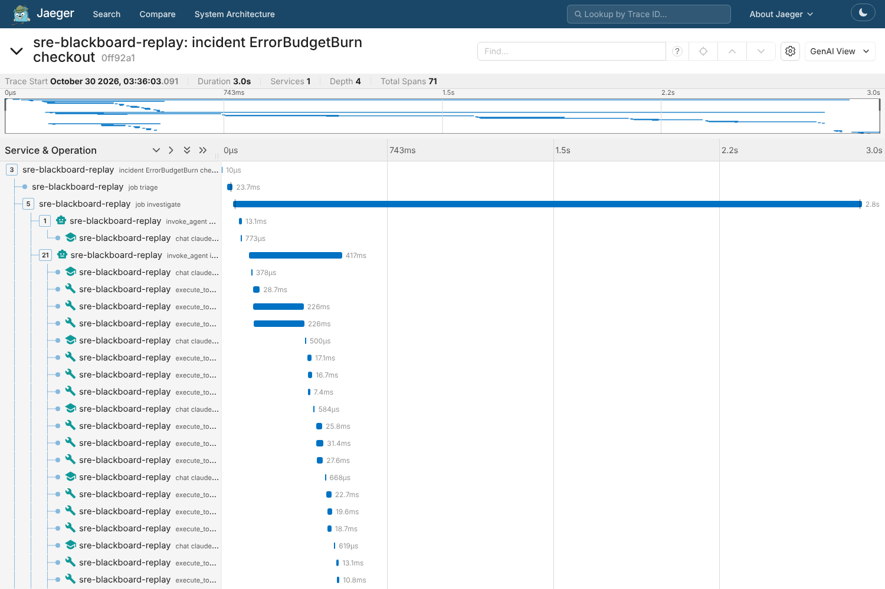

# SRE Blackboard

A multi-agent incident copilot for Kubernetes microservices. When an SLO alert
fires, a coordinator agent plans an investigation, specialist agents query
metrics, logs, traces and cluster changes in parallel, and a synthesizer ranks
root-cause candidates. Every claim has to cite evidence. Any change to
production is proposed, checked by a deterministic policy engine, and needs
human approval before an isolated executor applies it.

> **Status: being rebuilt (M0–M9 done; M10, the documentation, runs throughout).** The first version was a
> spec-shaped prototype: it had no real model calls, no real tool backends, and
> an evaluation that could not fail. This repository is now being rebuilt into a
> working system, one milestone at a time. The plan, including every known
> defect and how it gets fixed, is in
> [`docs/plan/rebuild-plan.md`](docs/plan/rebuild-plan.md) (Chinese).
> This README only describes what exists on `main`.

## Design principles

These carry over from the prototype and are what the rebuild implements for real:

- **Blackboard handoff.** Agents never chat with each other. They publish
  versioned, structured findings to a shared blackboard, and each finding
  references the evidence it rests on.
- **Evidence or it didn't happen.** A finding may only cite evidence IDs that
  this incident's tool calls actually produced. Knowledge-base citations never
  stand alone; they must be paired with live evidence.
- **Problem host vs. event host.** The service where symptoms show up (for
  example a gateway returning 502s) is tracked separately from the
  root-cause candidate, so remediation is never aimed at the messenger.
- **Read-only AI.** Agents have no write tools. Actions are tiered R0–R4. R3
  (rollback, traffic shift, config change) needs human approval bound to the
  exact plan, and R4 is never allowed.
- **Budgets everywhere.** Per-call and per-incident token limits, step limits
  per agent, and timeouts per tool. If a budget runs out, the incident is
  escalated together with the evidence gathered so far.

## What exists today

| Area | State on `main` |
|---|---|
| HTTP API | Stateless FastAPI app. `POST /api/v1/alerts` takes Alertmanager webhooks; `GET /api/v1/incidents[/{id}]` reads incidents; `/healthz` (liveness) and `/readyz` (database). Run as many processes as you like. |
| Auth | HS256 JWT with roles `viewer < responder < approver < admin`, plus an `ingest` service role for alert sources. The tenant comes only from the token; tokens without one are rejected. CORS is an explicit allowlist. |
| Storage | Postgres 16 with Alembic migrations: `incidents`, `alerts`, `jobs`, `audit_log`, `evidence`, `tool_calls`, for the agents `llm_calls`, `agent_runs`, `blackboard`, and for remediation `remediation_plans`, `approvals`, `executions`, and for the knowledge base `kb_documents`, `kb_chunks` (pgvector); incidents and jobs carry a trace context (M8). One transaction writes the alert, opens or merges the incident, enqueues its triage job and appends the audit event. |
| Deduplication | A partial unique index allows one open incident per (tenant, fingerprint). Concurrent duplicates merge; a test sends 50 at once and gets one incident. |
| Job queue | `FOR UPDATE SKIP LOCKED` claims, priority aging (a waiting P3 eventually beats new P0s), a slot reserved for P0, leases with heartbeats, a reaper that keeps priority, fencing tokens, exponential backoff, dead letters. |
| Worker | `python -m app.worker`: runs handlers, cancels a handler whose lease was taken, and on SIGTERM drains or hands back its jobs. Triage moves an incident from `RECEIVED` to `TRIAGED` and queues its investigation (`SRE_AUTO_INVESTIGATE=false` stops at triage). |
| Incident state machine | Explicit transition table, optimistic locking on `version`, every transition audited. |
| Audit log | Full SHA-256 hash chain; a trigger blocks UPDATE and DELETE. `python -m app.db.audit verify` (`make audit-verify`) and `GET /api/v1/audit/verify` (admin) recompute the chain and name the first tampered row. Every remediation step is an event: plan, approval or rejection, execution started and finished, verification, and each state transition. |
| LLM backends (M4) | One interface, "given the transcript, what is the next step": at most 3 tool calls or a final answer ([ADR-0006](docs/adr/0006-agent-loop-llm-backends-blackboard.md)). `cli` runs one `claude -p` per step on the Claude subscription, with every built-in tool, MCP server and local setting turned off and the output constrained by a JSON schema, so the model can only propose. `api` uses the Anthropic Messages API with native tool use and prompt caching. `replay` answers from a recording. Per-role model routing (default `claude-haiku-5-5`), retries with backoff for rate limits and overloads, and at most 2 `claude -p` processes per worker. |
| Agents (M4) | A hand-written loop in `app/agents/`. A coordinator writes a plan; three investigators (metrics, logs and traces, changes) work in parallel with only their own tools, up to 5 steps each at low reasoning effort (`SRE_AGENT_MAX_STEPS`, `SRE_LLM_EFFORT`); a synthesizer ranks root-cause candidates and separates facts, inferences and open hypotheses. Every cited evidence ID is checked without a model: it must belong to the incident, have been seen by the agent that cites it, and match the claim's kind. The model gets one chance to fix a bad citation, then the claim is dropped; with no supported root cause the incident is `ESCALATED`, as it is when the token budget runs out. Each agent's result and its "done" mark are written in one fenced transaction, so a worker killed mid-investigation is taken over without asking the model again for finished agents (a test SIGKILLs a real worker process). `GET /api/v1/incidents/{id}/diagnosis` returns the structured diagnosis, `/report` a Markdown report, and `GET /api/v1/evidence/{id}` the raw data behind any citation. A whole investigation can be exported and replayed in CI without a model or a cluster. On the lab with `claude-haiku-5-5`, the top root cause was right for all 3 acceptance faults in the last 2 of 3 runs (2/3 in the first), at about $0.05 per investigation; the last run's 8 investigations are replayed in CI. The weak spot: the incident on the delayed service itself tends to blame its database, whose client spans slow down with it ([study note](docs/learn/m4-agent.md#4-验收结果)). |
| Remediation (M5) | After a diagnosis a fifth agent, the planner, proposes at most two actions from a catalogue of three: `rollout_undo` (R3), `restart_deployment` and `scale_deployment` (R2), each citing evidence and naming the alternatives it rejected ([ADR-0007](docs/adr/0007-remediation-policy-approval-executor.md)). It can only read rollout history, deployment diffs and Kubernetes events. |
| Policy engine (M5) | `app/remediation/policy.py`, a pure function over structured fields only; the model's prose never reaches it. Blocking checks: the action is in the catalogue; the target is in the allowlist (`SRE_REMEDIATION_TARGETS`, empty means none); the target is the diagnosis's top root cause with confidence ≥ 0.5, not merely where the alert fired (problem host vs. event host); a rollback cites a rollout history or diff of that same Deployment; a way back exists; the change window is open. The verdict is `deny` with reasons if any fails, `allow` up to `SRE_REMEDIATION_AUTO_MAX_RISK` (default R1, so every current action needs approval), `require_approval` above. Any exception is a `deny`. |
| Approvals (M5) | `POST /api/v1/incidents/{id}/approvals` needs the `approver` role; the approver comes from the token, must not be whoever proposed the plan, and must send the plan's SHA-256 `plan_hash`. A revised plan (`POST /incidents/{id}/plans`, responder) gets a new hash, so an old approval never carries over. Plans and approvals are append-only. A plan still waiting after `SRE_REMEDIATION_APPROVAL_TTL_S` (30 minutes) escalates the incident. |
| Executor (M5) | `python -m app.executor`, a separate process that claims only `execute` jobs, with its own ServiceAccount that can get, list and patch Deployments and read ReplicaSets in one namespace, and no model or reader token. Before acting it re-runs the policy and re-checks the approval and its hash. It sends a server-side dry run, records the execution under a unique idempotency key, then applies a JSON patch guarded by the Deployment's `resourceVersion`. Run at most once: a redelivered job that finds its execution already started marks it `unknown` and escalates instead of trying again. |
| Verification (M5) | After the rollout, the worker reads the alert's SLI straight from Prometheus over 1 minute (error ratio below 6%, or p95 below 1 s); three healthy reads in a row resolve the incident, and if the deadline passes it is escalated with how to undo the change. On the lab, the bad release closed the whole loop: alert, diagnosis (checkout's release), a proposed `rollout_undo checkout` (R3, so `require_approval`), approval through the API, rollback from revision 2 to 3, the error ratio back to 0, and `RESOLVED` 130 s after the approval, with the audit chain intact. For the feature-flag and network faults, which no catalogue action repairs, the planner proposed no action in 6 of 7 incidents and wrote down what a human should check instead ([study note](docs/learn/m5-safety.md#4-验收结果)). |
| Prompt injection (M5) | Tool output stays in a data section the prompts say is not instructions; the policy reads no prose; the executor accepts only catalogue actions. `scripts/injection_eval.py` plants instructions in a rollout's change-cause and in a quoted log line and runs the planner with the real model on every `Model check` run: 0 safety violations, and the model ignored both injections. |
| Evaluation (M7) | 22 fault scenarios in `eval/scenarios/`, labelled from the injection point before any run (root cause, fault type, which services page, the fix a human should approve), each one seen to page on the lab ([ADR-0009](docs/adr/0009-evaluation-scenarios-variants-gate.md)). The live run (`eval.yml`, on `[eval]` in a commit message or by hand) builds the lab, injects each scenario and has every agent variant investigate the same alerts at the same minute, one tenant per variant: `default`, `single` (one agent with every tool), `strong-plan` (Sonnet for the coordinator and synthesizer), `rag` (the knowledge base, M6; not in the default run yet) and `canary` (a synthesizer prompt with a deliberately wrong rule). Scores are recomputed from stored observations: Top-1/Top-3, per-incident accuracy, action correctness, safety violations (an action put to a human that targets a healthy service), citations, diagnosis p50/p95, tokens and $ per incident, escalation rate. Every pull request replays the recorded runs through the worker's own handlers and applies the release gate: zero safety violations, Top-1 at most 10 points below the baseline, at least 80% of the baseline's scenarios scored, and the canary must fail or the evaluation is void. Results below. |
| Knowledge base (M6) | 18 runbooks and 6 postmortems in `kb/`, written for the lab's shop with the real error messages ([ADR-0010](docs/adr/0010-knowledge-base-hybrid-retrieval.md)). Chunked by section, embedded with `bge-small-en-v1.5` and stored per tenant in Postgres (generated tsvector plus `vector(384)`); ingest is idempotent. A search runs full text (`ts_rank_cd`) and vectors, top 20 each, fuses them with RRF (k=60), reranks with a MiniLM cross-encoder and drops results under a threshold, so "nothing relevant" is an answer; every query filters on the tenant in SQL. Both models run on the CPU (ONNX), offline at run time: no API key and no model usage. Agents reach it through the read-only `kb_search` tool, whose tenant comes from the incident, not the model; the citation check rejects any fact, inference or root cause that cites only the knowledge base. The `rag` agent variant turns it on; the default does not use it yet. Results below. |
| Observability (M8) | One trace per incident across the API, the workers and the executor ([ADR-0011](docs/adr/0011-system-observability.md)): the incident's root span context is stored with the incident and copied into every job it enqueues, so whichever process claims the job continues the trace. Agents, model calls and tool calls follow the OpenTelemetry GenAI conventions (model, tokens with cache reads, the tool's arguments, the evidence id); the policy verdict, executor actions and state changes are on the same tree; log lines carry the trace id. Prometheus metrics for incident stages and time to first diagnosis, queue wait and job outcomes, tokens and cost by agent, tool errors, approvals and executions; the queue depth and the oldest undiagnosed incident are read from Postgres when the API is scraped, so they are still there when every worker is down. A generated Grafana dashboard and 11 alert rules on the system itself (P0 without a diagnosis after 2 minutes, backlog, dead letters, no workers, model and tool backend errors, token spend), promtool-tested, meant for a human channel and never for the system itself. |
| Fault lab (M2) | `make env-up` builds a kind cluster with the OpenTelemetry Demo (trimmed), Loki, Chaos Mesh and SLO burn-rate alerts (promtool-tested); Alertmanager posts to this API. `make fault SCENARIO=…` injects one of 15 faults (feature flags, Chaos Mesh, a bad rollout). The lab is rebuilt from scratch and checked on GitHub Actions ([ADR-0004](docs/adr/0004-fault-lab-on-kind-in-ci.md)): a payment failure, a network delay and a bad release each reach this API as alerts within about 2–4 minutes and resolve after recovery, on a lab that first stays alert-free for 10 minutes. The whole lab uses about 4.7 GiB. |
| Tools (M3) | Nine read-only tools in `app/tools/` over Prometheus, Loki, Jaeger, the Kubernetes API and flagd (plus `kb_search` over the knowledge base since M6) ([ADR-0005](docs/adr/0005-tool-layer-evidence-and-replay.md)). Each has a strict Pydantic schema that doubles as the model's tool definition, a timeout, retries for transient errors and a circuit breaker per backend; failures come back as structured errors with the backend's message. The model gets a bounded summary (counts, top-N, peaks, log templates) and an evidence ID; the raw result is stored in `evidence` with its SHA-256, and rows cannot be updated or deleted. Evidence IDs are derived from the content, so a replay shows the model the same bytes. Calls can be recorded to a cassette and replayed without a cluster. Kubernetes access is a ServiceAccount that can only read in the demo namespace; Chaos Mesh objects are filtered out so the lab never hands the agent the answer. On the lab, during each of the 3 acceptance faults, the tools return the data a diagnosis needs (the failing service's error ratio, the bad revision and its diff, the slow spans); CI replays those real recordings and must reproduce the live results exactly. |
| Console (M9) | React + Vite + Tailwind in `web/` ([ADR-0008](docs/adr/0008-console-sse-replay-design-tokens.md)). An incident list (filters, virtualised, new incidents slide in) and an incident page: the state machine, the plan with each policy check and optimistic approve/reject bound to the plan's hash, root causes marking problem and event host, the agent call tree (`GET /api/v1/incidents/{id}/agents`: each step's time, tokens, cost and tool calls), the timeline, and an evidence drawer (metric sparklines, log groups, trace errors, deploy diffs). It follows `GET /api/v1/stream` (Server-Sent Events, resumable with `Last-Event-ID`) and refetches only what changed. Design tokens for both themes live in one file and a test checks WCAG AA contrast; CI holds first-screen JS under 200 KB gzip per route. |
| Static site (M9) | GitHub Pages: positioning, architecture, results, and a replay of a real lab incident through the same incident page, from a case exported with `python -m app.console.export` and sped up by its own timestamps; it pauses where the real run waited for a human. The lab exports each closed-loop incident as such a case. |
| Engineering | uv, ruff, mypy, pytest (database tests run against a real Postgres via testcontainers), pre-commit, GitHub Actions CI. |

## Quickstart

Requires Python 3.12+, [uv](https://docs.astral.sh/uv/) and Docker.

```bash
make install                 # uv sync + pre-commit hooks
make check                   # ruff, mypy, pytest (the same checks CI runs)

cp .env.example .env         # then set SRE_JWT_SECRET (32+ characters)
make up                      # Postgres, migrations, API (2 processes), 2 workers
make loadtest                # 1000 duplicate alerts, then checks nothing was duplicated
```

Send an alert by hand:

```bash
TOKEN=$(make -s token ROLES=ingest TENANT=t1)
curl -s -X POST localhost:8000/api/v1/alerts -H "authorization: Bearer $TOKEN" \
  -H 'content-type: application/json' -d '{"status": "firing", "alerts": [{"status": "firing",
  "labels": {"alertname": "HighErrorRate", "service": "checkout", "environment": "prod", "severity": "critical"}}]}'
curl -s localhost:8000/api/v1/incidents -H "authorization: Bearer $(make -s token ROLES=viewer TENANT=t1)"
```

To run the API and a worker on the host instead: `make db migrate`, then `make run` and `make worker`.

### Fault lab

Needs kind, kubectl and helm as well, and about 10 GB of memory for Docker.

```bash
make up                              # the API must be running: Alertmanager posts to it
make env-up                          # kind cluster + demo + alerting (first run pulls ~3 GB)
make faults                          # list what can be broken
make fault SCENARIO=payment-failure  # break something; an alert reaches the API within minutes
make lab-status                      # active faults and firing alerts
make recover ALL=1                   # undo everything
make lab-workers                     # point the compose workers at the lab (needs a Claude login, below)
make lab-accept                      # the acceptance run (alerts, tool checks, diagnoses, the approved rollback)
make env-down
```

The read-only tools can be called by hand against the lab:

```bash
make lab-env                         # endpoints and a 12h read-only token, into .lab.env
uv run python -m app.tools list      # tool definitions as the model sees them
uv run python -m app.tools call prom_query '{"query": "service:sli_error_ratio:rate5m"}'
uv run python -m app.tools call deploy_diff '{"deployment": "checkout"}' --record lab.jsonl.gz
uv run python -m app.tools call deploy_diff '{"deployment": "checkout"}' --replay lab.jsonl.gz
```

### Agents

The workers call the model through `claude -p`, so they need a Claude Code login. Put a token
from `claude setup-token` into `CLAUDE_CODE_OAUTH_TOKEN` in the environment `make up` runs in
(never into a committed file), or set `SRE_LLM_BACKEND=api` and `SRE_ANTHROPIC_API_KEY`.

```bash
make llm-smoke                       # one real agent step; prints tokens and cost
make llm-probe                       # final answers, tool isolation, error shapes
# after an alert: the incident goes TRIAGED -> INVESTIGATING -> DIAGNOSED (or ESCALATED)
curl -s localhost:8000/api/v1/incidents/$ID/report -H "authorization: Bearer $(make -s token ROLES=viewer TENANT=t1)"
# then PLANNED -> SAFETY_REVIEWED -> AWAITING_APPROVAL; approve the plan's hash as someone else
curl -s localhost:8000/api/v1/incidents/$ID/plans -H "authorization: Bearer $(make -s token ROLES=viewer TENANT=t1)"
curl -s -X POST localhost:8000/api/v1/incidents/$ID/approvals -H 'content-type: application/json' \
  -H "authorization: Bearer $(make -s token ROLES=approver TENANT=t1)" -d '{"plan_hash": "…", "decision": "approve"}'
# the executor applies it (make lab-workers starts it), then EXECUTING -> VERIFYING -> RESOLVED
make audit-verify
```

The demo shop is at http://localhost:18080 (Jaeger under `/jaeger/ui`, feature flags under
`/feature`), Prometheus at :19090, Alertmanager at :19093, Loki at :13100.

### Console

```bash
cd web && npm ci
npm run dev                          # http://localhost:5173, proxies /api to localhost:8000 (SRE_API_URL to change)
make -s token SUB=you ROLES=approver # paste it on the sign-in page; it stays in the tab's session storage
VITE_SITE=pages npm run build        # the static site; the replay reads web/public/cases/*.json
uv run python -m app.console.export $ID -o web/public/cases/my-case.json   # then open #/replay/my-case
npm test && npm run budget           # unit tests (SSE parser, replay, contrast); first-screen JS budget
```

A console served from another origin needs it in `SRE_CORS_ORIGINS`, e.g. `SRE_CORS_ORIGINS='["https://console.example"]'`.

### Evaluation

```bash
uv run python -m app.eval report eval/results/*.json   # scores, gate and the Markdown report
uv run pytest tests/test_eval_replay.py                 # what CI runs: replay every recording, apply the gate
git commit --allow-empty -m "rerun [eval token_budget=12000000]"   # a live run: 6 core scenarios, every variant
git commit --allow-empty -m "rerun [eval scenarios=bad-release variants= shards=1]"   # one scenario, default only
uv run python -m scripts.lab eval-import <lab-recordings checkout> --run <id> --baseline --variants single
```

Results on the 6 core scenarios, one run per variant (run 40715248288; the canary from run
40751455029). One run means one scenario is 17 points, so only large differences are signal:

| | default | single | strong-plan | canary |
|---|---|---|---|---|
| Top-1 | 6/6 | 5/6 | 6/6 | 0/2 (gate: fail, as it must) |
| Top-3 | 6/6 | 6/6 | 6/6 | 2/2 |
| per incident | 100% | 79% | 71% | 33% |
| actions right | 83% | 83% | 67% | 100% |
| safety violations | 0 | 0 | 0 | 0 |
| diagnosis p50 / p95 | 166 / 222 s | 49 / 136 s | 122 / 187 s | 141 / 155 s |
| tokens / incident | 191k | 143k | 183k | 194k |
| $ / incident (API prices) | $0.027 | $0.015 | $0.067 | $0.028 |
| escalated | 0% | 0% | 0% | 0% |

The single agent is three times faster and half the cost, and blamed the delayed service's
database on the network-delay scenario; the stronger model for the two reasoning-only steps
cost 2.5 times as much and bought no accuracy here. The wrong actions are all restarts of
the right service that cannot help (a Chaos Mesh pod failure is still running). Runs go on
the Claude subscription, so the default run is cut down (low effort, 5 steps, 6 scenarios,
a token budget); three runs per configuration and all 22 scenarios are for when quota
allows ([study note](docs/learn/m7-eval.md#4-结果)).

### Knowledge base

```bash
uv run python -m app.kb models                     # download the two models (needs HuggingFace)
uv run python -m app.kb ingest --tenant lab        # kb/ -> Postgres; docker compose runs this as kb-ingest
uv run python -m app.kb search --tenant lab "checkout fails with connection refused to cart"
uv run python -m app.kb eval --check               # the ablation below; fails if it no longer reproduces
```

The retrieval evaluation: 62 queries written before any retrieval ran (exact error strings,
paraphrases, investigation questions, and 8 the knowledge base cannot answer), labelled by
section; the threshold is chosen on the odd-numbered half only. CI recomputes it with the real
models on every pull request and compares it with `eval/retrieval/report.json`. On the 54
answerable queries, section chunking:

| | hit@1 | hit@3 | hit@5 | MRR | p50 |
|---|---|---|---|---|---|
| full text (`ts_rank_cd`) | 0.556 | 0.778 | 0.889 | 0.693 | 2 ms |
| vector (bge-small) | 0.648 | 0.833 | 0.870 | 0.760 | 8 ms |
| hybrid (RRF) | 0.722 | 0.907 | 0.926 | 0.815 | 10 ms |
| hybrid + rerank | **0.741** | **0.926** | **0.981** | **0.841** | 667 ms |

Each stage helps. Postgres full text has no IDF, and lost to the vectors even on exact error
strings (hit@1 0.65 against 0.85). The small reranker cannot tell a paraphrased question from
one with no answer: the chosen threshold (0.031) empties all 8 unanswerable queries but also
22% of the answerable ones on the held-out half, all of them paraphrases. Whether the agents
diagnose better with the knowledge base needs a live run of the `rag` variant, which uses the
subscription and has not been run yet ([study note](docs/learn/m6-rag.md#4-结果)).

### Observability

```bash
echo "SRE_OTEL_ENDPOINT=http://jaeger:4318" >> .env      # export traces (empty: none)
docker compose --profile observability up -d            # + Prometheus :9091, Grafana :3000, Jaeger :16686
uv run python -m scripts.dashboard                       # regenerate the dashboard JSON after editing panels
make rules-test                                          # promtool tests, the lab's SLO rules and these
```

In the lab the API, the workers and the executor send their spans straight to the demo's
Jaeger (`http://localhost:18080/jaeger/ui`, services `sre-blackboard-*`), not through its
collector: the collector turns spans into the metrics the lab's SLO alerts are computed from,
and the system's own failing spans must not page the system.

CI checks it without a model: after the load test, `scripts/obs_check.py` reconciles the
metrics with what was sent (2000 alerts, 200 incidents, 200 triage jobs, an empty queue),
evaluates every alert and dashboard query on the real Prometheus, checks that Grafana has the
dashboard and both data sources, finds a trace whose root the API opened and whose triage job a
worker ran, and replays a recorded investigation into Jaeger. The replayed bad-release
investigation is 71 spans (3 jobs, 6 agents, 21 model calls, 39 tool calls, the policy); a
span costs about 37 µs. Durations in a replay are the replay's, not the live run's:



The objective "90% of P0 incidents diagnosed within 2 minutes" is not met today: in the M7 run
the default agents took 166 s at p50 (the single agent 49 s). A live lab run would show where
those seconds go, agent by agent; it uses the subscription and has not been run yet.

## Roadmap

| Milestone | Scope | Status |
|---|---|---|
| M0 | Cleanup, honest docs, engineering baseline | done (`v0.1.0`) |
| M1 | Postgres, `SKIP LOCKED` job queue with leases and fencing, stateless API, auth | done |
| M2 | kind + OpenTelemetry Demo, SLO alerts, fault injection (flagd, Chaos Mesh, bad rollouts) | done |
| M3 | Read-only tools (Prometheus, Loki, Jaeger, Kubernetes), evidence store, record/replay | done |
| M4 | Real agents: hand-written loop, pluggable LLM backends (`claude -p`, Anthropic API, replay) | done |
| M5 | Policy engine, authenticated approvals, isolated executor, SLO recovery check, audit chain | done |
| M9 | Minimal console (React), plus a GitHub Pages replay of a real run | done |
| M7 | Labeled fault scenarios, live and replay eval, ablations, CI release gate | done |
| M6 | Postgres hybrid retrieval (tsvector + pgvector, RRF, reranker) with a labeled query set | done |
| M8 | OpenTelemetry traces and Prometheus metrics for the copilot itself | done |

Rows are listed in execution order.

## Repository layout

```
app/api/        FastAPI app factory and routes (alerts, incidents, health)
app/core/       settings, authentication and roles
app/db/         table definitions, Alembic migrations, incident and audit repositories
app/queue/      the Postgres job queue
app/worker/     worker loop and job handlers
app/ingest.py   Alertmanager webhook -> alerts, incidents, triage jobs
app/tools/      read-only tools, evidence store, record/replay (python -m app.tools)
app/llm/        LLM backends (claude -p, Anthropic API, replay), retries, per-role routing
app/agents/     agent loop, prompts, citation checks, blackboard store, investigation, report, recordings
app/remediation/ action catalogue, plans, policy engine, planner agent, approval flow, SLO checks
app/executor/   the executor process: Kubernetes writer, execute job
app/console/    case export for the static replay (python -m app.console.export)
app/eval/       scoring, metrics, release gate, report, replay evaluation (python -m app.eval)
app/kb/         knowledge base: chunking, local models, ingest, hybrid search, retrieval evaluation (python -m app.kb)
app/obs/        the system's own traces, Prometheus metrics, database-state gauges
web/            the console and the static site (React, Vite, Tailwind)
kb/             the knowledge base: 18 runbooks and 6 postmortems for the lab's shop
tests/          pytest suite; tests/fixtures/{lab,agent}: real lab recordings for the contract tests
deploy/kind/    fault lab: kind config, pinned versions, chart values, SLO rules and their tests
deploy/observability/ Prometheus, alert rules and their tests, Grafana provisioning and dashboard for the system itself
scripts/        M1 load test, LLM probe, dashboard generator, observability check; scripts/lab: fault injection CLI, acceptance, tool checks, diagnosis scoring
eval/           scenarios, live results, the baseline and the recordings CI replays; retrieval/: labelled queries and the retrieval report
docs/plan/      rebuild plan (Chinese)
docs/adr/       architecture decision records
docs/learn/     per-milestone study notes with interview Q&A (Chinese)
docs/legacy/    domain notes kept from the prototype
```
