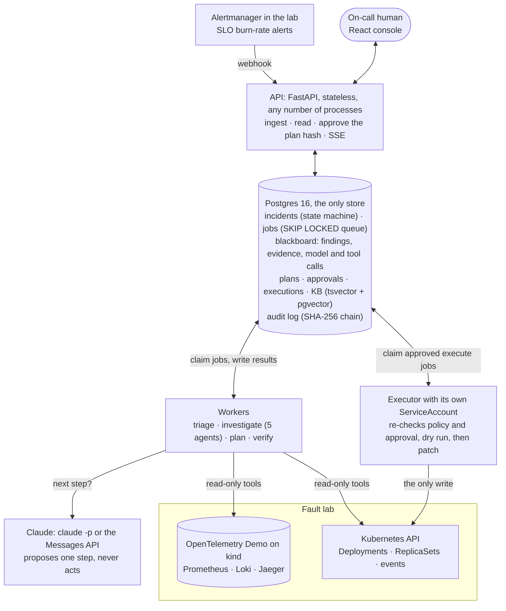
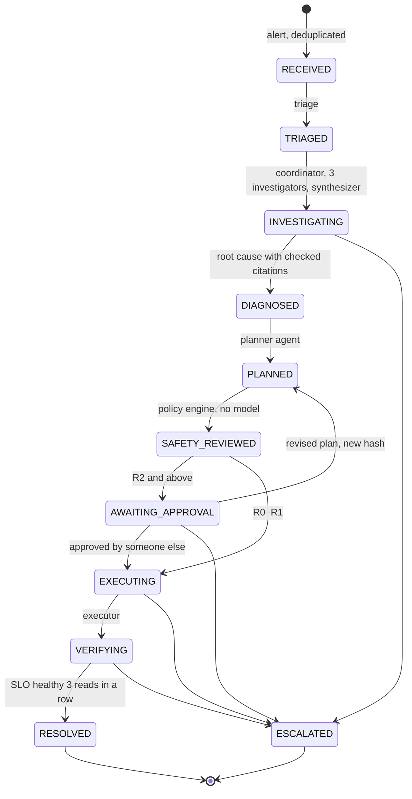

# Architecture

The source of the two pictures in the README. Edit the Mermaid here, then render the PNGs:

```sh
cd web && npm i --no-save mermaid@11.12.0 playwright && node scripts/render-diagrams.mjs
```

## Processes and data

Three kinds of process share one Postgres. They never call each other: everything an incident
needs next is a row in the job queue, claimed with `FOR UPDATE SKIP LOCKED`
([ADR-0002](adr/0002-single-postgres.md), [ADR-0003](adr/0003-postgres-skip-locked-queue.md)).
The agents can only read the cluster; the executor is the one process that can change it, and
only after a human approved the exact plan ([ADR-0007](adr/0007-remediation-policy-approval-executor.md)).



## One incident, end to end

The incident state machine (`app/db/incidents.py`). Every arrow is one transaction that moves
the incident, appends an audit event and enqueues the next job. Any state but a terminal one
can escalate to a human, with the evidence gathered so far: no supported root cause, a token
budget used up, a plan nobody approved in 30 minutes, an execution that did not finish, or a
verification that did not see the SLO recover.



Only the escalations that happen in practice are drawn; the state machine allows one from
every non-terminal state.

## Where the rest lives

| Concern | Where | Decision |
|---|---|---|
| Agent loop, model backends, blackboard, citation check | `app/agents/`, `app/llm/` | [ADR-0006](adr/0006-agent-loop-llm-backends-blackboard.md) |
| Read-only tools, evidence snapshots, record and replay | `app/tools/` | [ADR-0005](adr/0005-tool-layer-evidence-and-replay.md) |
| Policy, approvals, executor, verification | `app/remediation/`, `app/executor/` | [ADR-0007](adr/0007-remediation-policy-approval-executor.md) |
| Console, SSE, replayed cases | `web/`, `app/api/stream.py`, `app/console/` | [ADR-0008](adr/0008-console-sse-replay-design-tokens.md) |
| Scenarios, variants, release gate | `eval/`, `app/eval/` | [ADR-0009](adr/0009-evaluation-scenarios-variants-gate.md) |
| Knowledge base | `kb/`, `app/kb/` | [ADR-0010](adr/0010-knowledge-base-hybrid-retrieval.md) |
| The system's own traces, metrics and alerts | `app/obs/`, `deploy/observability/` | [ADR-0011](adr/0011-system-observability.md) |
| The fault lab | `deploy/kind/`, `scripts/lab/` | [ADR-0004](adr/0004-fault-lab-on-kind-in-ci.md) |
