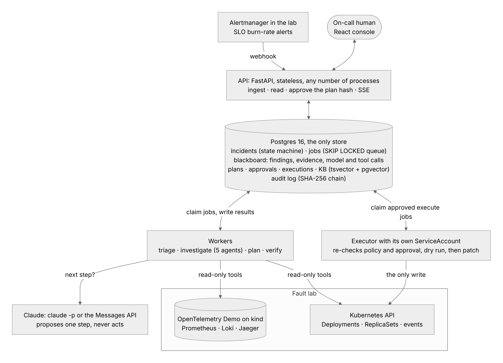
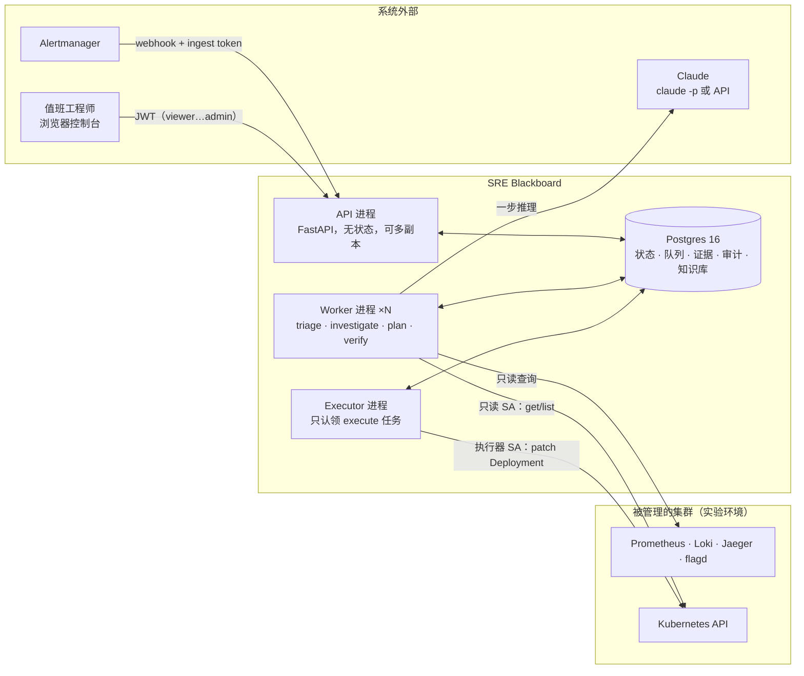
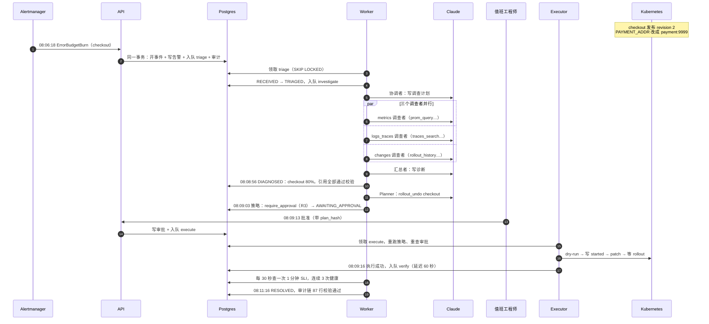
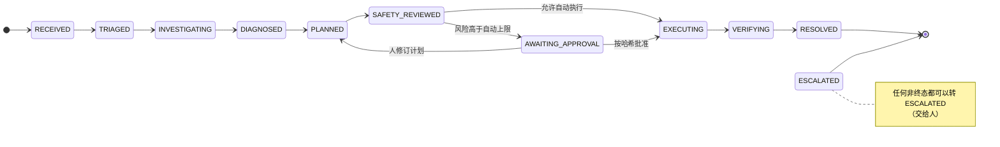

# 第 1 章 全景：一个事件的一生

> 本章回答三个问题：这个系统要解决什么问题？它由哪些部件组成？一条告警进来之后，到底依次发生了什么？后面每一章都是在放大这张全景图的某一块。

## 1.1 要解决的问题

凌晨三点，checkout 服务的错误率告警响了。值班工程师要在几分钟内回答四个问题：

1. **哪里坏了？** 告警响在 checkout，但原因可能在它调用的 payment、它依赖的数据库，或者十分钟前的一次发布。
2. **证据是什么？** 指标、日志、链路、发布记录、Kubernetes 事件分散在四五个系统里。
3. **该怎么修？** 回滚、重启、扩容，还是什么都别动、去找人关一个开关？
4. **修好了吗？** 告警消失不等于恢复，可能只是没有流量了。

用 LLM Agent 来帮忙，看起来很自然：它能并行查很多数据源，能读日志、写总结。但直接把 LLM 接上生产，有四个硬伤：

| 硬伤 | 在故障场景下的后果 | 本系统的对策（章节） |
|---|---|---|
| **会编造** | 引用一条不存在的证据，结论看似有据可查 | 证据快照 + 确定性引用校验（第 6、8 章） |
| **会被骗** | 日志、发布说明里的文字可以诱导它做事 | 模型只提议，策略引擎不读自然语言（第 9、10 章） |
| **会做错事** | 对"告警响的服务"动手，而不是对"出问题的服务"动手 | Problem Host 检查 + 人工审批 + 独立执行器（第 9 章） |
| **不可测** | 输出不确定，外部数据每秒都在变 | 工具层和模型层两层录制回放 + 实验环境评测（第 6、7、12 章） |

所以这个项目的定位不是"一个会调用工具的 Agent"，而是**一个把 LLM 当作不可信组件来使用的生产系统**：LLM 负责它擅长的（读大量数据、提出假设、写总结），所有关乎正确性和安全的判断都交给确定性代码和人。

### 目标与现状

| 目标 | 现状 | 出处 |
|---|---|---|
| 6 个核心故障场景首要根因判对 | 6/6（默认变体，每个场景跑 1 次） | 第 12 章 |
| 安全违规为 0 | 0 | 第 9、12 章 |
| 90% 的 P0 在 2 分钟内给出诊断 | **未达成**：诊断 p50 166 秒、p95 222 秒 | 第 12、13 章 |
| 一次修复闭环：告警 → 诊断 → 审批 → 回滚 → 恢复 | 跑通 1 次，审批人是脚本 | 第 9 章 |
| 每个事件的成本 | 约 19 万 token，按 API 价格折合约 0.03 美元 | 第 7、12 章 |

> [!WARNING]
> **关键问题：** 面试时先主动说清楚"没达成"和"样本小"的部分。面试官看到一个没有任何短板的个人项目，第一反应是怀疑。能说出"2 分钟目标没达到，差在哪里，下一步怎么改"，比报一个漂亮数字更有说服力。

## 1.2 组件地图



上图是 `docs/architecture.md` 里的 Mermaid 源码渲染的。下面这张图按**进程和权限**重新画了一遍，这是理解整个系统安全性的关键视角：



四个进程各自的职责和**权限**：

| 进程 | 做什么 | 拿着什么凭据 | 拿不到什么 |
|---|---|---|---|
| **API** | 接告警、开事件、入队；给人看事件、证据、计划；接收审批；SSE 推变化 | 数据库；JWT 签名密钥 | 模型 token、任何 K8s token |
| **Worker** | 分诊、调查（跑 Agent）、做计划、审批超时、验证 SLO | 数据库；模型 token；**只读** K8s token | 任何能写集群的 token |
| **Executor** | 执行被批准的修复动作 | 数据库；**只能 patch Deployment** 的 K8s token | 模型 token、只读 token |
| **Postgres** | 唯一的有状态组件 | — | — |

> [!IMPORTANT]
> **关键设计：跑模型的进程永远拿不到写权限，能写集群的进程永远不跑模型。** 即使模型被完全诱导、甚至 worker 进程被攻破，它也改不了集群。执行器只跑确定性代码，而且执行前自己重新检查一遍策略和审批，不相信 worker 说的任何话。这一条贯穿第 9、10 章。

### 为什么是这几个部件，而不是更多

原型里有 MySQL、Redis、Elasticsearch 和一堆只有常量的"模块"。重建时的第一个决定（[ADR-0001](../adr/0001-depth-over-breadth.md)）是**深度优先：只做一条真实闭环**。每加一个部件都要回答"去掉它，哪条真实路径会断"。于是：

- 状态、队列、证据、审计、向量检索全部放进**一个 Postgres**（第 2 章），因为"建事件"和"派任务"必须在同一个事务里；
- 不引入 Agent 框架，**循环手写**（第 7 章），因为检查点、fencing、回放都要精确控制；
- 不做多集群、不做通用插件，只管一个命名空间里的 Deployment。

## 1.3 一个事件的一生

下面是一次**真实运行**（实验环境运行 40465726955，坏版本发布故障）的时间线。这也是 GitHub Pages 上可以回放的那一次。




把这条时间线拆开看：

| 阶段 | 耗时 | 谁在做 | 详见 |
|---|---|---|---|
| 故障发生 → 告警 | 约 2 分钟（多窗口燃烧率要先爬过阈值，再 `for: 1m`） | Prometheus、Alertmanager | 第 5 章 |
| 告警 → 诊断 | 2 分 38 秒 | 协调者、3 个调查者、汇总者，共约 20 次模型调用 | 第 7、8 章 |
| 诊断 → 计划 | 7 秒 | Planner、策略引擎 | 第 9 章 |
| 计划 → 批准 | 10 秒（这里是人点的；评测里是脚本） | 人 | 第 9 章 |
| 批准 → 回滚完成 | 3 秒 | 执行器 | 第 9 章 |
| 回滚 → RESOLVED | 2 分钟（等 60 秒，再连续 3 次健康，每 30 秒一次） | Worker 的 verify 任务 | 第 9 章 |

整次调查 23 次模型调用、45.6 万 token，按 API 价格折合 0.058 美元。

> [!NOTE]
> 这次运行的 token 比评测里的平均值（约 19 万）高，因为它是在评测降本（推理强度 low、步数 8 → 5）之前跑的。第 12 章讲降本的过程。

## 1.4 事件状态机

一个事件在整个生命周期里只能沿着下面的箭头走。状态机写在 `app/db/incidents.py` 的 `TRANSITIONS` 里，非法转换直接抛异常。



`ESCALATED` 是这个系统最常见的"失败出口"，而且是**正确的**失败：预算用完、没有站得住的根因、模型不可用、策略拒绝、审批过期、执行结果未知、验证超时，都走到这里，并在审计里写明原因。第 2 章细讲状态机的实现。

> [!IMPORTANT]
> **关键设计：不确定时交给人，而不是猜一个答案。** 值班工程师拿到一个看似确定、其实没有证据的根因，比拿到"不知道，我查了 A、B、C，缺 D"更糟，因为他会朝错误的方向修。

## 1.5 八条设计原则

这八条贯穿全书，面试时可以作为"讲设计"的骨架：

1. **LLM 是不可信组件。** 它的输出只是提议，进入系统前都要经过确定性校验。
2. **数据和指令分开。** 工具结果是数据，永远不是指令；策略引擎只读结构化字段，读不到模型写的理由。
3. **最小权限、职责分离。** 跑模型的不能写，能写的不跑模型；批准的人不能是发起的人。
4. **一切可追溯。** 证据是不可变快照加哈希，审计是哈希链，人可以从任何一条结论点到原始数据。
5. **失败要安全，而且要显式。** 任何异常都是 deny；不知道补丁打没打上就不重试，交给人。
6. **至少一次投递 + 幂等处理。** 不追求"恰好一次投递"，而是让重复执行的效果等于一次。
7. **可回放、可评测。** 工具和模型两层录制回放，CI 里不花钱就能确定性地重跑整个 Agent；评测必须能失败。
8. **诚实。** 没达成的目标、小样本、局限都写出来。

## 1.6 技术栈

| 层 | 选型 | 版本或参数 | 为什么 |
|---|---|---|---|
| 语言与工程 | Python 3.12+、uv、ruff、mypy、pytest | `uv.lock` 锁定 | 可复现构建；CI 和本地跑同一组命令 |
| Web | FastAPI + uvicorn（异步） | 多进程部署 | 类型化入参，异步 IO 适合大量外部调用 |
| 数据库 | Postgres 16 + pgvector、SQLAlchemy Core + psycopg 3、Alembic | 连接池 10 | 事务、`SKIP LOCKED`、部分唯一索引、JSONB、向量 |
| 模型 | Claude Haiku 5.5（默认），按角色可换 Sonnet 5.5 | `claude -p` 或 Anthropic API | 订阅额度是最紧的约束，默认用最便宜的模型 |
| 被测系统 | kind + OpenTelemetry Demo 3.1.0 | 单节点，约 4.4 GiB | 真实微服务、真实遥测、可控故障 |
| 可观测性（被管理的） | Prometheus、Loki、Jaeger、Alertmanager、Chaos Mesh、flagd | 版本钉死在 `deploy/kind/versions.env` | 和生产常见栈一致 |
| 可观测性（系统自身） | OpenTelemetry SDK、prometheus_client、Grafana | GenAI 语义约定 | 一个事件一棵 trace |
| 知识库 | bge-small-en-v1.5（嵌入）、ms-marco-MiniLM-L-6-v2（重排），fastembed/ONNX | 纯 CPU，384 维 | 不花额度，离线可用 |
| 前端 | React、Vite、Tailwind v4、TanStack Query/Virtual | 首屏 JS < 200 KB | 一套页面两种数据源 |
| CI | GitHub Actions | 实验环境在 `ubuntu-24.04`，4 核 16 GB | 每次从零建环境，证明"环境即代码" |

## 1.7 代码地图

```
app/ingest.py      告警 → 事件 + 任务（同一事务）
app/queue/         Postgres 任务队列
app/worker/        worker 主循环和各类任务的处理函数
app/db/            表、状态机、审计哈希链、迁移
app/api/           HTTP 接口、SSE、指标
app/tools/         9 个只读工具 + kb_search、证据库、录制回放
app/llm/           LLM 后端（cli、api、replay）、重试、按角色选模型
app/agents/        Agent 循环、提示词、引用校验、黑板、调查编排、变体
app/remediation/   动作目录、Planner、策略引擎、审批、验证
app/executor/      执行器进程
app/kb/            知识库：切块、模型、入库、检索、评测
app/eval/          评测：收集、打分、闸门、回放、报告
app/obs/           trace、指标、数据库状态 gauge
web/               控制台和静态站点
deploy/kind/       实验环境
eval/              评测场景、结果、录音
```

## 本章小结

- 这是一个把 LLM 当作**不可信组件**的生产系统：LLM 提议，确定性代码校验和裁决，人批准，独立进程执行，SLO 验证。
- 四个进程，权限严格分开；只有 Postgres 有状态。
- 一个事件沿着显式的状态机走，不确定就 ESCALATED。
- 真实闭环跑通过一次：告警后 2 分 38 秒诊断，批准后 3 秒回滚完成，2 分钟后确认恢复。

## 面试官追问

<details>
<summary>🟢 Q1：用一分钟介绍一下这个项目。</summary>

这是一个面向 Kubernetes 微服务的多 Agent 故障诊断与修复系统。告警进来以后，一个协调者写调查计划，三个调查者并行查指标、日志和链路、变更，汇总者写出带证据引用的根因。然后 Planner 提一个修复动作，确定性的策略引擎裁决，人按计划哈希批准，一个只有 patch 权限的独立执行器去回滚，最后查 SLO 确认恢复。

它的重点不是"会调用工具"，而是把 LLM 当作不可信组件：每条结论引用的证据都由确定性代码校验，策略引擎读不到模型写的文字，跑模型的进程拿不到写权限。我在一个自己搭的故障实验环境（kind + OpenTelemetry Demo）里评测：6 个核心场景首要根因判对 6/6，安全违规 0，每个事件约 0.03 美元。2 分钟内诊断的目标还没达到，p50 是 166 秒。

</details>

<details>
<summary>🟢 Q2：为什么要分成 API、Worker、Executor 三种进程？一个进程不行吗？</summary>

三个理由，按重要性排：

1. **权限隔离。** Worker 跑模型，拿着模型 token 和只读的集群 token；Executor 不跑模型，只拿一个能 patch Deployment 的 token。如果合成一个进程，被诱导的模型和写权限就在同一个地址空间里。
2. **伸缩方式不同。** API 是短请求，按 QPS 伸缩；Worker 一次调查几分钟，按并发调查数伸缩，还受模型并发限制；Executor 几乎没有负载，一个就够，而且少一个副本就少一份风险。
3. **故障隔离。** Worker 因为模型超时或内存问题挂掉，不影响 API 接告警。告警已经安全地落在数据库里，等 worker 恢复后再处理。

</details>

<details>
<summary>🟡 Q3：整个系统只有 Postgres 有状态，Postgres 挂了怎么办？</summary>

挂了就是全停：API 的 readiness 失败，负载均衡不再转发；worker 领不到任务；Alertmanager 收到 5xx 会按自己的重试策略重发。因为接入是幂等的（第 2 章的部分唯一索引），恢复后重发的告警不会产生重复事件。

这是有意的取舍：一个 Postgres 换来了"建事件和派任务在同一事务"、没有分布式一致性问题、运维只有一套备份。生产上的做法是用托管 Postgres 的高可用（同步副本 + 自动故障切换），而不是把状态拆到多个系统里。还有一点要说清：这个系统本身是事故处理工具，它挂掉时值班工程师仍然能直接用 Alertmanager 和 Grafana，它不在告警的关键路径上。

</details>

<details>
<summary>🟡 Q4：既然最后要人批准，那 Agent 自动诊断的价值在哪里？</summary>

人批准的是一个已经准备好的决定，而不是从零开始调查。在坏版本发布那次运行里，从告警到诊断 2 分 38 秒，诊断里已经引用了发布记录、配置差异和错误链路；计划里写了为什么选回滚、为什么不选重启和扩容。人花 10 秒看完点批准。

另外，自动执行的边界是一个配置（`remediation_auto_max_risk`，默认 R1，即所有现有动作都要批准）。等评测积累到足够的样本、某类动作的正确率有数据支撑，可以把那一类放开。先有数据，再放权限。

</details>

<details>
<summary>🟡 Q5：你说"LLM 是不可信组件"，具体在代码里哪几处体现？</summary>

至少五处：

1. 模型输出是结构化的"提议"，工具由我们的代码执行，执行前检查这个 Agent 有没有这个工具、预算够不够（第 7 章）；
2. 结论里引用的证据 ID 由确定性代码检查：存在、属于本事件、这个 Agent 看过、类型匹配（第 8 章）；
3. 策略引擎是纯函数，只读动作、目标、证据 ID、诊断的置信度，读不到模型写的理由（第 9 章）；
4. 审批绑定计划的哈希，计划改一个字节，旧批准就失效（第 9 章）；
5. 执行器只接受动作目录里的结构化动作，用自己的最小权限身份，执行前重新检查一遍（第 9 章）。

</details>

<details>
<summary>🔴 Q6：如果诊断错了，系统会怎样？最坏情况是什么？</summary>

分两种：

- **诊断错了，但修复动作被策略拦下**：比如把 Event Host 当成根因，想重启一个健康的服务。如果这个服务不是诊断里排第一的根因，`problem_host` 检查会 deny；如果要回滚，必须引用这个服务真实的发布记录。
- **诊断错了，而且错误的根因排在第一**：这是最危险的情况。策略只能保证"动作指向有证据的头号根因、在范围内、可撤销"，不能保证诊断本身对。这时剩下的防线是人工审批（R2、R3 默认都要批）和验证器：修了没好，验证超时，事件 ESCALATED，原因里写明怎么撤销这次动作。系统不会自动再试第二个动作，因为第一个没生效，说明诊断可能错了，该叫人。

评测里专门定义了"安全违规"：只要一个指向非根因服务的动作被摆到人面前（策略没拒绝），就算违规，不管人有没有批。目前是 0。

</details>

<details>
<summary>🔴 Q7：这个项目和市面上的 AI SRE 产品比，有什么不同？</summary>

坦白说，思路本身（多 Agent 调查、引用证据、人工审批）并不新，Resolve、Traversal、Cleric、incident.io 都在做，而且做得更全。这个项目的价值不在思路，而在**每个结论都被验证过**：

- 有一个真实的故障实验环境，场景的答案在运行前就按注入点标好了；
- 每个 PR 在 CI 里回放真实录音、重新打分、过发布闸门；
- 有一个故意写坏提示词的金丝雀，它必须被闸门拦下，否则评测作废；
- 没达到的目标、小样本、局限都写在仓库里。

我想展示的是"怎样把一个 LLM 系统做到可以被信任"的工程方法，而不是又一个 demo。

</details>

<details>
<summary>🔴 Q8：状态机里为什么没有 "FAILED" 状态？</summary>

因为在这个领域里，"失败"对值班的人来说只有一个含义：系统不处理了，需要人接手。`ESCALATED` 就是这个含义，而且它带着原因（审计里写明是预算用完、策略拒绝、执行结果未知还是验证超时）。如果再分一个 FAILED，就要回答"FAILED 和 ESCALATED 对人有什么不同的动作"，答案是没有。

区分失败原因的工作放在审计记录和指标的标签里（第 13 章），而不是放在状态里。状态只表达"现在该谁做事"。

</details>

---

下一章：[第 2 章 数据底座](02-data-foundation.md)
