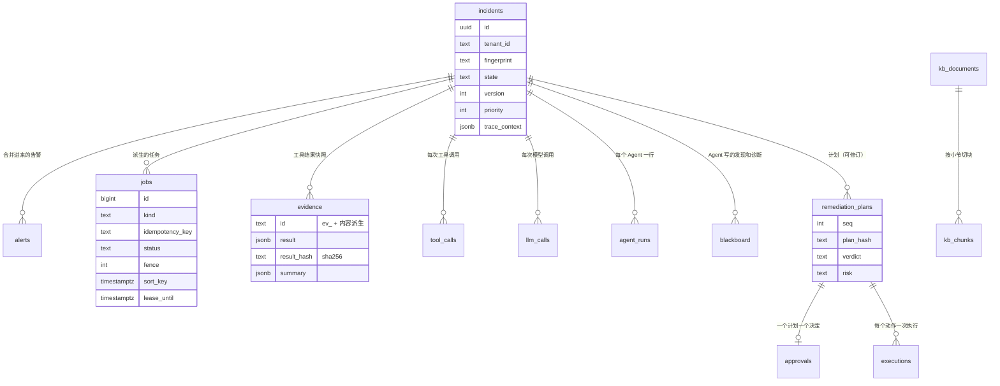
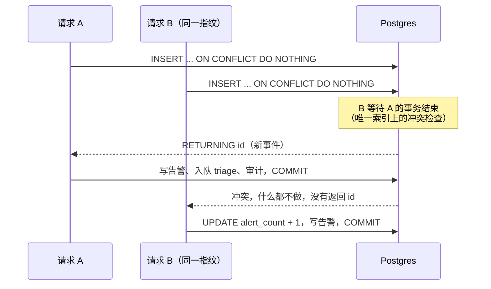

# 第 2 章 数据底座：一个 Postgres 承担一切

> 本章讲系统唯一的有状态组件。核心观点是：**事务边界决定了架构**。"开事件"和"派调查任务"必须同时成功或同时失败，最简单可靠的办法就是让它们写进同一个数据库、同一个事务。

相关决策：[ADR-0002](../adr/0002-single-postgres.md) · 学习笔记：[M1](../learn/m1-postgres-queue.md)

## 2.1 为什么只用一个 Postgres

原型用了 MySQL 存业务数据、Redis 做队列、Elasticsearch 做检索。看起来"每样都用最合适的工具"，实际带来了三个问题：

1. **跨系统一致性**：事件写进 MySQL、任务推进 Redis，是两次独立的写入。先写库后入队，入队前崩溃，事件就永远没人调查；先入队后写库，任务可能先跑，却找不到事件。要解决就得引入 outbox 模式和一个搬运进程。
2. **运维面**：三套备份、三套监控、三套高可用方案、三套权限和租户隔离。
3. **租户隔离要写三遍**：每个系统各有一套过滤逻辑，任何一处漏掉都会串租户。

Postgres 恰好能同时做这几件事：

| 需求 | Postgres 的能力 | 在本系统里 |
|---|---|---|
| 业务状态 | 事务、约束、JSONB | 事件、告警、计划、审批、执行 |
| 任务队列 | `FOR UPDATE SKIP LOCKED` | `jobs` 表（第 3 章） |
| 不可变记录 | 触发器禁止 UPDATE/DELETE | 证据、审计、计划、审批 |
| 全文检索 | `tsvector` + `ts_rank_cd` | 知识库（第 11 章） |
| 向量检索 | pgvector `vector(384)` | 知识库 |
| 互斥 | `pg_advisory_xact_lock` | 审计链追加 |

> [!IMPORTANT]
> **关键设计：入队就是同一事务里的一条 INSERT。** 不需要 outbox、不需要分布式事务、不需要补偿逻辑。这是选 Postgres 做队列的根本原因，比"少一个组件"重要得多。

### 代价

| 代价 | 量级 | 什么时候会成为问题 |
|---|---|---|
| 队列吞吐有上限 | 每秒几百到几千个任务 | 每秒几千个任务以上；本系统每天几千条告警 |
| 轮询延迟 | worker 每 0.5 秒查一次 | 需要毫秒级派发时（可以加 `LISTEN/NOTIFY` 唤醒） |
| 检索能力 | `ts_rank_cd` 没有 IDF，不是真 BM25 | 文档到十万级、需要真 BM25 时（第 11 章） |
| 单点 | 一个库挂了全停 | 用托管 Postgres 的高可用解决，而不是拆系统 |

## 2.2 表的全貌

14 张表，按职责分成六组。迁移在 `app/db/migrations/versions/` 里，编号就是里程碑的顺序。



| 组 | 表 | 迁移 | 特点 |
|---|---|---|---|
| 核心 | `incidents`、`alerts`、`jobs`、`audit_log` | 0001 | 事件带乐观锁 `version`；审计是哈希链 |
| 证据 | `evidence`、`tool_calls` | 0002 | 证据只追加，ID 由内容派生；`tool_calls` 记每次调用（包括失败的） |
| Agent | `agent_runs`、`blackboard`、`llm_calls` | 0003 | 检查点、只追加的黑板、模型调用账本 |
| 修复 | `remediation_plans`、`approvals`、`executions` | 0004 | 计划和审批只追加；执行带唯一的 `idempotency_key` |
| 知识库 | `kb_documents`、`kb_chunks` | 0005 | 生成列 `tsvector` + `vector(384)` |
| 可观测性 | `incidents.trace_context`、`jobs.trace_context` | 0006 | 跨进程传递 W3C traceparent |

**每张表都有 `tenant_id`**，而且每条查询都带租户条件。租户只来自经过校验的 token（第 4 章）。

### 只追加的表

有四张表在数据库层面用触发器禁止 UPDATE 和 DELETE：`audit_log`、`evidence`、`remediation_plans`、`approvals`。

为什么要在数据库层做，而不是"应用代码不写 UPDATE 就行"：

- 防的是**应用 bug 和未来的代码**：三个月后有人写了一个"顺手更新一下计划"的函数，触发器会直接拒绝；
- 审计和证据的价值在于**事后可信**。如果它们能被修改，就失去了作为证据的意义；
- 有权限关掉触发器的人做的篡改，由哈希链发现（第 4 章）。

修订计划不是 UPDATE，而是插入一行 `seq + 1` 的新计划，旧计划和它的审批原样保留。

## 2.3 事件状态机的实现

状态转换表（`app/db/incidents.py`）：

```python
TRANSITIONS = {
    "RECEIVED":          {"TRIAGED"},
    "TRIAGED":           {"INVESTIGATING"},
    "INVESTIGATING":     {"DIAGNOSED"},
    "DIAGNOSED":         {"PLANNED", "INVESTIGATING"},
    "PLANNED":           {"SAFETY_REVIEWED"},
    "SAFETY_REVIEWED":   {"AWAITING_APPROVAL", "EXECUTING"},
    "AWAITING_APPROVAL": {"EXECUTING", "PLANNED"},   # 修订后回到 PLANNED，重新过策略
    "EXECUTING":         {"VERIFYING"},
    "VERIFYING":         {"RESOLVED"},
}
# RESOLVED、ESCALATED 是终态；任何非终态都可以转 ESCALATED
```

每次转换做三件事，**在同一个事务里**：

1. 检查转换合法（`check_transition`），不合法抛 `IllegalTransition`；
2. 乐观锁更新：`UPDATE incidents SET state = :to, version = version + 1 WHERE id = :id AND version = :v`，影响 0 行就抛 `StaleVersion`；
3. 写一条审计记录。

> [!IMPORTANT]
> **关键设计：状态转换、审计、后续入队在同一个事务里。** 不存在"状态变了但审计没写"或"状态变了但下一步任务没派"的中间态。

### 为什么用乐观锁而不是 `SELECT ... FOR UPDATE`

| | 乐观锁（`version`） | 悲观锁（`FOR UPDATE`） |
|---|---|---|
| 冲突时 | 后提交的一方失败，重读后重试或放弃 | 后来的一方等待 |
| 持锁时间 | 不持锁 | 从读到提交 |
| 适合 | 冲突少、读和写之间可能有慢操作 | 冲突多、读写间隔短 |

本系统里同一个事件的并发写很少（同一时刻通常只有一个任务在处理它），而读和写之间可能隔着一次模型调用（几秒到几十秒）。用悲观锁就要在调用模型期间一直持有行锁，这不可接受。

乐观锁还顺带提供了**幂等**：一个任务因为租约过期被执行两次，第二次的状态转换会因为 version 不匹配而失败。

## 2.4 幂等接入：同一个故障只开一个事件

Alertmanager 会重发、会分组、会在多个副本间各发一次。系统必须保证：**同一个告警身份，同一时刻只有一个未关闭的事件**。

```sql
-- 部分唯一索引：只约束"未关闭"的事件
CREATE UNIQUE INDEX ux_incidents_open_fingerprint
  ON incidents (tenant_id, fingerprint) WHERE closed_at IS NULL;

INSERT INTO incidents (...) VALUES (...)
ON CONFLICT (tenant_id, fingerprint) WHERE closed_at IS NULL DO NOTHING
RETURNING id;
-- 没返回 id：说明已有未关闭的事件，UPDATE ... SET alert_count = alert_count + 1 合并进去
```

**指纹**是"告警名 + 服务 + 环境"。这个选择影响了告警规则怎么写：快速燃烧和慢速燃烧用同一个告警名 `ErrorBudgetBurn`、用 `burn` 标签区分，这样一次故障只开一个事件（第 5 章）。



> [!NOTE]
> **实测**：`tests/test_api.py` 同时发 50 个相同指纹的告警，结果只有 1 个事件，`alert_count` 是 50。负载测试 2000 条告警、200 个指纹、100 并发：0 失败，正好 200 个事件、200 个分诊任务。

> [!WARNING]
> **关键问题：为什么不按时间窗口去重（比如 10 分钟内同一指纹算一个）？**
> 分桶有边界问题：09:59:59 和 10:00:00 的两条告警落进两个桶，建出两个事件。"同一指纹同时只能有一个未关闭事件"没有边界。它的代价是：事件不关闭时，下一次同样的故障会合并进旧事件。这在实验环境里真的发生过，评测脚本在故障恢复后把事件转 ESCALATED 来关闭它；生产里事件的关闭由 RESOLVED 或人来做。

### 死锁预防

一个 webhook 请求可以带多条告警。如果请求 1 先处理指纹 X 再处理 Y，请求 2 顺序相反，两个事务会互相等待。做法是**一个 webhook 里的告警先按指纹排序再处理**，所有事务按同一顺序加锁，就不会成环。

## 2.5 优先级从哪里来

```python
SEVERITY_PRIORITY = {"critical": 1, "high": 1, "warning": 2, "info": 3}
DEFAULT_PRIORITY = 3
# P0 永远不会被推断出来：必须由告警显式标注 priority=P0
```

P0 不能被推断，是为了防止"所有 critical 都变成 P0"：P0 有预留的 worker 槽位（第 3 章）和 2 分钟诊断的 SLO（第 13 章），如果被滥用，这两样都会失去意义。

## 2.6 参数表

| 参数 | 默认值 | 环境变量 | 说明 |
|---|---|---|---|
| 数据库连接 | `postgresql+psycopg://...` | `SRE_DATABASE_URL` | psycopg 3 异步驱动 |
| 连接池大小 | 10 | `SRE_DB_POOL_SIZE` | 每个进程；worker 并发 4 + 心跳 + 回收任务，10 足够 |

## 本章小结

- 一个 Postgres 承担状态、队列、证据、审计、检索；根本原因是"开事件"和"派任务"要在同一个事务里。
- 14 张表，每张都有 `tenant_id`；四张表由触发器保证只追加。
- 状态机显式、乐观锁、转换和审计同一事务。
- 部分唯一索引 + `ON CONFLICT` 实现幂等接入；按指纹排序防止死锁。

## 面试官追问

<details>
<summary>🟢 Q1：为什么用 Postgres 做队列，而不是 Redis 或 Kafka？</summary>

事务边界。建事件和派任务必须同时成功或同时失败。队列在 Redis 里，就要引入 outbox 才能保证这一点；队列在同一个 Postgres 里，入队就是同一事务里的一条 INSERT。代价是吞吐上限和轮询延迟，对每天几千条告警的规模都不是问题。到了每秒几千个任务的规模，我会换掉它，但仍然会用 outbox 保证一致性。

</details>

<details>
<summary>🟢 Q2：部分唯一索引是什么？为什么这里要用"部分"？</summary>

带 `WHERE` 条件的唯一索引，只约束满足条件的行。这里是 `WHERE closed_at IS NULL`：同一个指纹，未关闭的事件只能有一个，但已关闭的可以有很多（同一个故障上周发生过一次、今天又发生一次，是两个事件）。如果不加条件，同一指纹一辈子只能有一个事件。

</details>

<details>
<summary>🟡 Q3：`ON CONFLICT DO NOTHING` 在高并发下是怎么保证只插入一行的？</summary>

靠唯一索引本身。两个事务同时插入同一个键时，后一个会在索引的冲突检查上等待前一个事务结束：前一个提交了，后一个看到冲突，执行 `DO NOTHING`；前一个回滚了，后一个正常插入。这是数据库保证的，不依赖应用代码。

"先 SELECT 查有没有，没有再 INSERT"在并发下一定会错：两个请求都查到"没有"，然后都插入。唯一约束是唯一可靠的做法。

</details>

<details>
<summary>🟡 Q4：乐观锁冲突了怎么办？会不会一直重试？</summary>

看调用方。对任务处理函数来说，`StaleVersion` 通常意味着"别人已经推进了这个事件"，比如同一任务被执行了两次，第二次的转换失败。这时不需要重试，直接结束，因为期望的状态已经达成或者已经被别人处理。

对人的操作（比如修订计划），返回 409，让前端重新读取最新状态。不做自动重试，因为人看到的内容已经过期了，应该让人重新看一眼。

</details>

<details>
<summary>🟡 Q5：证据表存原始结果，一次链路查询就 2 MB，数据库会不会爆？</summary>

会增长得很快，这是真实的生产问题。现在的规模（一个事件几十条证据、几 MB）没问题。生产上要做三件事：

1. **按时间分区**（`evidence` 按月分区），老分区可以整体归档或删除，比逐行删快得多，也不会因为只追加触发器而无法清理（清理是删分区，不是 UPDATE/DELETE 行）；
2. **大结果放对象存储**，表里只存哈希、大小、摘要和对象地址，哈希仍然保证可校验；
3. **保留策略**和合规要求对齐，比如证据保留 90 天，审计保留更久。

控制台导出时已经做了类似处理：原始结果超过 64 KB 的不导出，只保留摘要、大小和 SHA-256。

</details>

<details>
<summary>🔴 Q6：一个 Postgres 承担这么多职责，什么时候必须拆？先拆哪个？</summary>

按压力先后：

1. **知识库检索**最先拆：文档到十万级、需要真 BM25 或 ANN 索引带复杂过滤时，换 `pg_search` 或外部搜索引擎。它和业务没有事务耦合（入库是离线的），拆起来最容易。
2. **证据原始数据**其次：搬到对象存储，表里留元数据。
3. **队列**最后：每秒几千个任务以上才需要。拆的时候用 outbox，事件和 outbox 行仍在同一个事务里，搬运进程推到 Kafka 或 SQS。
4. **状态、审计**永远留在关系数据库里，它们需要事务和约束。

判断标准不是"Postgres 能不能做"，而是"拆出去之后，跨系统一致性的成本是否小于收益"。

</details>

<details>
<summary>🔴 Q7：多租户隔离只靠每条 SQL 都带 `tenant_id`，万一哪条忘了怎么办？</summary>

这确实是应用层隔离的弱点。现在的防线有三层：租户只来自签名 token，请求体里的租户字段一律忽略；所有查询函数都要求传租户、空租户直接报错；跨租户访问的测试（访问别的租户的事件返回 404）。

更强的做法是 Postgres 的**行级安全策略（RLS）**：每个连接 `SET app.tenant_id = ...`，表上定义 `USING (tenant_id = current_setting('app.tenant_id'))`，即使应用代码漏了条件，数据库也只返回本租户的行。这是纵深防御，我列为后续工作。需要注意的是 RLS 要和连接池配合好（事务级 `SET LOCAL`），否则租户设置会串到下一个使用这个连接的请求上。

</details>

<details>
<summary>🔴 Q8：同一个根因开了 5 个事件（5 个服务都告警），系统会怎么处理？</summary>

现在会开 5 个事件、各自调查，这在实验环境里真实发生过（网络延迟注入在 product-catalog，5 个服务告警）。问题有两个：

1. **成本**：5 次调查约 100 次模型调用、0.22 美元，而它们查的是同一个故障；
2. **重复修复**：坏版本发布开了 5 个事件，每个事件的 Planner 都提议回滚同一个服务。执行器的至多一次和执行前检查起了作用，没有回滚两次（第二次 Kubernetes 返回 422，后面的检查到没有可回滚的版本），但这是靠防线兜底，不是设计好的。

改进方向：事件关联（按时间窗口和服务依赖图把同一波告警聚成一组，只调查一次）；以及修复去重（同一个 Deployment 上已有进行中或刚完成的执行时，新计划标注"已由某事件处理"）。这两条都记为后续工作。

</details>

---

上一章：[第 1 章 全景](01-overview.md) · 下一章：[第 3 章 任务队列](03-job-queue.md)
