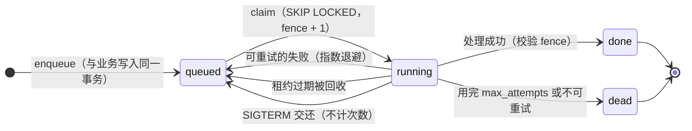
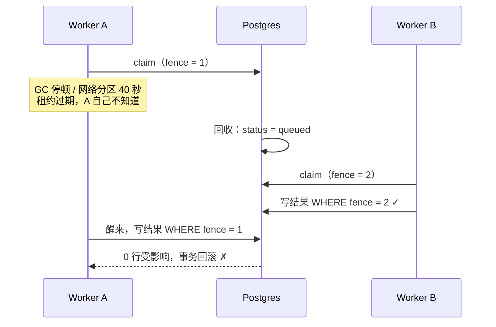
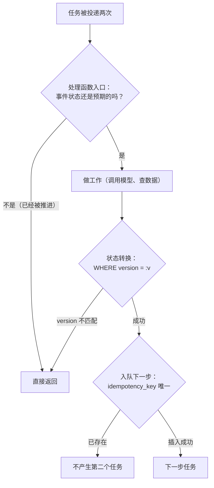

# 第 3 章 任务队列：在 Postgres 里做一个正确的队列

> 一次调查要几分钟，不能在 HTTP 请求里做。所以 API 只负责把告警变成事件和任务，真正的工作由 worker 从队列里领取。本章讲这个队列怎样在 worker 并发领取、被 `kill -9`、卡住后复活、重复执行这些情况下仍然正确。

相关决策：[ADR-0003](../adr/0003-postgres-skip-locked-queue.md) · 学习笔记：[M1](../learn/m1-postgres-queue.md) · 代码：`app/queue/jobs.py`、`app/worker/runner.py`

## 3.1 一个任务的生命周期



任务的种类（`kind`）和由谁处理：

| kind | 处理者 | 做什么 | 由谁入队 |
|---|---|---|---|
| `triage` | Worker | 分诊：RECEIVED → TRIAGED，入队调查 | 接入（开事件时） |
| `investigate` | Worker | 跑协调者、调查者、汇总者 | triage |
| `plan` | Worker | 跑 Planner、过策略 | investigate |
| `approval_timeout` | Worker | 到期还没审批就 ESCALATED | plan（延迟任务） |
| `execute` | **Executor** | 执行被批准的动作 | 审批接口，或策略允许自动执行时 |
| `verify` | Worker | 查 SLI，连续健康就 RESOLVED | execute（延迟 60 秒） |

> [!IMPORTANT]
> **关键设计：每个进程只领取自己能处理的 kind。** 所有进程共用一张 `jobs` 表，`claim(kinds=...)` 按种类过滤。只有执行器领取 `execute`，worker 永远不会去执行一个修复动作。这曾经是一个真实的 bug：早期 worker 会领取任何 kind，包括 execute（第 9 章）。

## 3.2 领取：`FOR UPDATE SKIP LOCKED`

```sql
WITH next AS (
    SELECT id FROM jobs
    WHERE status = 'queued' AND run_after <= now() AND priority <= :max_priority
      AND (:kinds IS NULL OR kind = ANY(:kinds))
    ORDER BY sort_key, id
    LIMIT 1
    FOR UPDATE SKIP LOCKED
)
UPDATE jobs AS j
SET status = 'running',
    lease_owner = :owner,
    lease_until = now() + :ttl,
    fence = j.fence + 1,
    attempts = j.attempts + 1
FROM next WHERE j.id = next.id
RETURNING j.*;
```

逐个关键词解释：

- **`FOR UPDATE`**：锁住选中的行，别的事务不能再锁它。
- **`SKIP LOCKED`**：遇到已经被锁住的行，**跳过**而不是等待。十个 worker 同时领取，会各自锁住十个不同的任务。没有它，所有 worker 会排队等同一行，并发度退化成 1。
- **选出和标记在同一条语句里**：如果先 SELECT 再 UPDATE 且不加锁，两个 worker 可能选中同一行。
- **`run_after <= now()`**：延迟任务（审批超时、验证前的等待、重试退避）用 `run_after` 表达，不需要额外的定时器。
- **`fence = fence + 1`**：每领取一次，fence 加一。下一节讲它的用处。

## 3.3 优先级与饥饿

### 老化

严格优先级（P0 永远先于 P3）在 P0 持续到达时，P3 会永远等下去。原型更极端：来过一次 P0 就永远不派发 P1–P3（bug B1）。

这里的做法是**入队时算好排序键**：

```
sort_key = 入队时间 + priority × aging_step（60 秒）
```

等价于"优先级每低一级，相当于晚到 60 秒"。一个 P3 等了 3 分钟以上，就排在新到的 P0 前面，所以**等待时间有上界**。

```mermaid
gantt
  title 排序键：P3 在 10:00 入队，P0 们陆续到达
  dateFormat HH:mm:ss
  axisFormat %H:%M
  section P3（10:00 入队）
  sort_key = 10：03 :milestone, p3, 10:03:00, 0s
  section P0（10:01 入队）
  sort_key = 10：01 :milestone, a, 10:01:00, 0s
  section P0（10:02 入队）
  sort_key = 10：02 :milestone, b, 10:02:00, 0s
  section P0（10:04 入队）
  sort_key = 10：04 :milestone, c, 10:04:00, 0s
```



领取顺序是 10:01 的 P0、10:02 的 P0、P3、10:04 的 P0。

> [!WARNING]
> **关键问题：为什么在入队时算，而不是查询时算 `priority - (now() - enqueued_at) / 60`？**
> 入队时算好的是一个普通列，可以建索引，`ORDER BY sort_key` 走索引；查询时算，每次领取都要对所有排队任务重新计算、排序。两者语义相同，前者便宜得多。一个推论：被回收的任务**保留原来的 sort_key**，不会因为重新入队而排到队尾。

### P0 预留槽位

老化解决"低优先级饿死"，预留槽位解决另一个问题：worker 的并发槽位全被 P2 的长调查占满时，新来的 P0 要等某个 P2 跑完（可能好几分钟）。

```python
# app/worker/runner.py
max_priority = 3 if free > worker_reserved_p0_slots else 0
```

每个 worker 默认 4 个槽位，最后 1 个只领 P0。

## 3.4 租约、心跳与 fencing token

### 租约和心跳

领到任务的 worker 只"借用"它一段时间（`lease_until = now() + 30 秒`）。运行期间每 `ttl/3 = 10` 秒续约一次。用三分之一，是为了容忍偶尔一两次续约失败。worker 死了就不再续约，租约过期后，回收任务（每 5 秒一次）把它放回队列。

### 只有租约不够：僵尸 worker



**fencing token** 是每次领取时加一的那个 `fence`。所有写入都带着自己的 fence，并在**同一个事务里**先校验 `fence = :mine`：

```sql
UPDATE jobs SET status = 'done', ... WHERE id = :id AND fence = :fence AND status = 'running'
```

> [!IMPORTANT]
> **关键设计：检查和写入由存储层在同一事务里完成。** 不能让 worker 自己判断"我还有租约吗"，因为卡住的 worker 恰恰无法正确判断这一点：它在判断之后、写入之前又可能卡住。这个概念来自 Martin Kleppmann 对 Redlock 的批评和《数据密集型应用系统设计》第 8 章。

fence 不只用在完成任务时。Agent 的检查点（第 8 章）、黑板写入都走 job 的 fence：一个已经失去租约的 worker，连"某个调查者完成了"都写不进去。

租约丢失时，worker 也会主动取消正在运行的处理函数，不再浪费模型调用。

## 3.5 失败、重试与死信

| 情况 | 处理 | 计入尝试次数 |
|---|---|---|
| 可重试的失败（超时、模型限流、后端 5xx） | 回到 queued，`run_after = now() + 退避` | 是 |
| 不可重试的失败（数据错误、非法状态转换） | 直接 dead | 是 |
| 用完 `max_attempts`（5 次） | dead | — |
| 处理函数超过 `worker_job_timeout_s`（1200 秒） | 当作失败，可重试 | 是 |
| 租约过期（worker 被 `kill -9`） | 回收任务放回 queued | 是（领取时已经加过） |
| 收到 SIGTERM，宽限期内没做完 | 主动交还队列 | **否**，这不是任务的错 |

退避公式（带抖动）：

```
cap   = min(300 秒, 2 秒 × 2^(attempt-1))
delay = 在 [cap/2, cap] 之间均匀随机
```

抖动是为了避免一批任务同时失败后，又在同一时刻一起重试，把刚恢复的后端再次压垮（惊群）。

**死信**（`status = 'dead'`）不会自动重试，需要人看。进入死信时写一条 `job.dead` 审计记录；它的事件不会再自己往前走。第 13 章的告警 `JobsDeadLettered` 在 15 分钟内出现任何死信时通知人，描述里直接给出查询死信的 SQL。

> [!WARNING]
> **关键问题：死信的事件停在原状态，而不是自动 ESCALATED。** 这是一个可以改进的地方：调查任务进了死信，事件停在 INVESTIGATING，控制台上看起来"还在调查"。更好的做法是进死信时把事件转为 ESCALATED 并写明原因，让状态本身就告诉人"该你了"。现在靠告警兜底。

## 3.6 "恰好一次"是怎么做到的

分布式系统里，**投递**只能做到至少一次：worker 可能在完成工作之后、标记 done 之前崩溃，任务会再跑一次。本系统接受这一点，让**处理**幂等：



三层合起来：**状态检查、乐观锁、带唯一键的后续入队**。任务即使执行两次，效果也和执行一次一样。

> [!WARNING]
> **关键问题：有些操作本身不幂等，怎么办？**
> 模型调用不幂等（花钱），修复动作更不幂等（回滚两次是灾难）。对这两类：
> - 模型调用：Agent 级检查点，已完成的 Agent 不再调用（第 8 章）；同一请求哈希的回答可以复用。
> - 修复动作：执行器把"至少一次"变成"至多一次"：动手前先提交一行带唯一键的 `started` 记录，重新投递时看到它就**不重试**，标记 `unknown` 交给人（第 9 章）。

## 3.7 优雅退出

Kubernetes 和 Docker 停止容器时，先发 SIGTERM，等宽限期，再发 SIGKILL。worker 收到 SIGTERM：

1. 停止领取新任务；
2. 等正在运行的任务完成，最多 `worker_shutdown_grace_s`（20 秒）；
3. 还没完成的，主动取消并交还队列，不计入尝试次数。

compose 里 `stop_grace_period: 30s` 必须大于 20 秒，否则 SIGKILL 会在交还之前到来。被 `kill -9` 的 worker 没有机会交还，靠租约过期回收。两种情况都有用真实子进程跑的测试。

## 3.8 参数表

| 参数 | 默认值 | 环境变量 | 为什么 |
|---|---|---|---|
| 租约时长 | 30 秒 | `SRE_QUEUE_LEASE_TTL_S` | 太短：心跳抖动就丢租约；太长：worker 死后要等很久才被接手 |
| 心跳间隔 | 租约的 1/3（10 秒） | — | 允许连续丢两次心跳 |
| 老化步长 | 60 秒 | `SRE_QUEUE_AGING_STEP_S` | P3 最多比新 P0 多等 3 分钟 |
| 最大尝试次数 | 5 | `SRE_QUEUE_MAX_ATTEMPTS` | — |
| 退避基数 / 上限 | 2 秒 / 300 秒 | `SRE_QUEUE_BACKOFF_BASE_S` / `_MAX_S` | 第 5 次重试前最多等 32 秒 |
| 每个 worker 的并发 | 4 | `SRE_WORKER_CONCURRENCY` | 还受模型并发（每进程 2 个 `claude -p`）限制 |
| P0 预留槽位 | 1 | `SRE_WORKER_RESERVED_P0_SLOTS` | — |
| 轮询间隔 | 0.5 秒 | `SRE_WORKER_POLL_INTERVAL_S` | 派发延迟的上界 |
| 回收间隔 | 5 秒 | `SRE_WORKER_REAP_INTERVAL_S` | — |
| 优雅退出宽限 | 20 秒 | `SRE_WORKER_SHUTDOWN_GRACE_S` | 小于容器的 30 秒 |
| 单个任务超时 | 1200 秒 | `SRE_WORKER_JOB_TIMEOUT_S` | 最长的任务是调查：约 17 步模型调用，部分并行 |

## 3.9 验证

| 场景 | 测试 | 结果 |
|---|---|---|
| 并发领取不重复 | 负载测试 2000 条告警、100 并发、2 个 worker | 200 个任务全部完成，最大 fence 为 1（没有任何任务被领两次） |
| 被 SIGKILL 后接手 | `tests/test_worker.py` 真的杀子进程 | 租约过期后另一个 worker 完成 |
| 僵尸写入被拒 | fence 测试 | 旧 fence 的写入失败 |
| 饥饿 | `tests/test_queue.py` | 等待中的 P3 最终排在新 P0 前面 |
| 优雅退出 | 真实子进程 + SIGTERM | 交还任务且不计次数 |

## 本章小结

- `SKIP LOCKED` 让多个 worker 无冲突地并发领取；选出和标记在同一条语句里。
- 老化（入队时算 `sort_key`）防饥饿，P0 预留槽位防 P0 排队。
- 租约 + 心跳处理"worker 死了"，fencing token 处理"worker 以为自己还活着"。
- 投递至少一次，处理幂等；不幂等的副作用（修复）由执行器单独做到至多一次。

## 面试官追问

<details>
<summary>🟢 Q1：`SKIP LOCKED` 解决了什么问题？不加会怎样？</summary>

不加的话，所有 worker 会去锁排在最前面的同一行。一个 worker 拿到锁，其他的排队等它的事务结束，并发度退化成 1。加了之后，每个 worker 跳过别人锁住的行，各自拿到不同的任务。代价是排序变成"近似"的：一个被锁住的高优先级任务会被暂时跳过，但它马上就被锁住它的那个 worker 处理了，所以没有实际影响。

</details>

<details>
<summary>🟢 Q2：有了租约，为什么还需要 fencing token？</summary>

租约只保证"过期后别人可以接手"，不能阻止原来的持有者在过期之后继续写。一个 GC 停顿了 40 秒的 worker 醒来时并不知道自己已经失去租约。fencing token 把检查放在存储层：每次领取时加一，写入时在同一个事务里校验。过期持有者手上的 token 是旧的，写入一定失败。

</details>

<details>
<summary>🟡 Q3：你的队列是"恰好一次"吗？</summary>

投递是至少一次。效果上做到恰好一次，靠的是处理幂等：入口的状态检查、带乐观锁的状态转换、带唯一键的后续入队。声称"恰好一次投递"的系统（比如 Kafka 的 exactly-once）内部也是"至少一次 + 幂等/事务"，只是把幂等做进了框架里。

但我会补一句：修复动作不能靠"幂等"糊弄过去，因为"回滚"执行两次的效果不等于一次。所以执行器是另一套逻辑：至多一次，宁可交给人也不重试。

</details>

<details>
<summary>🟡 Q4：租约 30 秒、心跳 10 秒，这两个数怎么定的？调大调小各有什么问题？</summary>

租约长度是两个风险的权衡：

- **太短**（比如 3 秒）：一次数据库慢查询或 GC 停顿就会让心跳迟到，租约过期，任务被别人接手，原来的 worker 白干，模型调用被浪费。
- **太长**（比如 10 分钟）：worker 被 `kill -9` 后，任务要等 10 分钟才被接手。对 P0 来说不可接受。

30 秒意味着最坏情况下一个 P0 调查因为 worker 崩溃延迟 30 + 5（回收间隔）秒。心跳取 1/3 是常见做法：连续丢两次心跳仍然不会失去租约。

</details>

<details>
<summary>🟡 Q5：老化步长 60 秒，那一个 P3 最多等多久？如果 P0 源源不断呢？</summary>

P3 的 sort_key 比同时入队的 P0 晚 180 秒。所以 P3 入队 180 秒后，任何新来的 P0 都排在它后面。它最多等"180 秒 + 排在它前面的任务被处理完的时间"。如果 P0 到达速度持续超过处理能力，那不是饥饿问题而是容量问题：所有任务都在变慢，这时需要的是扩 worker，而且第 13 章的"最老的可运行任务"告警会响。

</details>

<details>
<summary>🔴 Q6：轮询 0.5 秒一次，10 个 worker 就是每秒 20 次查询。规模大了会不会把数据库打满？</summary>

会成为问题，但量级很远。每次领取是一条走索引的查询，空队列时只返回 0 行，Postgres 每秒处理几千条这样的查询没问题。真要优化有三个方向：

1. **`LISTEN/NOTIFY`**：入队时 `NOTIFY jobs`，worker `LISTEN`，有任务才被唤醒，轮询间隔可以放长到几秒作为兜底；
2. **批量领取**：一次 `LIMIT N`；
3. **部分索引**：`WHERE status = 'queued'`，让索引只包含待处理的任务，避免 done 的历史行拖慢查询。

另一个真实的问题是 `jobs` 表会无限增长，done 的行要定期归档或删除，否则索引和 vacuum 的压力会越来越大。

</details>

<details>
<summary>🔴 Q7：如果数据库的时钟和 worker 的时钟不一致，租约会出问题吗？</summary>

不会，因为所有时间都用数据库的 `now()`：`lease_until = now() + ttl`、回收时比较 `lease_until < now()`、`run_after <= now()`。worker 本地时钟只用来决定"什么时候发下一次心跳"，即使它快了慢了，也只是心跳发得早一点或晚一点，判断租约是否过期的永远是同一个时钟。这是分布式租约设计的一条基本原则：**由一个权威时钟来判断过期**。

</details>

<details>
<summary>🔴 Q8：一个调查任务跑了 15 分钟还没完，这时 worker 的数据库连接断了一下。会发生什么？</summary>

逐步看：

1. 心跳失败。如果连接很快恢复（10 秒内），下一次心跳成功，什么都没发生；
2. 如果断开超过 30 秒，租约过期，回收任务把它放回队列，另一个 worker 领取（fence + 1）；
3. 原来的 worker 发现租约丢失（续约返回 0 行），取消正在运行的处理函数；
4. 即使取消没来得及生效，它之后的任何写入（Agent 检查点、状态转换）都会因为 fence 不匹配而失败；
5. 新 worker 从检查点继续：已完成的调查者直接读黑板，不再调用模型；被打断的那个从头开始，它之前的工具调用复用已有的证据行（证据 ID 由内容派生，重复写入是 `ON CONFLICT DO NOTHING`）。

损失的只是被打断的那个 Agent 已经花掉的模型调用。

</details>

---

上一章：[第 2 章 数据底座](02-data-foundation.md) · 下一章：[第 4 章 接入层、鉴权与审计](04-api-auth-audit.md)
