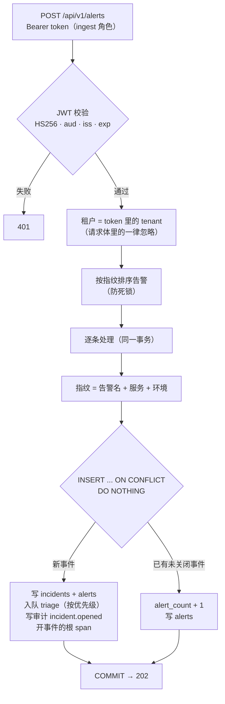
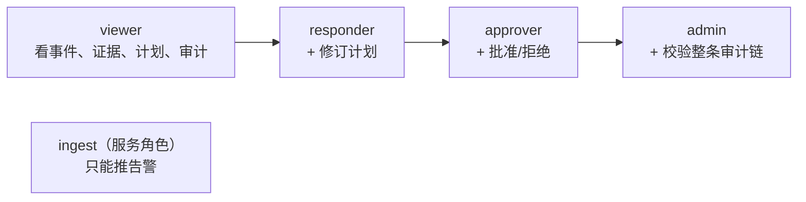
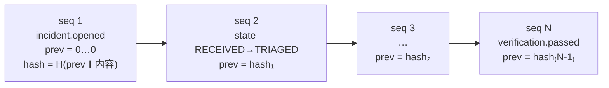

# 第 4 章 接入层、鉴权与审计

> API 是系统和外界的唯一接口：Alertmanager 从这里推告警，人从这里看事件、批准计划。本章讲三件事：API 为什么必须无状态；谁能做什么（鉴权和租户）；怎样证明事后没人改过记录（哈希链审计）。

学习笔记：[M1](../learn/m1-postgres-queue.md)、[M5](../learn/m5-safety.md) · 代码：`app/api/`、`app/core/security.py`、`app/db/audit.py`、`app/ingest.py`

## 4.1 API 的形状

所有接口在 `/api/v1` 下：

| 方法 | 路径 | 最低角色 | 用途 |
|---|---|---|---|
| POST | `/alerts` | `ingest`（服务角色） | Alertmanager webhook，返回 202 |
| GET | `/incidents`、`/incidents/{id}` | viewer | 事件列表和详情 |
| GET | `/incidents/{id}/diagnosis`、`/report` | viewer | 结构化诊断、Markdown 报告 |
| GET | `/incidents/{id}/agents` | viewer | Agent 调用树（每步耗时、token、工具、证据） |
| GET | `/evidence/{id}` | viewer | 一条证据的原始数据和哈希 |
| GET | `/incidents/{id}/plans` | viewer | 修复计划和策略结论 |
| POST | `/incidents/{id}/plans` | responder | 人修订计划 |
| POST | `/incidents/{id}/approvals` | approver | 批准或拒绝，必须带 `plan_hash` |
| GET | `/incidents/{id}/audit` | viewer | 本事件的审计记录 |
| GET | `/audit/verify` | admin | 校验整条审计链 |
| GET | `/stream` | viewer | SSE：本租户的变化通知（第 14 章） |
| GET | `/healthz`、`/readyz`、`/metrics` | 无 | 探针和 Prometheus |

### 无状态

API 进程不在内存里保存任何业务状态：事件、任务、会话都在 Postgres，身份在 JWT 里。所以：

- 可以随时加减副本，负载均衡随便转发；
- 进程重启不丢任何东西；
- 原型把事件存在进程内的字典里，多进程部署时每个进程看到的是不同的事件（bug T9），这是重建时最先修的问题之一。

## 4.2 一条告警进来以后



两个细节：

- **resolved 通知**：Alertmanager 在告警仍在触发时，`endsAt` 是零值时间 `0001-01-01T00:00:00Z`。只有 `status=resolved` 时才保存 `ends_at`，否则会存进一个公元 1 年的时间。
- **202 而不是 200**：接口只保证"告警已经安全落库、任务已经入队"，调查是异步的。

## 4.3 鉴权：JWT 的几个坑

本系统用 HS256 签名的 JWT。看起来简单，但每一条都对应一种真实的攻击：

| 做法 | 防的是什么 |
|---|---|
| `jwt.decode(..., algorithms=["HS256"])` 固定算法 | `alg: none` 攻击；RS256/HS256 混淆攻击（用公钥当 HMAC 密钥伪造签名）。测试专门覆盖了 `alg: none` |
| 校验 `aud` 和 `iss` | 别的系统用同一把密钥签发的 token 被拿来用 |
| 密钥少于 32 个字符拒绝启动 | HS256 的安全性完全取决于密钥长度 |
| 密钥缺失拒绝启动（fail fast） | 而不是带着一个默认密钥跑起来 |
| **租户只来自 token** | 告警标签里写 `tenant_id=t2`，事件仍然属于 token 里的 t1（bug B4）；缺少租户声明的 token 直接 401（bug B6） |
| 跨租户访问返回 **404 而不是 403** | 403 会泄露"这个 ID 存在，只是不属于你" |
| 审批人身份来自 JWT 的 `sub` | 不来自请求体，不能替别人批准 |

> [!IMPORTANT]
> **关键设计：身份和租户只有一个来源，就是经过签名校验的 token。** 请求体里的任何字段都不能决定"你是谁"或"你属于哪个租户"。这条规则让多租户隔离和审批的职责分离都有了可靠的基础。

### 角色



人的角色有等级（`viewer < responder < approver < admin`），高的包含低的。`ingest` 是**服务角色**，不在等级里：Alertmanager 的 token 只能推告警，不能看任何事件。实验环境里这个 token 由部署脚本现签，放在 Kubernetes Secret 里，通过 `credentials_file` 挂给 Alertmanager，不会出现在 ConfigMap 里。

> [!WARNING]
> **关键问题：approver 能不能批准自己修订的计划？**
> 不能。审批时比较 `approver != proposed_by`。Planner 提的计划发起人是 `agent:planner`；人修订的计划发起人是这个人。拒绝不受这个限制，谁都可以拦下一个计划。这是职责分离（four-eyes principle）的最小实现。

## 4.4 审计：哈希链

每一个有意义的动作都写一条审计记录：事件打开、状态转换、计划提出、批准或拒绝、执行开始和结束、验证通过或失败、任务进死信。

### 链的结构



```
hash = sha256(prev_hash + canonical_json(本行内容))
```

- **改了某一行**：这一行重算出的哈希和存的不一样；
- **删了某一行**：下一行的 `prev_hash` 对不上；
- **`verify` 从头重算**，报出第一处断裂的位置（"BROKEN at seq N"）。

### 两层防护

| 层 | 防什么 | 怎么做 |
|---|---|---|
| 触发器 | 应用 bug、误操作 | 表上禁止 UPDATE 和 DELETE |
| 哈希链 | 有权限关掉触发器的人 | 任何修改都会让链断裂；测试模拟了"关触发器、改数据、开触发器"，`verify` 仍然报出被改的行 |

### 两个容易踩的坑

**并发追加会让链分叉。** 两个事务同时追加，可能都读到同一个"最后一行"，各自算出 prev_hash，链就分成了两支。做法是追加前 `SELECT pg_advisory_xact_lock(常量)`，把追加串行化。这把锁在事务提交或回滚时自动释放，所以后一个事务一定能看到前一个事务写入的行。

**规范化。** JSONB 不保留键的顺序，时间读回来的时区表示可能不同。所以计算哈希时 `sort_keys=True`，时间统一转成 UTC 的 ISO 格式。否则同样的数据写进去和读出来，算出的哈希不一样，`verify` 会误报。

> [!NOTE]
> **实测**：坏版本发布的闭环运行结束时，审计链 88 行全部校验通过；闭环事件 `remediation.plan → remediation.approved → execution.started → execution.succeeded → verification.passed` 按顺序出现。

> [!WARNING]
> **关键问题：哈希链能防住数据库管理员吗？**
> 不能完全防住。一个能写数据库的人可以改掉某一行，再把后面所有行的哈希全部重算一遍，链仍然是完整的。哈希链能防的是"改了却不重算"，以及让篡改留下可检测的痕迹。要防住有完整权限的人，需要把链的**锚点**放到他控制不了的地方：比如定期把最新的哈希写进另一个系统（只追加的对象存储、外部的时间戳服务、甚至一封邮件），之后任何重算都会和外部锚点对不上。这是后续工作。

## 4.5 启动、探针与退出

| 探针 | 检查什么 | 失败的后果 | 为什么 |
|---|---|---|---|
| `/healthz`（liveness） | 只检查进程本身 | Kubernetes 重启进程 | 如果检查数据库，数据库一抖动，所有 API 实例被一起重启，小故障变成大故障 |
| `/readyz`（readiness） | 数据库能连上 | 负载均衡暂时不转发 | 数据库不可用时不接流量，但不重启 |

启动时连一次数据库，连不上直接退出（fail fast），而不是启动以后每个请求都报错。原型的问题正相反：初始化时任何异常都被吞掉，`app = None`，进程看起来活着却什么都做不了（bug B7）。

## 4.6 参数表

| 参数 | 默认值 | 环境变量 | 说明 |
|---|---|---|---|
| JWT 签名密钥 | 无（必须设置，≥ 32 字符） | `SRE_JWT_SECRET` | 缺失或太短拒绝启动 |
| issuer / audience | `sre-blackboard` | `SRE_JWT_ISSUER` / `SRE_JWT_AUDIENCE` | — |
| CORS 白名单 | 空（不发任何 CORS 头） | `SRE_CORS_ORIGINS` | 原型是 `*` |
| SSE 轮询间隔 | 1 秒 | `SRE_STREAM_POLL_S` | 第 14 章 |
| SSE 单连接最长 | 300 秒 | `SRE_STREAM_MAX_S` | 到期主动断开，客户端续传 |

## 本章小结

- API 无状态，所有状态在 Postgres，身份在 JWT。
- JWT 固定算法、校验 aud/iss、密钥长度检查；租户和身份只来自 token；跨租户 404。
- 角色有等级，`ingest` 是独立的服务角色；批准人不能是发起人。
- 审计是 SHA-256 哈希链 + 禁止修改的触发器；advisory lock 防分叉；规范化防误报。
- liveness 不查数据库，readiness 查。

## 面试官追问

<details>
<summary>🟢 Q1：liveness 和 readiness 有什么区别？为什么 liveness 不检查数据库？</summary>

liveness 失败会导致重启进程，readiness 失败只会让流量暂时不发过来。如果 liveness 检查数据库，数据库一抖动，所有 API 实例会被一起重启：重启本身解决不了数据库的问题，反而让所有实例同时冷启动、同时去连数据库，加重故障。所以数据库检查只放在 readiness 里。

</details>

<details>
<summary>🟢 Q2：为什么跨租户访问返回 404 而不是 403？</summary>

403 的意思是"这个资源存在，但你没有权限"，等于告诉攻击者这个 ID 是有效的。攻击者可以用它枚举别的租户的事件 ID。404 对"不存在"和"不属于你"给出同样的回答，不泄露任何信息。

</details>

<details>
<summary>🟡 Q3：为什么用 HS256 而不是 RS256？</summary>

HS256 是对称签名，签发方和校验方共用一把密钥；RS256 是非对称的，私钥签发、公钥校验。现在签发和校验都在本系统里（部署脚本签发服务 token、测试签发人的 token），HS256 最简单。

接入公司的 SSO（OIDC）时应该换成 RS256 或 ES256：身份提供方用私钥签发，本系统只拿公钥（从 JWKS 地址获取），永远不持有能签发 token 的密钥。这时"固定算法"更重要，因为混淆攻击正是利用"服务端按 token 头里的 alg 选算法"，把公钥当 HMAC 密钥去校验。

</details>

<details>
<summary>🟡 Q4：审计链为什么要加 advisory lock？不加会怎样？</summary>

两个事务同时追加时，都会读到同一个"最后一行"作为 prev，各自写入一行，两行的 prev_hash 相同，链就分叉了。之后 `verify` 按 seq 顺序重算，第二行的 prev_hash 对不上第一行的 hash，报告断裂，但其实没人篡改。

`pg_advisory_xact_lock` 是一把事务级的应用锁：拿不到就等，事务结束自动释放。后一个事务拿到锁时，前一个已经提交，它读到的"最后一行"一定是最新的。

</details>

<details>
<summary>🔴 Q5：审计链用一把全局锁串行化，这不是一个全局瓶颈吗？</summary>

是的。每条审计写入都要排队拿同一把锁，持锁时间是"读最后一行 + 计算 + 插入 + 提交"，大约毫秒级。所以吞吐上限是每秒几百到上千条审计。对事件处理这种低频操作足够，但它确实是一个全局串行点。

规模大了有两个方向：

1. **按租户分链**：每个租户一条链，锁的键是租户 ID 的哈希，不同租户并行；
2. **批量追加**：一个后台进程从"待审计"表里按批取出，一次算一批的哈希。代价是审计和业务写入不再在同一个事务里，需要保证"待审计"行和业务写入同事务，这又回到了 outbox 模式。

我会先做第一种，因为它不改变一致性语义。

</details>

<details>
<summary>🔴 Q6：有人拿到了 approver 的 token，能做什么？怎么限制损失？</summary>

能批准当前等待审批的计划，但只能批准**已经存在**的计划：

- 他不能提出新的动作，计划来自 Planner 或 responder，而且都要过策略；
- 策略只允许动作目录里的动作、只能指向诊断里排第一的根因服务、回滚必须有对应的发布证据、只能在允许范围内的 Deployment 上；
- 执行器执行前还会再查一遍。

所以损失被限制在"让一个本来需要人判断的、策略已经放行的动作提前执行"。要进一步限制：token 有效期缩短（默认 1 小时）；审批接入 SSO 并要求二次认证；高风险动作（R3）要求两个不同的人批准；审批记录实时通知给团队频道，让异常的批准能被看到。

</details>

<details>
<summary>🔴 Q7：Alertmanager 的 ingest token 泄露了，攻击者能做什么？</summary>

能伪造告警。后果是：开出假事件、触发调查（花模型额度）、甚至让 Planner 提出修复计划。

但它不能直接造成写操作：

- 调查用的数据来自真实的 Prometheus、Loki、K8s，假告警说 checkout 坏了，数据会显示 checkout 好好的，诊断找不到站得住的根因，通常会 ESCALATED；
- 即使诊断被诱导，所有修复都要人批准（默认配置）；
- 每个事件有 token 预算上限，限制了单个事件能花掉的额度。

需要补的是：按租户的告警速率限制（防止用假告警刷爆额度）；ingest token 定期轮换；以及来源校验（比如 mTLS 或只接受来自集群内网的请求）。

</details>

---

上一章：[第 3 章 任务队列](03-job-queue.md) · 下一章：[第 5 章 故障实验环境](05-fault-lab.md)
