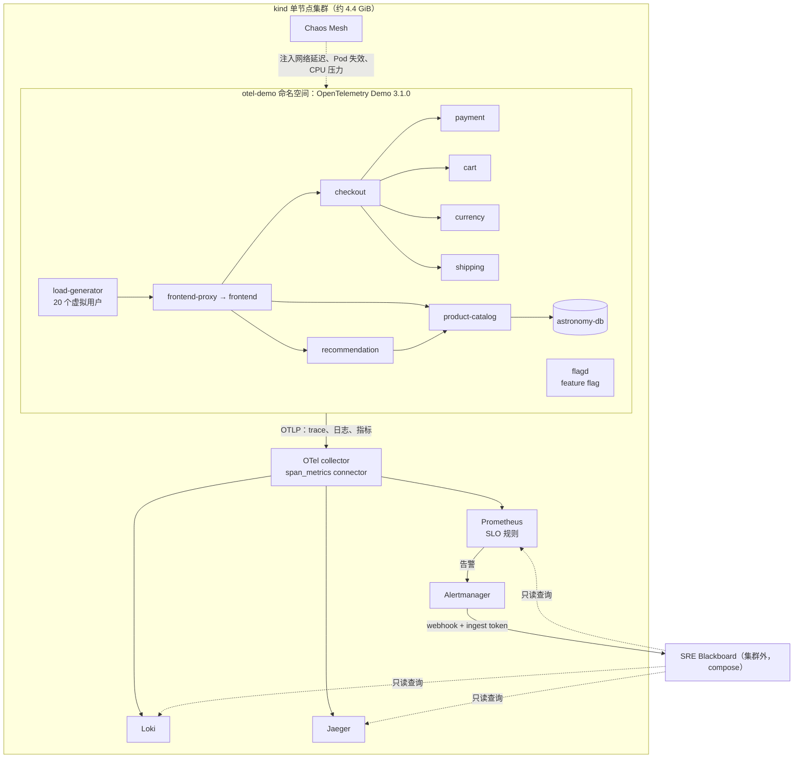

# 第 5 章 故障实验环境：一个能真的坏掉的系统

> 没有真实故障，Agent 的诊断就无从验证。本章讲怎样造一个"能真的坏掉、坏了会告警、告警会推给本系统"的环境：一个电商微服务应用跑在 Kubernetes 里，按 SLO 告警，支持 15 种以上可控的故障注入，并且在 GitHub Actions 上每次从零搭建。

相关决策：[ADR-0004](../adr/0004-fault-lab-on-kind-in-ci.md) · 学习笔记：[M2](../learn/m2-fault-lab.md) · 代码：`deploy/kind/`、`scripts/lab/`

## 5.1 实验环境的组成

| 部件 | 选型 | 说明 |
|---|---|---|
| 集群 | kind 单节点 | 版本全部钉死在 `deploy/kind/versions.env`；`make env-up` 幂等 |
| 被测应用 | OpenTelemetry Demo 3.1.0（chart 0.42.4） | 十几个服务、七八种语言，自带完整的遥测；裁掉约 2 GB 用不上的组件 |
| 指标 | Prometheus（OTLP 写入） | SLI 来自 span 指标 |
| 日志 | Loki（替换 Demo 默认的 OpenSearch） | 更省内存，LogQL |
| 链路 | Jaeger | — |
| 故障注入 | flagd、Chaos Mesh、真实的 rollout | 三种方式（5.4） |
| 运行位置 | GitHub Actions `ubuntu-24.04`，4 核 16 GB | 每次从零搭建，整次运行约 50 分钟 |

### 集群里的 Alertmanager 怎么推给集群外的本系统

本系统跑在集群外（docker compose）。做法是：建一个**没有 selector 的 Service**（Kubernetes 不会自动维护它的后端），再手动建一个 **EndpointSlice** 指向宿主机 IP。Alertmanager 的配置里只写 `http://sre-blackboard:8000`。以后本系统部署进集群，只要把 Service 改成普通的带 selector 的 Service，Alertmanager 配置不用动。

## 5.2 SLI、SLO 与错误预算

- **SLI**（指标）：一个比例，比如"成功的请求 / 总请求"。
- **SLO**（目标）：SLI 要达到的水平，比如 30 天 99%。
- **错误预算**：1 − SLO，这里是 1%。预算是"可以花的东西"，发布和实验都会花一些；花得太快才需要叫人。

本项目的 SLI 来自 **span 指标**：collector 的 `span_metrics` connector 对每个 span 计数，生成 `traces_span_metrics_calls_total` 和耗时直方图。只统计 **SERVER span**：它代表调用方实际感受到的结果；CLIENT span 是"我调用别人"，算进来会重复计算。

| SLO | SLI | 阈值 |
|---|---|---|
| availability | 服务端 span 的错误比例 | 多窗口燃烧率（下一节） |
| latency | 服务端 span 的 p95 | 1000 ms |

> [!WARNING]
> **关键问题：为什么用 span 指标做 SLI，而不是各服务自己暴露的指标？**
> Demo 的服务用七八种语言写成，各自的指标命名不一致；span 指标由 collector 统一生成，所有服务口径一致。代价是依赖链路数据和 collector 的健康：collector 挂了，SLI 也就没了。生产中通常再用负载均衡器或网关的指标做一层兜底。

## 5.3 多窗口燃烧率告警

**燃烧率** = 当前错误比例 / 错误预算比例。燃烧率 1 表示刚好 30 天用完预算；14.4 表示约 2 天就会用完。

只看一个窗口会有两难：

- 窗口长（1 小时）：故障开始后很久才触发，故障结束后也很久才解除；
- 窗口短（5 分钟）：一点抖动就误报。

**多窗口**：长短两个窗口**同时**超过阈值才告警。长窗口保证"确实烧了不少预算"，短窗口保证"现在还在烧"。故障一结束，短窗口立刻降下来，告警很快解除。

| 档位 | SRE workbook | 本项目（缩短 12 倍） | 严重度 |
|---|---|---|---|
| 快速燃烧 | 14.4 倍，1h 和 5m | 14.4 倍，**5m 和 1m** | critical（P1） |
| 慢速燃烧 | 6 倍，6h 和 30m | 6 倍，**30m 和 5m** | warning（P2） |

另外所有告警都有**流量门槛**：5 分钟内少于 10 个请求不告警，避免"3 个请求错 1 个"就把人叫起来。

> [!IMPORTANT]
> **关键设计：快慢两档用同一个告警名。** 本系统按"告警名 + 服务 + 环境"算事件指纹（第 2 章）。如果快慢两档用两个名字，一次大故障会开两个事件；而且快速燃烧解除后慢速燃烧还要响几分钟，恢复期间又冒出一个新事件。所以两档都叫 `ErrorBudgetBurn`，用 `burn` 标签区分；Alertmanager 再加一条抑制规则：快速燃烧在响时，压住同服务的慢速燃烧通知。这个问题是写 promtool 单元测试时发现的。

### 一条告警要多久才到

以支付失败为例（错误比例 50%，快速燃烧阈值是 14.4 × 1% = 14.4%）：

```mermaid
gantt
  title 从故障注入到告警送达（约 190 秒）
  dateFormat ss
  axisFormat %S 秒
  span 指标刷新 + 抓取和规则评估 :a, 00, 30s
  5 分钟窗口的错误比例爬过 14.4% :b, after a, 90s
  for 1m :c, after b, 60s
  Alertmanager group_wait :d, after c, 10s
```

实测首个告警 128–221 秒。支付失败波动最大，因为 payment 每秒只有约 0.2 个请求，1 分钟窗口里只有十几个样本，比例会短暂跌回阈值以下，`for` 重新计时。

**恢复为什么要约 5 分钟**：快速燃烧的 1 分钟窗口很快降下来；但它一解除，被抑制的慢速燃烧就露出来了，它的 5 分钟窗口要等故障期间的错误被"挤出"窗口，比例从 50% 降到 6% 以下，约 4.4 分钟。这是窗口长度决定的，不是故障没恢复。所以修复后的**验证不看告警是否消失**，而是直接查 1 分钟的 SLI（第 9 章）。

## 5.4 三种故障注入

| 方式 | 例子 | 原理 | 恢复 | 对应的真实根因类型 |
|---|---|---|---|---|
| feature flag | `paymentFailure`（50% 支付失败） | 应用里预埋的故障分支，flagd 下发开关 | 开关设回 off | 代码缺陷 |
| Chaos Mesh | product-catalog 出口加 1 秒延迟、Pod 失效、CPU 压力 | 用 tc、cgroup 改变容器的运行条件 | 删除 Chaos 对象 | 基础设施问题 |
| 坏版本发布 | checkout 把 `PAYMENT_ADDR` 改成 `payment:9999` | 一次真实的 Deployment rollout，带 `change-cause` | `kubectl rollout undo` | 变更引起的故障 |

> [!IMPORTANT]
> **关键设计：三种方式对应三类根因，只有"坏版本发布"的正确修复是回滚。** 如果评测只有 flag 类故障，"回滚"永远不是正确答案，安全策略就测不出来；如果只有发布类故障，Agent 可能学会"看到发布就回滚"。三类混在一起，才能测出 Agent 是否真的在根据证据判断。

### Problem Host 与 Event Host

告警响在哪个服务（**Event Host**），不等于问题出在哪个服务（**Problem Host**）。实测：

| 故障 | 根因（Problem Host） | 告警的服务（Event Host） |
|---|---|---|
| payment-failure | payment | payment、checkout |
| network-delay | product-catalog | product-catalog、recommendation、checkout、frontend、frontend-proxy（5 个） |
| bad-release | checkout | 只有 checkout（payment 根本收不到请求，frontend 的下单流量只占约 3%，到不了阈值） |

故障目录给每个故障同时记录 `root_cause` 和 `symptoms`。这正是诊断要解决的核心难点（第 8 章），也是评测打分的依据（第 12 章）。

> [!NOTE]
> payment-failure 和 bad-release 的症状很像（checkout 下单失败），区别在于 payment 自己有没有出错：前者 payment 返回错误，后者 payment 根本没收到请求。这是区分"下游坏了"和"自己配错了"的关键证据。

## 5.5 让评测诚实的几个设计

| 设计 | 为什么 |
|---|---|
| **Chaos Mesh 的事件在取数时就过滤掉**，RBAC 也不给读权限 | 它们写着"对 product-catalog 注入了 1 秒网络延迟"。真实生产不会有这种东西，Agent 看到就是在抄答案。契约测试检查真实录音里连 "Chaos" 这个词都没有 |
| 保留坏发布的 `change-cause` 和 flag 状态 | 真实环境里发布说明和 flag 变更都是看得到的，而且看到变更不等于知道它是根因（第 12 章有"无害发布"干扰项） |
| 验收先空跑 10 分钟，期间有任何告警（包括 pending）直接失败 | 早期运行"通过"了，其实基线就在告警，见 5.6 |
| "安静"要求连续 60 秒没有 firing 也没有 pending | 只看某一刻没有告警太宽松 |
| 告警抖动（故障期间解除、解除后又响）判失败 | 抖动的告警会被记到下一个故障头上 |

## 5.6 一个值得讲的排查故事：启动噪声

第 5、6 次运行三个故障都"通过"了，但故障注入前 frontend 的错误比例就在 7%–13%，慢速燃烧在响。排查过程：

1. **按 span 名拆错误**：集中在 frontend 的 `GET /api/products/[productId]`，frontend 这一侧的 CLIENT span 报错，但 product-catalog 的 SERVER span 没有错误。所以请求根本没到 product-catalog。
2. **日志**：日志行本身只有 "API request failed"，错误详情在 Loki 的 structured metadata 里，要加 `X-Loki-Response-Encoding-Flags: categorize-labels` 请求头才返回。拿到之后是 `14 UNAVAILABLE: ... connect ECONNREFUSED`。
3. **原因**：Demo 的服务都没有 readiness probe，容器一启动 Service 就转流量过来，而 Java、.NET 服务要几十秒才开始监听。load-generator 一上来就发请求被拒绝，frontend 的 gRPC 客户端进入重连退避（最长 2 分钟），退避期间每个调用立刻失败；慢速燃烧的 30 分钟窗口又把这些错误留了很久。
4. **修复**：给 load-generator 加一个 init 容器，等所有后端都能建立 TCP 连接再开始发流量。告警规则一条没改。之后基线所有服务错误为 0。

同时验收加了"先空跑 10 分钟"的门。这个故事说明了两件事：**验收标准本身要能失败**；**用数据一层层排除，而不是猜**。后者也正是 Agent 被要求做的事。

## 5.7 参数表

| 参数 | 值 | 位置 | 为什么 |
|---|---|---|---|
| 快速燃烧 | 14.4 倍，5m 和 1m，`for: 1m` | `deploy/kind/rules/` | workbook 的窗口缩短 12 倍，几分钟内出结果 |
| 慢速燃烧 | 6 倍，30m 和 5m | 同上 | — |
| 流量门槛 | 5 分钟 ≥ 10 个请求 | 同上 | 低流量服务的比例噪声太大 |
| p95 延迟阈值 | 1000 ms | 同上 | 基线最高的 product-catalog 是 17 ms |
| span 指标刷新 | 15 秒（默认 60 秒） | collector 配置 | 60 秒时 1 分钟窗口里只有 1 个点，`rate` 算不出来 |
| 虚拟用户 | 20（默认 5） | chart values | 5 个用户时 checkout 每分钟只有约 3 个请求，告警忽有忽无 |
| Alertmanager `group_wait` | 10 秒 | — | — |

## 本章小结

- kind + OpenTelemetry Demo，完整的指标、日志、链路，版本全部钉死，在 CI 上每次从零搭建。
- SLI 用 SERVER span 指标；多窗口燃烧率告警（窗口缩短 12 倍）加流量门槛；快慢两档同名防止一次故障开两个事件。
- 三种故障注入对应三类根因；故障目录同时标注 Problem Host 和 Event Host。
- 过滤 Chaos Mesh 事件、基线空跑、严格的"安静"定义，都是为了让评测诚实。

## 面试官追问

🟢 Q1：为什么用多窗口燃烧率告警，而不是"错误率超过 5% 就告警"？

固定阈值和预算无关：5% 对 99.9% 的服务是灾难，对 95% 的服务是常态。燃烧率把告警和"预算还能撑多久"挂钩，严重度有统一的含义。多窗口是为了同时满足两点：长窗口保证不是抖动，短窗口保证故障结束后告警很快解除。

🟢 Q2：告警响在 frontend，你怎么知道根因不在 frontend？

告警只说明"哪里感受到了问题"。要沿着调用链往下找：frontend 的 trace 里哪个下游 span 变慢或出错；那个下游自己的 SERVER span 是否也异常；最近有没有变更、Pod 事件。下游自己的 SERVER span 正常、只有调用方的 CLIENT span 出错，通常说明请求没到下游（网络、配置），这时要看调用方的变更。

🟡 Q3：你的告警窗口为什么和 SRE workbook 不一样？生产上你会怎么设？

缩短了 12 倍，为的是实验环境在几分钟内出结果；workbook 的 1 小时窗口要几十分钟才触发。比例关系不变，代价是对短时抖动更敏感，所以加了流量门槛。生产上用原始窗口（1h/5m、6h/30m），再按服务的流量和重要性调整：低流量服务用更长的窗口或按请求数而不是时间来判断。

🟡 Q4：实验环境为什么放在 GitHub Actions 上，而不是本地？代价是什么？

本地机器长期被占用，云端开发容器又跑不了 Kubernetes。GitHub 给公开仓库的 runner 是 4 核 16 GB，和本地预算相同。每次从零搭建，等于每次都在证明"环境即代码"是真的。

代价是不能交互调试，一次迭代 15–25 分钟（整次运行约 50 分钟），而且日志在云端开发容器里读不到。对策是推送前尽量做静态验证（promtool 测规则、amtool 查 Alertmanager 配置、kubeconform 校验清单、helm template 渲染），以及把关键结果写成 GitHub 的 annotation，用 REST API 读回来。

🟡 Q5：故障注入为什么要三种方式？只用 Chaos Mesh 不行吗？

它们对应不同类型的根因：flag 模拟代码缺陷，Chaos Mesh 模拟基础设施问题，坏发布模拟变更引起的故障。只有坏发布会留下 rollout 历史，回滚才是正确动作。只用 Chaos Mesh 的话，"回滚"永远不是答案，修复策略测不出来；而真实事故里由变更引起的占比最高。

🔴 Q6：评测时发现一半故障根本不告警，你是怎么处理的？这说明了什么？

第一次评测 24 个场景里 14 个在 5 分钟内没告警。我没有直接把等待时间调长，而是先加诊断：等告警时每 30 秒采一次相关服务的 SLI，没告警就打印峰值和阈值。结果分三类：有的只是慢（6–7 分钟后才响）；有的错误率低于快速燃烧阈值（10% 的错误率在 5 分钟窗口到不了 14.4%）；有 7 个故障（内存泄漏、CPU、锁争用等）在这个流量下所有 SLI 都几乎不动。

那 10 个不告警的故障不做评测场景，因为 Agent 收不到告警就无从评测。但这本身是一个发现：**只靠错误率和延迟两个 SLO，资源类故障在流量不大时完全隐身**。真实系统要补饱和度告警（容器内存接近上限、CPU 节流）。评测先测出来的是告警规则的覆盖缺口。

🔴 Q7：实验环境和真实生产差别很大，在这里评测出来的准确率有多少参考价值？

直说：参考价值有限，而且我在报告里写明了。差别主要有三点：

1. **故障是单一、干净的**：真实事故经常是多个因素叠加，还伴随大量无关的噪声告警；
2. **服务规模小**：十几个服务，真实系统可能几百个，Agent 要查的范围大一个数量级；
3. **样本小**：每个变体在 6 个场景上各跑 1 次，一个场景就是 17 个百分点。

它的价值在于**可控和可复现**：答案在注入前就确定，同一个故障可以让几个 Agent 变体并排跑，改了代码可以回放比较。用它来回答"这个改动让系统变好还是变坏了"是可靠的；用它来回答"生产上能有多准"不可靠。要回答后者，需要把评测的场景来源换成真实事故的复盘。

---

上一章：[第 4 章 接入层、鉴权与审计](04-api-auth-audit.md) · 下一章：[第 6 章 工具层与证据](06-tools-evidence.md)
