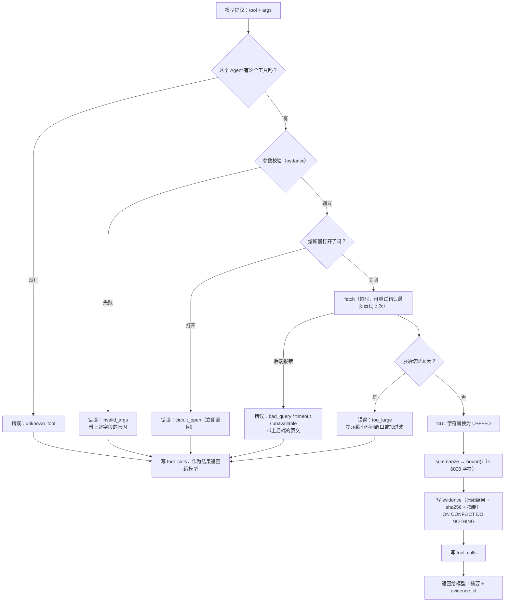
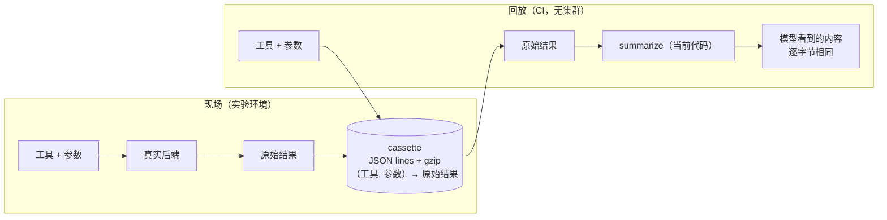
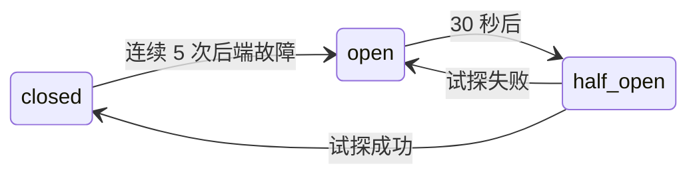

# 第 6 章 工具层与证据：Agent 的眼睛

> Agent 只能通过工具看世界。本章讲工具层的四个职责：**只读**（永远改不了任何东西）、**压缩**（把几 MB 的原始结果变成几 KB 的摘要）、**存证**（每个结果存成不可变的快照，带哈希和由内容派生的 ID）、**可回放**（没有集群也能逐字节重现 Agent 看到的一切）。

相关决策：[ADR-0005](../adr/0005-tool-layer-evidence-and-replay.md) · 学习笔记：[M3](../learn/m3-tools.md) · 代码：`app/tools/`

## 6.1 十个工具

| 工具 | 后端 | 查什么 | 给哪个调查者 |
|---|---|---|---|
| `prom_query` | Prometheus | 某一时刻的 PromQL 值 | metrics |
| `prom_range` | Prometheus | 一段时间的曲线 | metrics |
| `logs_search` | Loki | 按服务、级别、关键词查日志 | logs_traces |
| `traces_search` | Jaeger | 按服务、是否出错、最小耗时查链路 | logs_traces |
| `trace_get` | Jaeger | 一条链路的全部 span | logs_traces |
| `k8s_events` | Kubernetes API | 某对象最近的事件 | changes |
| `rollout_history` | Kubernetes API | Deployment 的版本和 change-cause | changes |
| `deploy_diff` | Kubernetes API | 两个版本之间的差异 | changes |
| `flag_state` | flagd | 当前开着的 feature flag | changes |
| `kb_search` | Postgres | 运行手册和复盘（第 11 章，只给 `rag` 变体） | 全部 |

全部是 **R0（只读）**。Kubernetes 用专门的 ServiceAccount `sre-blackboard-reader`：只能在 `otel-demo` 命名空间里 get/list events、pods、services、deployments、replicasets；不能读 Secret，不能写，没有集群级权限；token 现签，12 小时过期。

## 6.2 一个工具的形状

每个工具由三部分组成：

```python
class PromQueryArgs(BaseModel):          # 1. 严格的入参模型
    model_config = ConfigDict(extra="forbid")
    query: str = Field(description="PromQL ...")
    at: datetime | None = None

async def fetch(args) -> dict: ...         # 2. 取原始数据
def summarize(raw) -> dict: ...            # 3. 压成有界摘要（确定性）
```

入参模型一份定义，三处使用：

1. **校验**模型给的参数（`extra="forbid"`：多余字段直接报错，而不是被悄悄忽略）；
2. 生成给模型看的 **`input_schema`**（字段描述、取值范围、枚举，模型都会读）；
3. 作为**录制回放的键**（校验后的参数做规范化 JSON）。

不会出现"文档说可以、实际不行"的漂移。

### 一次调用的流程



> [!IMPORTANT]
> **关键设计：工具永远返回结果，不抛异常。** 错误也是给模型的输入。错误信息写得好（"parse error: unexpected identifier"、"缩小时间窗口"），模型能自己改正；直接抛异常，整个调查就断了。

## 6.3 为什么原始结果不能进 prompt

一次 `traces_search` 返回 0.5–2.0 MB，一次日志查询 369 KB。直接塞进 prompt 有三个问题：

1. **贵**：几十万 token，而且 transcript 每一轮都要重发（第 7 章），成本随步数近似平方增长；
2. **找不到重点**：模型在大段 JSON 里找异常容易漏，也容易被无关字段带偏（lost in the middle）；
3. **注入面大**：日志内容是外部输入，原样进 prompt 就是把攻击面全打开（第 10 章）。

所以每个工具有一个**确定性的摘要函数**，把原始结果变成诊断需要的统计：

| 工具 | 摘要里有什么 |
|---|---|
| `prom_query` | 按值排序的前 10 条序列；NaN 变成 null |
| `prom_range` | 每条序列的首值、末值、最小、最大、均值、峰值时间，和 12 个桶的形状 |
| `logs_search` | 按模板分组（UUID、IP、数字替换成占位符），每组计数、示例、有用的结构化元数据 |
| `traces_search` | 出错的 span 按（服务, 操作, 错误信息）分组；耗时 p50/p95/max；最慢的几条链路 |
| `trace_get` | 按**自身耗时**（时长 − 子 span 时长）排序的 span；`orphan_spans`（父 span 不在链路里的数量） |
| `k8s_events` | 警告在前，按原因计数，按对象分组 |
| `rollout_history` / `deploy_diff` | 每个版本的 change-cause；两个版本之间 env、镜像、参数、资源、注解的差异 |
| `flag_state` | 开着的 flag 和它的变体 |

最后还有一个通用的 **`bound()`**：摘要超过 6000 字符时，把最大的那个列表砍掉后半段，重复直到放得下，并标记 `truncated`。工具作者忘了限制长度，也不会把 prompt 撑爆。单个字符串截到 300 字符（`kb_search` 例外，见第 11 章）。

> [!NOTE]
> **实测压缩**（真实录音，模型看到的 = 摘要 + 证据 ID）：

| 调用 | 原始结果 | 模型看到 | 倍数 |
|---|---|---|---|
| `traces_search`（支付失败，出错链路） | 2.0 MB | 3.3 KB | 602 |
| `traces_search`（网络延迟，慢链路） | 550 KB | 1.6 KB | 337 |
| `logs_search`（frontend，50 行） | 169 KB | 1.4 KB | 120 |
| `trace_get`（一条慢链路） | 96 KB | 1.8 KB | 53 |
| `deploy_diff` | 11 KB | 0.5 KB | 25 |
| `prom_query` | 0.5–1.8 KB | 0.6–1.3 KB | ≈1 |

3 个故障共 16 次调用，后端返回约 4.9 MB，模型看到约 21 KB，整体约 230 倍。

> [!WARNING]
> **关键问题：摘要会丢信息，怎么办？**
> 摘要保留计数、Top-N 和"是否被截断"，模型知道自己没看全，可以加过滤条件或缩小窗口再查。摘要函数是确定性的、有单元测试的，丢什么、留什么是设计出来的。原始数据也没丢，它在证据库里，人随时可以点开看。还用真实录音验证了：每个故障需要的关键信息（错误比例、坏版本的 diff、慢 span 所在的服务）都在摘要里。

## 6.4 证据：快照、哈希、由内容派生的 ID

"Agent 说 checkout 的 PAYMENT_ADDR 被改成了 9999"，怎么证明它没编？原型返回 `EV-xxxxx` 这样的假 ID，无从核对。现在：

- 每次成功的调用写一行 `evidence`：原始结果（JSONB）、原始结果**规范化 JSON 的 SHA-256**、摘要、来源（live/replay）、取数时间；
- 触发器禁止 UPDATE 和 DELETE；
- 模型拿到的是摘要 + `evidence_id`；结论必须引用 ID（第 8 章）；人可以顺着 ID 看到原始数据，并用哈希验证它没被改过。

**规范化 JSON**：键排序、无多余空格、禁止 NaN。同一份数据不管从哪条路径序列化，字节都相同，哈希才有意义。

### 证据 ID 为什么由内容派生

```
evidence_id = "ev_" + sha256(范围, 工具, 规范化参数, 结果哈希)[:16]
范围 = 租户 / 事件
```

最初用的是随机 ID，写完测试才发现两个问题：

1. **回放对不上**：模型层的回放按 transcript 的哈希匹配（第 7 章），证据 ID 出现在 transcript 里，随机 ID 让每次运行的 transcript 都不同，回放永远 miss；
2. **重试产生重复证据**：任务被重新执行，同样的查询又写一行。

由内容派生后，同一事件里同样的数据只有一行（`ON CONFLICT DO NOTHING`）；不同事件即使数据相同也是不同的证据，租户之间不会互相引用。

> [!IMPORTANT]
> **关键设计：ID 相同就意味着数据逐字节相同。** 因为 ID 包含了结果的哈希。契约测试只要比较证据 ID，就同时验证了"回放出来的数据和现场一模一样"。

## 6.5 录制回放

LLM 系统难测有两层原因：模型不确定，外部数据也不确定（指标每秒都在变）。工具层先解决第二层。



几个关键选择：

| 选择 | 理由 |
|---|---|
| **在工具层录，不在 HTTP 层录** | HTTP 请求里带着每次都不同的 start/end 时间戳，按 URL 匹配要写很多忽略规则；工具参数用相对窗口（`minutes: 10`），天然稳定；一行一次调用，人能读懂 |
| **录原始结果，不录摘要** | 改了摘要逻辑，老录音照样能用来验证新逻辑 |
| 同一调用出现多次 | 按录制顺序返回，用完了一直返回最后一个；Agent 隔一会儿再查，能看到"数据变了" |
| **错误也录** | 录的时候超时，回放时也超时，错误处理路径同样能测（`too_large` 也要录，曾经因为漏录导致回放失败） |
| 按事件、再按 Agent 分开回放 | 同一故障的几个事件、并行的几个调查者会问同样的问题、拿到不同时刻的答案 |
| gzip 时 mtime 设为 0 | 同一份录音永远是同样的字节，提交进 git 不产生无意义的差异 |

## 6.6 重试与熔断

- **只重试可能自己好的错误**：超时、连接失败、429、5xx，最多 2 次。查询写错（400）重试多少次都一样，还会把错误信息延后交给模型。
- **退避加抖动**：`0.25 秒 × 2^n × (1 + 随机 0–0.5)`。
- **熔断器**：每个后端一个，连续 5 次失败后打开 30 秒，期间立即返回 `circuit_open`；30 秒后放一个请求试探（半开），成功就关闭。查询写错不算后端故障，不计入。



效果：Loki 挂了，Agent 很快得到一个明确的错误，可以改查链路，而不是每次调用都等满超时。

## 6.7 实测中发现的问题

真实环境推翻了好几个假设，这也是契约测试用真实录音而不是手写假数据的原因：

| 发现 | 教训 |
|---|---|
| 坏发布时 checkout **自己不打错误日志**，错误作为 gRPC 状态返回给 frontend，由 frontend 记录 | "错误日志在调用方"必须写进调查者的提示词 |
| payment 拒绝支付打的是 **warn** 不是 error | 假数据里我写的是 error；级别过滤正好在真实数据上被验证 |
| `level="warn"` 漏掉了 error | 参数说明写"这个级别或更严重"，实现只匹配了 warn |
| 日志模板正则 `[A-Z0-9]{10}` 把 "CONNECTION" 也替换了 | 要求至少包含一个数字 |
| 网络延迟时"最慢的 span"是 frontend-proxy | 它等满 15 秒超时，下面的子 span 不在取回的链路里，父 span 的全部时长都算成了自身耗时。加了 `orphan_spans`，并在工具说明里告诉模型它意味着什么 |
| 一条日志带 U+0000，Postgres JSONB 存不了 | 证据写入失败，整个调查任务失败重跑。入库前把 NUL 换成 U+FFFD |

## 6.8 参数表

| 参数 | 值 | 说明 |
|---|---|---|
| 摘要上限 | 6000 字符 | `bound()` 兜底 |
| 单个字符串上限 | 300 字符 | `kb_search` 按行返回，每段最多 900 字符 |
| 重试 | 最多 2 次，`0.25 × 2^n × (1 + 0–0.5)` 秒 | 只重试超时、连接、429、5xx |
| 熔断 | 连续 5 次失败，打开 30 秒 | 每个后端一个 |
| K8s 只读 token | 12 小时过期 | 现签 |
| 后端地址 | `SRE_PROMETHEUS_URL`、`SRE_LOKI_URL`、`SRE_JAEGER_URL`、`SRE_K8S_API_URL` | — |

## 本章小结

- 十个工具全部只读；入参模型一份定义三处使用。
- 确定性摘要把原始结果压缩约 230 倍，`bound()` 兜底长度；工具永远返回结果，错误也是给模型的输入。
- 证据是不可变快照，带规范化 JSON 的 SHA-256；ID 由内容派生，ID 相同就意味着数据相同。
- 在工具层录制原始结果，回放时重新生成摘要；重试只针对可恢复错误，每个后端一个熔断器。

## 面试官追问

<details>
<summary>🟢 Q1：工具结果为什么不直接给模型？</summary>

三个原因：大小（一次链路查询 0.5–2 MB，而 transcript 每一轮都要重发）、质量（模型在大段 JSON 里找异常容易漏，确定性的统计比模型自己数更可靠）、安全（日志是外部输入，原样进 prompt 就是把注入面全部打开）。原始数据没有丢，它在证据库里，摘要带着证据 ID。

</details>

<details>
<summary>🟢 Q2：证据 ID 为什么不用 UUID？</summary>

因为要可回放。模型层的回放用 transcript 的哈希做键，证据 ID 出现在 transcript 里，随机 ID 会让每次运行的 transcript 都不同。由内容派生的 ID 在同样的数据下永远相同，顺带解决了任务重试时的重复写入。范围里包含租户和事件，不同租户的证据不会撞在一起。

</details>

<details>
<summary>🟡 Q3：为什么在工具层录制，而不是 HTTP 层（像 vcrpy 那样）？</summary>

HTTP 请求里带着当前时间，每次都不同，按 URL 匹配要写很多忽略规则；一个工具可能发多个请求，录音难读。工具层的参数用相对窗口，天然稳定，录音一行一次调用，人能直接读懂。代价是录音和工具的参数模型绑定：改了参数模型就要重新录。

</details>

<details>
<summary>🟡 Q4：工具的错误信息为什么要写得那么细？</summary>

因为错误是模型下一步的输入。`bad_query` 带上 Prometheus 的原文（`parse error: unexpected identifier`），模型通常能在下一步改对查询；`too_large` 提示"缩小时间窗口或加过滤条件"，模型会照做；`circuit_open` 告诉它这个后端暂时不可用，它会换数据源。如果只返回"error"，模型要么重复同样的错误查询，要么放弃，浪费步数。

</details>

<details>
<summary>🟡 Q5：为什么要过滤 Chaos Mesh 的事件？这不是在隐藏信息吗？</summary>

是为了让评测诚实。Chaos Mesh 的事件直接写着"对 product-catalog 注入了网络延迟"，真实生产环境不存在这种东西。Agent 看到它就能"诊断"正确，但那是在抄答案，分数会虚高。反过来，坏发布的 change-cause 和 flag 变更在真实环境里都看得到，所以保留。判断标准是：**真实生产里看不看得到**。

</details>

<details>
<summary>🔴 Q6：如果 Agent 查询了一个巨大的时间窗口，把 Prometheus 打挂了怎么办？</summary>

有几层限制：

1. 工具的参数模型限制了取值范围（比如时间窗口的分钟数有上限，结果条数有上限）；
2. 结果大小有上限，超过返回 `too_large`，不会把大结果读进内存再处理；
3. 每个 Agent 最多 5 步、每步最多 3 个查询，一次调查的查询总数有上界；
4. 熔断器：后端开始失败，5 次后打开，停止继续施压。

但我承认，PromQL 本身可以写出很贵的查询（比如对高基数指标做 `count by` 不带过滤），参数校验管不住查询的代价。生产上应该在 Prometheus 侧限制（`query.timeout`、`query.max-samples`），并且给 Agent 用的是只读副本或专门的查询前端（比如 Thanos/Mimir 的 query-frontend，带查询代价限制和缓存），不要直接打主 Prometheus。

</details>

<details>
<summary>🔴 Q7：证据存了原始结果，里面可能有用户的个人信息（日志里的邮箱、token）。怎么办？</summary>

这是一个真实的合规问题，现在没有完整处理：

- 已做的：trace 的 span 上**不记**提示词和回答，只记请求哈希（第 13 章）；K8s 不能读 Secret；
- 没做的：证据原始结果和模型看到的摘要里可能包含日志中的 PII。

生产上要做：(1) 在工具层摘要之前做脱敏（邮箱、token、卡号的正则替换；或者用日志平台已有的脱敏规则），脱敏后再算哈希，保证哈希仍然对应"存下来的那份"；(2) 证据按租户加密存储、按合规要求设保留期；(3) 模型调用走有数据处理协议的 API，而不是个人订阅。脱敏要放在摘要之前，因为摘要会进 prompt，而 prompt 会被录音、会被发给模型提供方。

</details>

---

上一章：[第 5 章 故障实验环境](05-fault-lab.md) · 下一章：[第 7 章 Agent 运行时](07-agent-runtime.md)
