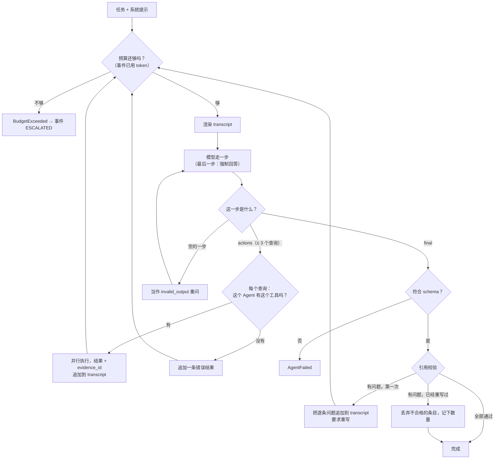
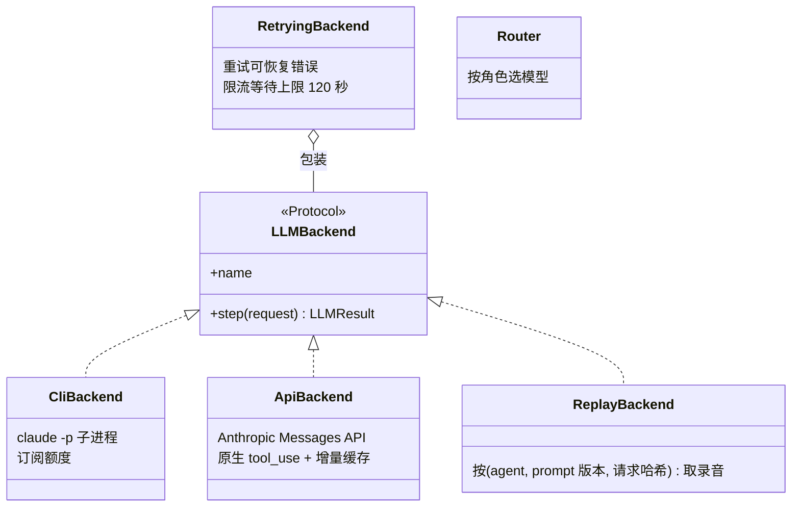
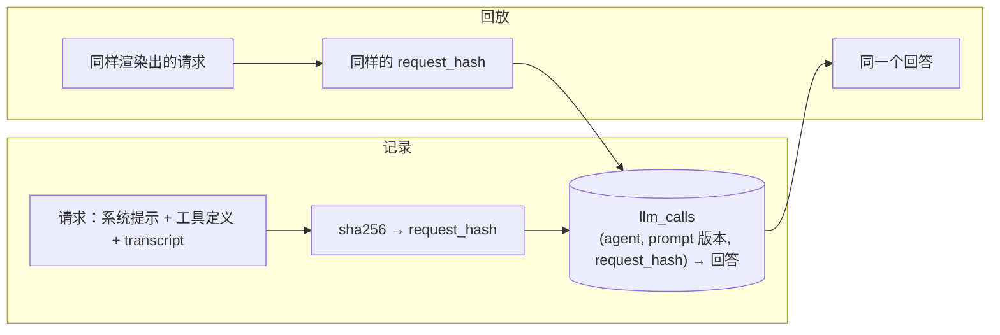

# 第 7 章 Agent 运行时：手写的循环和可插拔的模型

> 本章讲"一个 Agent"是怎么运行的：一个一百多行的循环，一个能换成订阅 CLI、Anthropic API 或录音回放的模型后端，每一步都有结构化的输出、预算检查和可回放的记录。下一章再讲多个 Agent 怎样协作。

相关决策：[ADR-0006](../adr/0006-agent-loop-llm-backends-blackboard.md) · 学习笔记：[M4](../learn/m4-agent.md) · 代码：`app/agents/loop.py`、`app/llm/`

## 7.1 Agent 循环到底是什么

去掉所有包装，一个工具型 Agent 就是这样一个循环：



关键在于**谁执行**。模型只输出结构化的"提议"，执行永远在我们的代码里，所以可以在执行前做任何检查：这个 Agent 有没有这个工具、预算够不够、这是不是最后一步。这也是安全边界：模型说"去重启 Pod"，它手里根本没有重启工具。

> [!IMPORTANT]
> **关键设计：最后一步只能回答。** 第 `max_steps` 步时，请求里带 `force_final`，系统提示追加"你没有查询步数了，用已有的结果回答"。否则 Agent 可能一直查下去，或者在最后一步还在提查询，白白浪费所有已经花掉的 token。

### 为什么不用 LangGraph 之类的框架

循环本身只有一百多行。真正难的是循环之外的三件事，而框架会把它们藏起来：

1. **检查点要和任务的 fence 绑定**：一个 Agent 完成时，它的输出、"完成"标记必须在同一个事务里、带着 job 的 fence 提交（第 3、8 章）；
2. **回放要逐字节对上**：请求哈希覆盖系统提示、工具定义和整个 transcript，渲染方式必须完全由我们控制；
3. **预算要在每一步之前检查**，并且计入并行的兄弟 Agent 花掉的 token。

框架把状态放在它自己的对象里，这些都要绕着它做。手写的代价是没有现成的可视化，用数据库里的 `agent_runs`、`llm_calls`、`blackboard` 加控制台的调用树代替（第 14 章）。

## 7.2 一步的形状：结构化输出

每一步的输出必须符合这个 schema（CLI 后端）：

```json
{
  "reasoning": "两三句话：看到了什么、下一步做什么",
  "actions": [ {"tool": "prom_query", "args": {"query": "..."}} ],
  "final": null
}
```

- `actions` 最多 3 个，**并行**执行；
- 每一项是一个 `anyOf` 分支：`tool` 是常量，`args` 是那个工具自己的参数 schema，所以模型填参数时有精确的字段约束；
- `final` 只在结束时给，它的 schema 就是这个角色的输出模型（`Plan`、`InvestigatorReport`、`Diagnosis`、`RemediationPlan`），字段都有长度上限。

参数是否合法最终仍由工具注册表校验（第 6 章），错误作为结果返回给模型。

## 7.3 可插拔的 LLM 后端



### `claude -p` 当作"单步推理引擎"

Claude Code 的无头模式本来是一个完整的编码 Agent，有自己的工具、自己的循环。这里只要它的"一步推理"，所以要把其余的全关掉：

| 参数 | 作用 |
|---|---|
| `--system-prompt` | 替换掉自带的编码助手提示 |
| `--tools ""` | 一个内置工具都没有（没有 Bash、Read、Edit） |
| `--strict-mcp-config`、`--setting-sources ""` | 不加载任何 MCP server 和本机设置 |
| `--json-schema` | 输出必须符合 schema，结果在 `structured_output` |
| `--output-format json` | 一次性返回 JSON，带 `usage`、`total_cost_usd`、`is_error` |
| `--no-session-persistence` | 不存会话；每步无状态，transcript 由我们渲染 |
| `--effort low` | 推理强度（第 12 章降本时设的） |
| 空的工作目录、去掉 `CLAUDECODE` 环境变量 | 不读到任何 `CLAUDE.md`，不以为自己在另一个会话里 |

`--json-schema` 的实现方式：CLI 给模型加一个叫 `StructuredOutput` 的工具，模型通过调用它交答案，所以一次正常调用 `num_turns` 是 2。

> [!WARNING]
> **关键问题：数据源写在哪里，模型就把它当成什么。** 第一次探测时，系统提示里写了"你可以用 prom_query 查指标"，Haiku 先把 `prom_query` 当原生工具去调，得到 `No such tool available`，第二轮才改用 `actions` 字段：`num_turns` 3、提示 5.2k token、4.7 秒。改成数据源只出现在输出 schema 的 `anyOf` 分支里、系统提示不提，`num_turns` 2、提示 2.6k、3.2 秒。在结尾加一句"请用 StructuredOutput"没用：问题出在模型"看到"的工具定义，而不在指令。

### API 后端有什么不同

| | CLI 后端 | API 后端 |
|---|---|---|
| 工具 | 数据源是输出 schema 里的字段 | 原生 `tool_use`；最终答案是 `submit_final` 工具；`tool_choice: any` 保证每步必须调工具 |
| 缓存 | transcript 作为一整块文本传入，每步都不同，每步都是**写缓存**，读不到上一步的 | 在 transcript 末尾设缓存断点，下一步只为新增部分付全价 |
| 成本 | JSON 里有 `total_cost_usd`（按 API 价格的等价成本） | 只返回 token；不维护价格表，成本为空 |
| 每步开销 | 起一个进程，约 1 秒、250 MB | 一次 HTTP 请求 |
| 计费 | 订阅的用量窗口 | 按 token 付费 |

### 错误分类

后端把所有失败归成八种 `code`：`rate_limited`、`overloaded`、`timeout`、`auth`、`bad_request`、`invalid_output`、`replay_miss`、`unavailable`，并标明是否可重试。几个从真实探测里学到的规则：

| 现象 | 处理 |
|---|---|
| 未知模型：退出码 1、`is_error: true`、`api_error_status: 404`，但 `subtype` 仍是 `success` | 先看退出码和 `is_error`，再按 `api_error_status` 分类；**不信 `subtype`** |
| schema 无法满足：退出码 0，没有 `structured_output`，`result` 是一段道歉 | 没有 `structured_output` 就是 `invalid_output`，可重试 |
| 空的一步：`actions` 为空且没有 `final` | `invalid_output` 重问；重试后仍然如此，只让这个 Agent 失败 |
| 订阅用量上限 | 专门的错误，不重试；调查记为"模型不可用"（评测里不进分母，第 12 章） |
| 限流的 `retry_after` 超过 120 秒 | 放弃这一步，交给队列稍后重试整个任务；已完成的 Agent 保留 |

重试：可重试的错误最多 3 次，退避 `base × 2^(n-1) × (1 + 0–0.5 随机)`；有 `retry_after` 时至少等那么久。

### 按角色选模型

默认所有角色用 `claude-haiku-5-5`（最便宜）。可以按角色覆盖（`SRE_LLM_ROLE_MODELS='{"synthesizer": "claude-sonnet-5-5"}'`），按"家族"（`investigator`）或具体角色（`investigator.metrics`）。第 12 章的 `strong-plan` 变体就是把协调者和汇总者换成 Sonnet。

## 7.4 预算与成本

两种"花费"：

- **token**：每一步都重发整个 transcript，总量随步数**近似平方增长**。每步之前检查本事件已用的 token（含并行兄弟 Agent 的），超过上限（150 万）就 `BudgetExceeded`，事件 ESCALATED。
- **等价成本**：CLI 报告的 `total_cost_usd`，每次调用存进 `llm_calls`。

> [!NOTE]
> **实测**：一次完整调查（4 个 Agent）约 16–27 次模型调用。评测降本前（默认推理强度、8 步）坏发布场景 61.7 万 token；降本后（`--effort low`、5 步）17.6 万 token，诊断和修复都没变。默认变体在 6 个场景上平均每个事件约 19 万 token、0.027 美元。

成本控制手段汇总：

| 手段 | 效果 |
|---|---|
| 工具结果压缩（第 6 章） | 模型看到的约是原始数据的 1/230 |
| 每个调查者最多 5 步，最后一步强制回答 | 后面的步最贵（上下文最长） |
| 每步最多 3 个查询，并行 | 减少步数 |
| 推理强度 low | 每步输出从约 2,900 token 降到约 1,200 |
| 每事件 token 上限 | 防止失控 |
| 默认用最便宜的模型，按角色可换 | — |

## 7.5 让 LLM 可回放

第 6 章让工具可回放，这里把模型也接上。



前提是**渲染给模型的内容逐字节稳定**。transcript 里的工具结果带着由内容派生的证据 ID，所以只要工具返回同样的原始数据，transcript 就相同。还修掉了三处依赖时钟的渲染：

| 不稳定来源 | 改法 |
|---|---|
| 告警计数（不断增长） | 不渲染 |
| 最新通知的标注（可能带新的数值） | 只用存储的稳定值 |
| "相关事件"（本事件之后 10 分钟内开的事件） | 只算本事件打开时**已经打开**的事件。同一波告警的事件相差几毫秒提交，调查开始时后来的事件可能还不存在，回放时却都在 |

> [!IMPORTANT]
> **关键设计：两层回放合起来，整个 Agent 在 CI 里是确定的、免费的、不需要集群。** 工具层回放原始结果，模型层按请求哈希回放回答，中间所有确定性代码（循环、校验、状态机、策略）都真实运行。改坏了任何一处，回放的结果就会变（第 12 章的闸门会拦）。改了提示词，请求哈希变了，回放会 miss 并明确报错，而不会被悄悄当成分数变化。

## 7.6 参数表

| 参数 | 默认值 | 环境变量 | 说明 |
|---|---|---|---|
| 默认模型 | `claude-haiku-5-5` | `SRE_LLM_MODEL` | — |
| 按角色的模型 | `{}` | `SRE_LLM_ROLE_MODELS` | JSON |
| 后端 | `cli` | `SRE_LLM_BACKEND` | `cli` / `api` / `replay` |
| 推理强度 | `low` | `SRE_LLM_EFFORT` | 降本后的值 |
| 单步超时 | 180 秒 | `SRE_LLM_TIMEOUT_S` | — |
| 重试次数 | 3 | `SRE_LLM_RETRIES` | 只重试可恢复错误 |
| 限流最长等待 | 120 秒 | — | 超过就交给队列稍后重试 |
| 每进程 `claude -p` 并发 | 2 | `SRE_LLM_CONCURRENCY` | 每个进程约 250 MB |
| 每事件 token 上限 | 1,500,000 | `SRE_LLM_INCIDENT_TOKEN_BUDGET` | 超过 ESCALATED |
| 调查者最大步数 | 5 | `SRE_AGENT_MAX_STEPS` | 单 Agent 变体是 3 倍；M7 前是 8 |
| 每步最多查询数 | 3 | 代码常量 `MAX_ACTIONS` | 并行执行 |
| 引用不合格时的重写次数 | 1 | `AgentSpec.max_rewrites` | 再不合格就丢弃 |

## 本章小结

- Agent 循环：渲染 → 一步 → 校验 → 执行工具 → 追加；最后一步只能回答；每步前检查预算。
- 不用框架，因为检查点、fence、回放、预算都要精确控制。
- 后端可插拔：`claude -p`（关掉所有内置能力，只当单步推理引擎）、API、回放；错误分成八类，限流太久就交给队列。
- 请求哈希覆盖全部输入；渲染必须稳定；两层回放让整个 Agent 在 CI 里确定性地运行。

## 面试官追问

<details>
<summary>🟢 Q1：模型怎么"调用工具"，但又什么都执行不了？</summary>

模型只输出一个结构化的提议（工具名 + 参数），执行在我们的代码里。CLI 后端甚至没有任何工具：数据源只是输出 schema 里的一个字段。执行前检查这个 Agent 有没有这个工具、参数是否合法、预算够不够。修复动作也走同样的路：模型提议，策略引擎裁决，人审批，独立的执行器执行。

</details>

<details>
<summary>🟢 Q2：为什么不用 LangGraph？</summary>

要的只是"渲染 → 一步 → 校验 → 执行"这个循环，一百多行。真正难的是循环之外的东西：每个 Agent 的检查点要和 job 的 fence 绑定、回放要按请求哈希逐字节对上、预算要在每步之前检查。框架把状态放在它自己的对象里，这些都要绕着它做。代价是没有现成的可视化，我用数据库里的三张表加控制台的调用树代替。

如果团队已经在用某个框架、而且不需要这三件事的精确控制，用框架是合理的。这不是"框架不好"，而是"这个场景的难点不在框架解决的地方"。

</details>

<details>
<summary>🟡 Q3：用 `claude -p` 做后端有什么代价？为什么还要用它？</summary>

代价：每步起一个进程（约 1 秒、250 MB），所以每进程并发限制为 2；transcript 是一整块文本，每步都要写缓存，不能增量缓存；订阅有用量窗口，用完了要等几个小时。

用它的原因是**约束**：这是一个个人项目，最紧的资源是订阅额度，没有 API 账单。后端是可插拔的，同一个接口换成 API 后端，就有原生工具调用和增量缓存。在生产里我会默认用 API 后端。

</details>

<details>
<summary>🟡 Q4：token 为什么随步数"近似平方"增长？怎么缓解？</summary>

每一步都要把完整的 transcript 发给模型：第 1 步发 1 份上下文，第 2 步发 1 份 + 第 1 步的结果，……第 n 步发的量和 n 成正比，n 步加起来就和 n² 成正比。

缓解办法：(1) 工具结果压缩，让每步新增的内容小；(2) 限制步数，最贵的是后面几步；(3) 每步并行多个查询，用更少的步数拿到同样的信息；(4) API 后端的增量缓存，前缀部分按缓存读取价计费（便宜很多）；(5) 更激进的做法是对早期的工具结果做二次摘要，但这会破坏回放的稳定性，我没有做。

</details>

<details>
<summary>🟡 Q5：结构化输出失败了怎么办？</summary>

分三层：schema 不满足（没有 `structured_output`）或者空的一步，记为 `invalid_output`，可重试，由重试层重问；`final` 能解析但不符合角色的输出模型（比如字段超长），这个 Agent 失败（`AgentFailed`），因为模型已经在强约束下还是答错了形状，再问意义不大；`final` 符合 schema 但引用有问题，把逐条问题发回去重写一次，还不合格就丢弃那些条目。

区分"形状错"和"内容有问题"很重要：前者是模型或后端的故障，后者是可以纠正的推理问题。

</details>

<details>
<summary>🔴 Q6：请求哈希覆盖了整个 transcript，那改一个字的提示词，所有录音都失效了？</summary>

是的，而且这是有意的。回放验证的是"这份录音在当时的配置下能否原样重现"。提示词变了，模型会给出不同的回答，用旧回答去测新提示词没有意义。所以：

- 改了提示词，回放会 miss，测试明确报错"提示词变了，请重跑 live 评测"，而不是悄悄通过或给出错误的分数；
- 提示词有版本号，录音记下版本；
- 一些会进入 transcript 的配置（比如步数上限）也写进录音的元数据，回放按录音时的配置运行，否则改一个参数会让所有旧录音失效。

代价是每次改提示词都要花额度重跑 live 评测。这是"可回放"和"能快速迭代提示词"之间的真实张力。

</details>

<details>
<summary>🔴 Q7：订阅额度在一次评测的中途用完了，你的系统做了什么？</summary>

真实发生过：一次评测开了 240 个事件，只有 8 个真正调用了模型，其余的 CLI 都只回一句"已达用量上限"。当时 Agent 循环把它当成普通的模型错误，调查失败、事件升级，评分把它们记成"答错"，Top-1 掉到个位数，看起来像 Agent 突然变差。

修了三层：后端识别出用量上限，抛专门的错误，不重试；评分把"模型不可用"单列，不进分母，并且超过 20% 的场景没有模型可问时整次运行不通过；评测的 runner 遇到上限就等到窗口重置再重跑这个场景。

一般的教训：**分母里只能放"被测对象有机会作答"的样本**。

</details>

<details>
<summary>🔴 Q8：同时有 50 个 P0 事件，模型并发只有每进程 2 个，会怎样？</summary>

每个调查有 5 个 Agent（协调者、3 个并行的调查者、汇总者），每个 Agent 几步，每步几秒到十几秒。每进程 2 个并发意味着一个 worker 进程同时只能推进 2 个模型调用，50 个事件会严重排队，诊断时间会从 3 分钟变成几十分钟。

应对：(1) 横向扩 worker 进程，CLI 后端的瓶颈是内存（每个进程 250 MB），API 后端的瓶颈是供应商的速率限制；(2) 事件关联：50 个 P0 很可能是同一个根因（比如数据库挂了），聚成一组只调查一次，这比扩容更有效；(3) 对超过阈值的情况，直接降级：跳过多 Agent，用单 Agent 变体（快 3 倍）或者只做分诊、把事件交给人。第 13 章的"P0 诊断超时"告警会在这时响。

</details>

---

上一章：[第 6 章 工具层与证据](06-tools-evidence.md) · 下一章：[第 8 章 多 Agent 编排与防幻觉](08-multi-agent.md)
