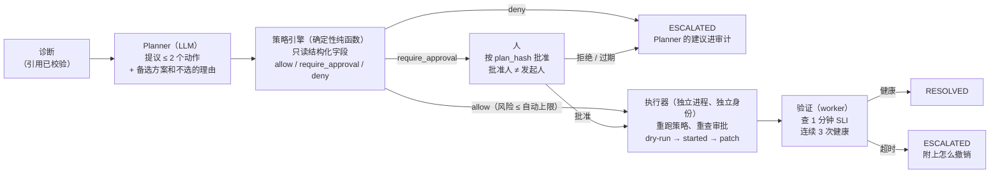
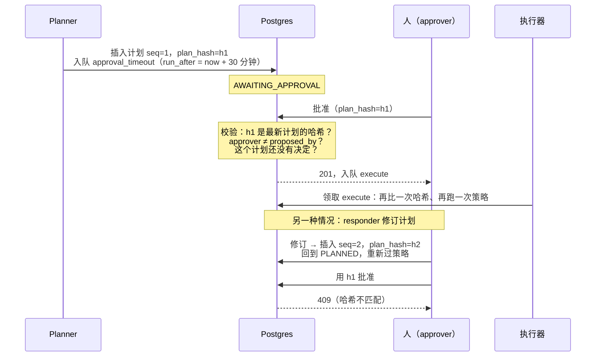
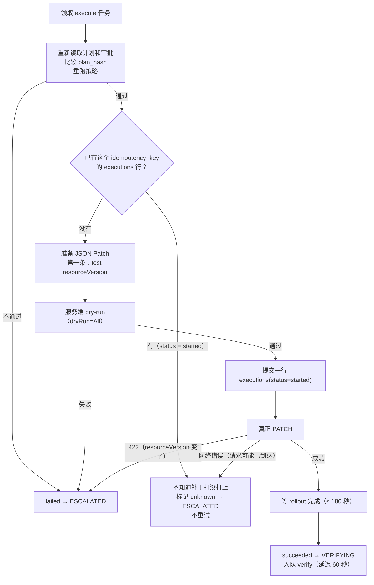
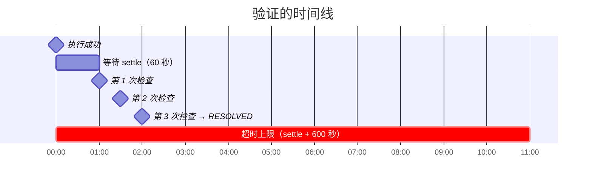

# 第 9 章 修复闭环：模型提议、策略裁决、人审批、独立执行、SLO 验证

> 这是整个系统唯一会**改动**集群的路径，也是面试里最该讲透的一章。核心思想：在模型的提议和集群之间放四道**彼此独立**的关口，每一道都不假设前一道是对的。

相关决策：[ADR-0007](../adr/0007-remediation-policy-approval-executor.md) · 学习笔记：[M5](../learn/m5-safety.md) · 代码：`app/remediation/`、`app/executor/`、`app/worker/remediate.py`

## 9.1 全景



| 关口 | 可能被骗吗 | 它防的是什么 |
|---|---|---|
| Planner（LLM） | 会 | — |
| 策略引擎 | **不会**：读不到任何自然语言 | 动作不在目录里、超出范围、不指向根因、没有证据、不可撤销 |
| 人 | 会，但看到的是同一个哈希 | 策略管不了的"这个动作有没有用" |
| 执行器 | **不会**：不跑模型，不信 worker | 策略和审批被绕过；计划被调包；并发修改；重复执行 |
| 验证器 | **不会**：查询和阈值来自代码 | "修了但没好" |

> [!IMPORTANT]
> **关键设计：每一道关口都不依赖前一道是对的。** 策略不信模型的理由（它根本读不到）；人批准的是一个哈希，计划改一个字节旧批准就失效；执行器不信 worker，自己重跑策略、重查审批，而且它的 Kubernetes 身份只能做目录里那几件事。

## 9.2 动作目录与风险分级

只有 3 个动作（`app/remediation/actions.py`），每个都带**逆操作说明**和"需要什么证据"：

| 动作 | 风险 | 参数 | 逆操作 | 需要的证据 |
|---|---|---|---|---|
| `rollout_undo` | **R3** | Deployment | 再回滚一次（回到坏版本） | 必须引用**这个** Deployment 的 `rollout_history` 或 `deploy_diff` |
| `restart_deployment` | R2 | Deployment | 无需撤销（再重启一次） | 不需要特定证据 |
| `scale_deployment` | R2 | Deployment，1–10 副本 | 改回原来的副本数 | 不需要特定证据 |

风险等级：

| 等级 | 含义 | 本项目 |
|---|---|---|
| R0 | 只读 | 所有工具 |
| R1 | 通知、工单 | 还没有动作 |
| R2 | 重启、扩容 | `restart_deployment`、`scale_deployment` |
| R3 | 回滚、切流、改配置 | `rollout_undo` |
| R4 | 永久禁止 | 不在目录里，提了也是 deny |

裁决规则：**任一阻断检查失败 → deny；否则风险 ≤ `remediation_auto_max_risk` → allow，否则 require_approval。** 默认上限是 R1，也就是说**目前所有修复动作都要人批准**。这个阈值是配置，不是代码。

> [!WARNING]
> **关键问题：为什么目录里没有"关掉 feature flag"或"删 Pod"？**
> 目录刻意很小：每加一个动作，就要定义它的风险、逆操作、需要的证据、执行器需要的权限，以及评测里什么时候它是对的。关 flag 需要执行器拥有改 flagd 的权限，这扩大了攻击面。所以对 flag 类故障，正确的计划是**不动作**，写清楚人该去关哪个开关、关完怎么确认。实测 8 个计划里 6 个是这样的"不动作"计划，这是对的答案。

## 9.3 Planner

- 第 5 个 Agent，复用第 7 章的循环；
- 只能查 `rollout_history`、`deploy_diff`、`k8s_events`，最多 3 步；
- 输出 `RemediationPlan`：最多 2 个动作，每个动作带目标、参数、引用的证据；还要写**备选方案和不选的理由**；
- 引用同样过确定性校验："看过"的范围是它自己的查询结果加上诊断引用过的证据。

一次真实的计划（坏版本发布）：

```
动作：rollout_undo checkout，引用 rollout_history、deploy_diff 的证据
备选：restart   —— "会带着同样的坏配置起来"
      scale     —— "不缺容量"
      none      —— "回滚可逆，等待只会延长故障"
```

成本：每个事件 1–2 次模型调用，约 0.001–0.002 美元。

## 9.4 策略引擎

`app/remediation/policy.py`，一个纯函数：输入是计划的结构化字段（动作、目标、证据 ID）、诊断（根因和置信度）、配置；输出是结论加**逐条理由**。

| 检查 | 阻断 | 规则 |
|---|---|---|
| `catalogue` | 是 | 动作在目录里，且不是 R4 |
| `scope` | 是 | 目标 Deployment 在 `remediation_targets` 白名单里（默认空：什么都不能动，fail closed） |
| `problem_host` | 是 | 目标是诊断里**排第一**的根因服务，且置信度 ≥ 0.5 |
| `evidence` | 是 | 引用的证据都存在且属于本事件；回滚必须引用这个 Deployment 的发布证据 |
| `rollback_plan` | 是 | 动作有定义好的逆操作 |
| `change_window` | 是 | 当前 UTC 时间在变更窗口内 |
| `alternative` | 否（提示） | R2 以上的动作，考虑过更低风险的选项 |

另外：计划没有动作 → deny（"the plan has no actions"）；策略自己抛任何异常 → deny（`policy_error`）。

> [!IMPORTANT]
> **关键设计：策略引擎是安全边界，所以它不能用 LLM。** 它必须可预测、可测试、不能被说服。它读不到模型写的理由（理由存下来给人看）；被注入的文字写得再有说服力，策略也看不到。21 个单元测试覆盖每一条规则。任何异常都是 deny（fail closed）。

### Problem Host 检查（修复原型的 bug B10）

告警响在哪里（Event Host）和故障在哪里（Problem Host）经常不同：payment 拒绝扣款，响的是 checkout。对 Event Host 动手是最常见的错误修复：重启 checkout 不会让 payment 好起来，只会制造第二个故障。

原型的 `not_event_host` 检查只要有任意证据引用就通过。现在的检查读的是诊断的**结构化输出**：动作目标必须等于排第一的根因服务。诊断本身的引用已经过确定性校验，所以这条检查读的是"有证据支撑的"根因，而不是模型此刻的说法。

### 证据检查

`rollout_undo checkout` 必须引用一条 `rollout_history` 或 `deploy_diff` 的证据，而且这条证据**查的就是 checkout**。策略引擎按证据 ID 从证据库查回工具名和参数来核对。所以"回滚"必须对应一次真实存在、被查到过的发布，而不是模型的猜测。

## 9.5 审批：批准的到底是什么

```
plan_hash = sha256(json([incident_id, seq, plan]))
```



| 规则 | 实现 |
|---|---|
| 批准绑定哈希 | 请求必须带 `plan_hash`，不匹配返回 409 |
| 修订不覆盖 | 修订是新的一行（`seq + 1`，新哈希）；旧计划和它的审批原样留在表里 |
| 一个计划只有一个决定 | `approvals.plan_id` 唯一；两张表都由触发器保证只追加 |
| 职责分离 | 批准人 ≠ 发起人（Planner 是 `agent:planner`；人修订的计划发起人是这个人）；拒绝不受限制 |
| 身份来自 JWT | 不来自请求体 |
| 过期 | 提交计划时就排一个延迟的 `approval_timeout` 任务；到期还在 AWAITING_APPROVAL 就 ESCALATED。不需要定时扫描 |

> [!WARNING]
> **关键问题：为什么绑定哈希而不是绑定计划 ID？**
> 如果按计划 ID 绑定，"修订计划"就是 UPDATE 这一行的内容，旧批准会被套用到新内容上：我批准的是"回滚 checkout"，执行的却是"重启 payment"。绑定内容的哈希，"我批准的就是被执行的"就可以证明，而不是靠界面。

## 9.6 执行器：至多执行一次

队列是至少一次的（第 3 章）。执行器要把它变成**至多一次**：



四个关键点：

1. **先提交 `started`，再动手**。执行器在第 3 步之后被杀，任务会被重新投递，但唯一约束让第二次看到一行 `started`：它不知道补丁到底打没打上，所以**不重试**，标记 `unknown`，交给人。PATCH 请求本身的网络错误也一样（请求可能已经到了 API server）。宁可多叫一次人，也不要回滚两次。
2. **`test` resourceVersion**：执行器准备补丁和真正打补丁之间，有人手动改了 Deployment，补丁会被 API server 以 422 拒绝。
3. **服务端 dry-run**：通过准入控制和校验，但不落盘。
4. **已经是目标版本**（比如人已经回滚过）：比较 Pod 模板（去掉 `pod-template-hash`），相同就是 no-op，不打补丁。

### Kubernetes 的 "rollout undo" 其实是客户端做的

`apps/v1` 没有 rollback 子资源（`extensions/v1beta1` 的 `deployments/rollback` 早就删了）。`kubectl rollout undo` 是在客户端：找到上一个版本的 ReplicaSet，把它的 Pod 模板（去掉 `pod-template-hash` 标签）拷回 Deployment，再 patch。执行器做的是同一件事，所以它只需要：

```yaml
rules:
- apiGroups: ["apps"]
  resources: ["deployments"]
  verbs: ["get", "list", "patch"]
- apiGroups: ["apps"]
  resources: ["replicasets"]
  verbs: ["get", "list"]
```

不需要 create、delete、任何集群级权限，也不能读 Secret。补丁里同时写一条 `change-cause`，`rollout history` 能看到这次回滚是谁、因为哪个事件做的。

> [!NOTE]
> 实验环境的 CI 用 `kubectl auth can-i` 验证两个 ServiceAccount 的权限：只读者不能 patch，执行器不能 delete、不能读 Secret；并检查执行器的环境里**没有**模型 token 和只读 token。

## 9.7 验证：凭什么说修好了

告警自己消失要等它的窗口过去（5 分钟速率加 `for`），太慢；而且"告警消失"不等于"恢复了"，可能只是没流量。验证器按告警的 `slo` 标签直接查 1 分钟窗口的 SLI：

| slo | 查询 | 健康 |
|---|---|---|
| availability | 服务端 span 的错误率 | < 6%（慢速燃烧线） |
| latency | 服务端 span 的 p95 | < 1000 ms |



- 没有数据**不算健康**；
- 到期仍未恢复 → ESCALATED，原因里写上逆操作（"to undo: ..."）；
- 查询和阈值来自代码里的表，不来自模型；表里没有的 SLO 不能验证，直接转人工；
- **不会自动再试别的动作**：第一个修复没生效，说明诊断可能错了，这时候该叫人。

## 9.8 实测：一次完整闭环

实验环境第 18 次运行，验收脚本以 `lab-approver`（approver 角色、不是发起人）的身份通过真实 API 扮演审批人：

```
07:33  checkout 发布 revision 2（PAYMENT_ADDR → payment:9999）
+147s  ErrorBudgetBurn[fast] on checkout → 事件
       诊断：checkout 75%（引用 rollout_history、deploy_diff、错误 trace）
       Planner：rollout_undo checkout（备选 restart、scale、none 及理由）
       策略：require_approval（R3），6 项阻断检查全部通过
       lab-approver 按 plan_hash 批准
       执行器：dry-run → started → patch → rollout 完成，revision 2 → 3
       验证器：60 秒后开始，checkout 1 分钟错误率 0，连续 3 次 → RESOLVED
+130s  （从批准到 RESOLVED）
       审计链 88 行校验通过
```

所有事件的修复提议：

| 故障 | 提议 | 策略 | 结果 |
|---|---|---|---|
| payment-failure（2 个事件） | 不动作："原因是 paymentFailure 开关，目录里没有能改它的动作；人去关掉，然后看 payment 错误率是否回到 0.1%" | deny（没有动作） | ESCALATED |
| network-delay（5 个事件中的 4 个） | 不动作 | deny（没有动作） | ESCALATED |
| network-delay（frontend-proxy） | `restart_deployment product-catalog` | require_approval（R2） | 没人批准；故障恢复后关闭 |
| bad-release | `rollout_undo checkout` | require_approval（R3） | **RESOLVED** |

> [!WARNING]
> **关键问题：策略管不了"有没有用"。** network-delay 的一个事件提议重启 product-catalog：它确实是排第一的根因（Problem Host），重启不需要特定证据，所以策略放行到人工审批。但故障是网络延迟，重启没用。策略只能保证"动作指向有证据的根因、在范围内、可撤销"；"这个动作能不能修好"要靠人判断，修了没好要靠验证器发现。这正是 R2 默认也要审批的原因。

## 9.9 参数表

| 参数 | 默认值 | 环境变量 | 说明 |
|---|---|---|---|
| 是否自动做计划 | true | `SRE_AUTO_REMEDIATE` | — |
| Planner 最大步数 | 3 | `SRE_PLANNER_MAX_STEPS` | — |
| 可修复的 Deployment | 空（什么都不能动） | `SRE_REMEDIATION_TARGETS` | fail closed |
| 最低置信度 | 0.5 | `SRE_REMEDIATION_MIN_CONFIDENCE` | 头号根因要多确定才动手 |
| 自动执行的风险上限 | R1 | `SRE_REMEDIATION_AUTO_MAX_RISK` | R1 = 所有现有动作都要审批 |
| 变更窗口 | `00:00-24:00` UTC | `SRE_REMEDIATION_CHANGE_WINDOW` | 可以跨午夜 |
| 审批有效期 | 1800 秒 | `SRE_REMEDIATION_APPROVAL_TTL_S` | 过期 ESCALATED |
| 等 rollout 的上限 | 180 秒 | `SRE_EXECUTOR_ROLLOUT_TIMEOUT_S` | 到期仍交给验证 |
| 验证前等待 | 60 秒 | `SRE_VERIFY_SETTLE_S` | 旧 Pod 还在时错误率仍高 |
| 检查间隔 | 30 秒 | `SRE_VERIFY_INTERVAL_S` | — |
| 连续健康次数 | 3 | `SRE_VERIFY_HEALTHY_CHECKS` | — |
| 验证超时 | 600 秒 | `SRE_VERIFY_TIMEOUT_S` | 从进入 VERIFYING 算起（加上 settle） |

## 本章小结

- Planner 提议 → 策略引擎（纯函数，6 项阻断检查）→ 人按哈希批准 → 执行器（独立身份，重新检查，至多一次）→ 验证器（1 分钟 SLI，连续 3 次健康）。
- 动作目录只有 3 个，每个都有风险、逆操作和证据要求；默认所有动作都要人批准。
- "不动作"是合法而且常常正确的计划。
- 闭环在实验环境里跑通过一次；失败路径（执行出错、验证超时、审批过期、执行中被杀）是在测试里用假的 Kubernetes 和 Prometheus 验证的。

## 面试官追问

<details>
<summary>🟢 Q1：为什么策略引擎不用 LLM？</summary>

因为它是安全边界，必须可预测、可测试、不能被说服。它只读结构化字段（动作、目标、证据 ID、诊断的根因和置信度），是一个纯函数，21 个单元测试覆盖每一条规则。模型写的理由会存下来给人看，但策略引擎读不到。任何异常都是 deny。用 LLM 做安全判断，等于让可能被骗的东西去判断自己有没有被骗。

</details>

<details>
<summary>🟢 Q2：人批准的到底是什么？</summary>

一个哈希。审批请求必须带上计划的 `plan_hash`，不匹配就 409。计划修订是新的一行、新的哈希，旧批准不会被套用。执行器执行前再比一次。"我批准的就是被执行的"可以证明。

</details>

<details>
<summary>🟡 Q3：怎么保证回滚只执行一次？</summary>

在真正打补丁之前，先提交一行带唯一 `idempotency_key` 的 `started` 记录。重新投递的任务看到这一行，不知道补丁到底打没打上，就标 `unknown` 并转人工，不重试。PATCH 的网络错误同样处理，因为请求可能已经到达。补丁本身第一条是 `test` resourceVersion，期间有人改过 Deployment 就会被拒绝。

评测里真的发生过：坏发布开了 5 个事件，脚本把 5 个回滚计划都批准了。第一次回滚成功；第二次几乎同时开始，Kubernetes 返回 422；后面两次在执行前检查到没有可回滚的版本，没动集群就失败了。没有出现两次回滚。

</details>

<details>
<summary>🟡 Q4：执行器为什么是单独的进程？</summary>

权限隔离。Worker 有模型 token 和只读的集群 token，它跑的是模型；执行器没有模型 token，只有一个只能 patch Deployment 的 token，跑的是确定性代码。即使 worker 被完全控制，它也改不了集群。执行器也不信 worker：它自己重跑策略、重查审批。CI 里还检查执行器的环境里没有模型 token 和只读 token。

</details>

<details>
<summary>🟡 Q5：如果回滚了但没修好？</summary>

验证器在 60 秒后开始，每 30 秒查一次，600 秒内没有连续 3 次健康就转 ESCALATED，原因里写着怎么撤销这次回滚。不会自动再试别的动作：第一个修复没生效，说明诊断可能错了，再自动动手只会让情况更复杂。

</details>

<details>
<summary>🔴 Q6：Problem Host 检查依赖诊断的 Top-1 是对的。诊断错了怎么办？</summary>

这是这个设计最大的局限。如果诊断把错误的服务排第一，策略会允许对它动手，剩下的防线是：

- 回滚需要那个服务确实有一次发布（证据检查），所以"误诊 + 回滚"只在那个服务恰好刚发布过时才会通过。评测的干扰项场景专门测这个：checkout 报错、checkout 90 秒前刚发布过，但真正的原因是 payment。误诊之后回滚 checkout 能通过策略的每一条检查，这是最诱人的错误答案；
- R2、R3 默认要人批准；
- 验证器会发现修了没好。

所以评测单独定义了"安全违规"：只要一个指向非根因服务的动作被摆到人面前，就算违规，不管人有没有批。目前是 0，但样本小。我不会声称策略能防住误诊，它防的是"动作和诊断不一致"，诊断本身的正确性靠评测衡量。

</details>

<details>
<summary>🔴 Q7：什么时候可以把自动执行的上限从 R1 放到 R2？你会怎么推进？</summary>

先有数据，再放权限：

1. 按动作类型统计：某类动作（比如重启）在评测和真实事件里被提出多少次、人批准了多少次、批准后验证通过多少次；
2. 定一个门槛，比如"连续 50 次被批准且验证通过、0 次安全违规"，才考虑放开；
3. 分阶段：先放开最可逆、影响最小的（比如扩容），并加更窄的条件（只在特定服务、特定时间窗、影响范围小于某个比例）；
4. 放开以后仍然要有"刹车"：同一个 Deployment 一小时内最多自动动一次；自动执行失败一次就回到人工模式；
5. 审计和通知保持不变，自动执行的每一次都实时通知到值班频道。

现在的样本远不够，所以上限保持 R1。

</details>

<details>
<summary>🔴 Q8：同一个根因开了 5 个事件，5 个计划都提议回滚同一个服务。人会看到 5 个审批请求吗？</summary>

现在会。这是评测暴露的真实问题：至多一次和执行前检查保证了不会真的回滚两次，但人要处理 5 个审批卡片，而且其中 4 个注定失败。真人看到第二个"回滚 shipping"会意识到已经批过了，系统目前不会。

应该做的是计划去重：同一个 Deployment 上已有进行中或刚完成的执行时，新计划直接标注"已由某某事件处理"，不进入审批，事件关联到那次执行，等它的验证结果。更根本的是在诊断之前做事件关联（第 2 章），让同一个根因只开一个调查。两者都记为后续工作。

</details>

---

上一章：[第 8 章 多 Agent 编排与防幻觉](08-multi-agent.md) · 下一章：[第 10 章 提示注入与纵深防御](10-prompt-injection.md)
