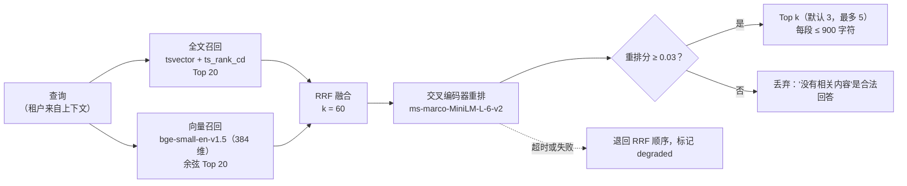

# 第 11 章 知识库：Postgres 里的混合检索

> 让 Agent 能查运行手册和复盘，并且"查得准不准"有能复现的数字。本章讲一条完整的检索流水线（全文 + 向量召回、RRF 融合、交叉编码器重排、阈值拒答），检索评测集怎样构建才不自证，以及一个关键的规则：知识库的内容不能单独作为结论。

相关决策：[ADR-0010](../adr/0010-knowledge-base-hybrid-retrieval.md) · 学习笔记：[M6](../learn/m6-rag.md) · 代码：`app/kb/`、`app/tools/kb.py`

## 11.1 流水线



| 部分 | 选型 | 说明 |
|---|---|---|
| 语料 | 24 篇自写文档：18 篇运行手册、6 篇复盘 | 写的都是实验环境里真实存在的服务和真实的报错原文 |
| 存储 | `kb_documents`、`kb_chunks`（生成列 `tsvector` + `vector(384)`） | 按租户；入库幂等（按内容哈希） |
| 切块 | 按 `##`/`###` 小节切；超长小节在段落边界再切，带 80 token 重叠，代码块不切开 | 两套参数做消融（11.4） |
| 嵌入 | bge-small-en-v1.5（33M 参数），fastembed/ONNX，纯 CPU | 嵌入一个查询几毫秒 |
| 重排 | ms-marco-MiniLM-L-6-v2（22M 参数） | 重排 20 个候选约 0.7 秒 |
| 租户隔离 | 两条检索 SQL 的 WHERE 里都有 `tenant_id = :tenant` | 没有不带租户的检索函数，空租户直接报错 |

## 11.2 三个核心概念

### BM25 与 `ts_rank_cd`

BM25 给一个词打分看三样东西：词频（会饱和）、文档长度归一化、**IDF**（这个词在整个语料里有多稀有）。"payment" 出现在一半的文档里，几乎不提供信息；"9999" 只出现在一篇里，命中就很说明问题。

Postgres 的 `ts_rank_cd` 只看词频和词之间的距离（cover density），**没有 IDF**。所以这里的"BM25"只是沿用名字，实际是一个没有 IDF 的近似。评测把代价量出来了：在精确标识符的查询上，它的 hit@1 反而比向量检索低 20 个点（错误原文里全是 failed、request、connection 这类常见词）。真 BM25 的升级路径是 ParadeDB 的 `pg_search` 扩展。

另一个细节：`plainto_tsquery` 会把所有词 AND 起来，长查询几乎匹配不上任何块。所以这里把词 OR 起来，靠排序区分。

### 双塔与交叉编码器

| | 双塔（bi-encoder） | 交叉编码器（cross-encoder） |
|---|---|---|
| 怎么算 | 查询和文档各自编码成向量，比较余弦 | 把（查询, 文档）一起送进模型 |
| 速度 | 文档向量提前算好，快 | 每个候选都要跑一次模型，慢 |
| 精度 | 编码时互相看不见，分不清"payment 坏了"和"checkout 连不上 payment" | 每个词都能看到对方，准 |
| 用在 | 召回 | 重排 |

### RRF：只用名次融合

全文分数没有上界、随文档长度变化；余弦相似度在 [-1, 1] 之间，而且不同模型的分布完全不同。直接加权求和，就得先把两种分数校准到同一个尺度，而这个校准每换一次模型、每改一次语料都会失效。

**RRF**（Reciprocal Rank Fusion）只用名次：

```
score(块) = Σ  1 / (k + 它在每个列表里的名次)        k = 60
```

- 名次和分数的尺度无关，不用校准；
- k 越大曲线越平：两个列表里都排第 2 的块（1/62 + 1/62 ≈ 0.0323）胜过只在一个列表里排第 1 的块（1/61 ≈ 0.0164）。这正是"两路都认可"的意思；
- 代价：丢掉了分数里的"差距"信息，所以后面还要重排。

## 11.3 知识只能作背景

> [!IMPORTANT]
> **关键设计：知识库的结果不能单独支撑任何事实、推断或根因。** 运行手册说的是"这类故障通常怎样"，复盘说的是"上次发生了什么"，它们都不是这一次事件的测量。

复盘写的恰好是和评测场景同类的历史事件（`PM-2026-10-16-RED-HERRING` 讲的就是"发布是干扰项"）。如果允许只引用知识库，Agent 很容易得出"上次是 payment 开关，所以这次也是"。这和第 12 章被拦下的金丝雀犯的是同一类错：用一条看起来合理的先验代替证据。

所以引用校验（第 8 章）规定：fact、inference、根因候选如果**只**引用了 `kb_search`，被退回，仍然不改就丢弃。hypothesis 可以只靠运行手册，因为假设本来就不需要证据，它的作用是"值得去查"。工具摘要和提示里也写了"数据和运行手册冲突时，以数据为准"。

知识库只对 `rag` 变体开放（第 12 章），默认变体不用。

## 11.4 检索评测

### 评测集怎么构建才不自证

1. **先写查询，再跑检索**，写好以后不按结果改。改标注必须有文本上的理由，写进提交说明。
2. **按小节标注，不按块标注**。块的边界随切块参数变化，小节（`RB-PAYMENT#typical-failures`）不变；一个结果块只要包含任一相关小节就算命中。所以两种切块能用同一份标注评测。
3. **分类型**：精确标识符（20 条，BM25 的主场）、换说法的改写（16 条，向量的主场）、调查中会问的问题（18 条，混合型）、无答案的负例（8 条，用来校准阈值）。
4. **dev/test 拆分**：阈值只在 dev（奇数编号）上选，test（偶数编号）只报告。
5. **能复现**：报告只依赖语料、查询、模型和代码。CI 的 `retrieval` 任务用真模型在每个 PR 上重算，和提交的报告比较，对不上就失败。

### 结果（section 切块，54 条可回答的查询）

| 模式 | hit@1 | hit@3 | hit@5 | MRR | p50 延迟 |
|---|---|---|---|---|---|
| 全文（`ts_rank_cd`） | 0.556 | 0.778 | 0.889 | 0.693 | 2 ms |
| 向量 | 0.648 | 0.833 | 0.870 | 0.760 | 8 ms |
| 混合（RRF） | 0.722 | 0.907 | 0.926 | 0.815 | 10 ms |
| 混合 + 重排 | **0.741** | **0.926** | **0.981** | **0.841** | 667 ms |

按类型（hit@1 / hit@3）：

| 模式 | 精确标识符 | 改写 | 调查问题 |
|---|---|---|---|
| 全文 | 0.65 / 0.90 | 0.38 / 0.50 | 0.61 / 0.89 |
| 向量 | 0.85 / 0.95 | 0.44 / 0.75 | 0.61 / 0.78 |
| 混合 | 0.90 / 1.00 | 0.56 / 0.75 | 0.67 / 0.94 |
| 混合 + 重排 | 0.90 / 1.00 | 0.56 / 0.75 | 0.72 / 1.00 |

- **两路互补**：全文在改写上 hit@3 只有一半；向量在调查问题上最弱；混合在每一类上都不低于较好的一路。
- **每一级都比前一级好**：这是这条流水线存在的理由。

### 切块：参数是语料的函数

原设计的参数（target 450 / min 200 / max 700 / overlap 80）是为几千 token 的长文档设计的。这个语料平均约 300 token，每个小节都小于 200，被并进前一块，结果 24 篇文档切出 25 块，"按标题切块"名存实亡；其中 3 块还超过了嵌入模型的 512 wordpiece 上限。

| 切块 | 块数 | 混合 + 重排 hit@1 / hit@3 | 每条结果 token | 重排 p50 |
|---|---|---|---|---|
| original（几乎每篇一块） | 25 | 0.870 / 1.000 | ~324 | 1.5 s |
| section（每小节一块） | 108 | 0.741 / 0.926 | ~101 | 0.67 s |

original 的命中率更高，但**尺子不一样**：整篇块包含所有小节，命中天然更容易。它给 Agent 的上下文是 3.2 倍，重排慢 2.2 倍，有 3 块超过嵌入上限。所以默认用 section：k=3 时约 300 token 就能拿到答案。

### 阈值：拒答

> [!WARNING]
> **关键问题：第一版阈值选错了目标。** 一开始的目标是区分"首条结果相关"和"其他所有情况"，可回答但首条排错的查询被算进了"不该回答"，选出 0.998，清空了 63% 可回答的查询。这把**排序**（hit@1、MRR 衡量）和**拒答**（阈值决定）混在了一起。改成只区分"可回答"和"无答案"以后，阈值是 0.031。
>
> 但即使目标对了，MiniLM 也分不开两类：8 条无答案查询的最高分是 0.015，而有 4 条可回答的改写查询得分是 0.000。这个模型在 MS MARCO 网页问答上训练，词面重叠少时它不认为相关。在 test 上，阈值清空了全部 8 条无答案查询，也清空了 22% 可回答的查询（全是改写）。Agent 多半拿错误原文和具体现象去查，所以接受这个取舍，记下升级方向。

### 还没有的数字

`rag` 变体的代码、提示和引用规则都已就位，回放测试也通过了。但它在实验环境评测上的表现要用真实模型跑，会消耗订阅额度，还没有跑。**所以"知识库让诊断更准"目前没有证据。** 另外复盘写的是和评测场景同类的历史事件，即使提升了，也只回答"重复发生的故障"；要回答"没见过的故障"，需要每个场景去掉它自己的那篇复盘再测（留一法）。

## 11.5 参数表

| 参数 | 默认值 | 环境变量 | 说明 |
|---|---|---|---|
| 嵌入模型 | `BAAI/bge-small-en-v1.5` | `SRE_KB_EMBEDDER` | 测试用确定性替身 `hash` |
| 重排模型 | `Xenova/ms-marco-MiniLM-L-6-v2` | `SRE_KB_RERANKER` | 测试用 `overlap` |
| 阈值 | 0.03 | `SRE_KB_MIN_SCORE` | 在 dev 上选出 |
| 离线模式 | false | `SRE_KB_OFFLINE` | worker 镜像里预置权重，运行时不下载 |
| 召回各取 | 20 | 代码 | — |
| RRF k | 60 | 代码 | 原论文的经验值，没有调 |
| 返回条数 | 3（1–5） | `kb_search` 参数 | 每段 ≤ 900 字符 |
| 切块（section） | 每小节一块；超长小节带 80 token 重叠 | `app/kb/chunking.py` | 代码块不切开 |

## 本章小结

- 全文 Top 20 + 向量 Top 20 → RRF(k=60) → 交叉编码器重排 → 阈值；全部在 Postgres 和本地 CPU 上。
- 评测集先写后跑、按小节标注、分类型、dev/test 拆分、CI 用真模型重算。
- 结果：hit@1 0.741、hit@5 0.981、MRR 0.841；每一级都比前一级好。
- 知识只能作背景：只引用知识库的结论会被拒。`rag` 变体对诊断的效果还没测。

## 面试官追问

<details>
<summary>🟢 Q1：RRF 为什么能融合不同尺度的分数？k 为什么取 60？</summary>

它不用分数，只用名次：每个列表贡献 `1/(k + 名次)`。全文分数没有上界、随长度变化，余弦相似度的分布随模型变化，直接加权就得先校准，校准每换一次模型就失效。k 越大曲线越平，一个列表里的第 1 名越难压过两个列表都靠前的块。60 是原论文在多个数据集上的经验值，我没有调：调它需要单独的验证集，这个规模下收益不大。代价是丢掉了分数的差距信息，所以后面接重排。

</details>

<details>
<summary>🟢 Q2：已经有混合召回了，为什么还要重排？</summary>

召回的目标是不漏，重排的目标是排准。双塔的查询和文档在编码时互相看不见，全文只看词面；交叉编码器把两者一起读，能分辨"讲这个问题"和"提到了这个词"。重排把 hit@5 从 0.926 提到 0.981，调查类问题的 hit@3 从 0.94 提到 1.00。它还提供一个能设阈值的分数，让"没有相关内容"成为合法回答。代价是约 0.7 秒，相对 Agent 一步十几秒的模型调用可以接受；超时或失败时退回 RRF 的顺序并标记 degraded。

</details>

<details>
<summary>🟡 Q3：为什么知识库的引用不能单独作为结论？</summary>

运行手册和复盘说的是"通常怎样"和"上次怎样"，不是这一次的测量。复盘越像这次的故障，越容易被照搬成结论，这和金丝雀犯的是同一类错：用先验代替证据。所以 fact、inference、根因候选至少要有一条实时证据；hypothesis 可以只靠运行手册，它本来就是"值得去查"的意思。

</details>

<details>
<summary>🟡 Q4：为什么用 pgvector 而不是专门的向量库？</summary>

已经有 Postgres，镜像里已经带了 pgvector。知识库和业务数据同库：租户过滤、事务（换文档时块的替换是原子的）、备份、迁移都是一套。规模是每租户 108 块，精确扫描几毫秒，连 ANN 索引都不需要。专门的向量库在千万级向量、复杂过滤时才有优势，代价是多一个有状态服务、多一套隔离和备份。

</details>

<details>
<summary>🟡 Q5：评测集是你自己写的，怎么防止它自证？</summary>

几条规则：查询在跑任何检索之前写好，之后不按结果改；按小节标注，改切块不会让标注失效；阈值只在 dev 上选，test 只报告；报告完全由语料、查询、模型和代码决定，CI 用真模型重算并比较。

剩下的偏差我也写明了：语料和查询是同一个人写的，措辞会相近，数字可能偏乐观。真正的解决办法是让不写文档的人来写查询，或者用真实值班时的搜索日志。

</details>

<details>
<summary>🔴 Q6：HNSW 加租户过滤有什么坑？</summary>

HNSW 是近似搜索，按图游走找 `ef_search` 个候选（默认 40），然后才应用 WHERE。如果目标租户只占 1%，40 个候选里可能一个都不属于它，返回结果不足 k 条甚至为空，而且不报错。解决办法：pgvector 0.8 的 iterative scan（不够就继续游走）、按租户分区或建部分索引、调大 `ef_search`。现在的规模用精确扫描，没有这个问题，ADR 里写了到什么规模再加索引、加的时候注意什么。

</details>

<details>
<summary>🔴 Q7：如果知识库变成一万篇文档，你会改什么？</summary>

- 入库改成增量的后台任务，按文档哈希判断要不要重做（现在已经幂等），嵌入批量做；
- 加 HNSW 带 iterative scan，或按租户分区；
- 全文换成 `pg_search`（真 BM25）或外部引擎；
- 文档要有 owner、过期时间和版本：过期的运行手册比没有更危险，检索时降权或者在结果里标出来；
- 评测集要扩，由不写文档的人来写查询；
- 检索质量进可观测性：Agent 引用了哪些块（线上命中率的代理）、"无相关内容"的比例、重排延迟。

</details>

<details>
<summary>🔴 Q8：你的检索评测很好，但你没测 RAG 对诊断有没有帮助。这不是本末倒置吗？</summary>

是一个合理的批评。检索质量是 RAG 有用的必要条件，不是充分条件：检索得准，Agent 也可能不用、用错，或者被先验带偏。我先做检索评测，是因为它可以用本地模型、不花订阅额度、在 CI 里每次重算；诊断层面的评测要用真实模型在实验环境里跑，每次几百万 token。

所以我在文档里明确写了"`rag` 变体对诊断的效果没有测"，而不是用检索的数字暗示诊断会变好。要测的话，设计是：`rag` 和 `default` 在同一批故障上并排跑（第 12 章的方法），再加留一法排除"复盘就是答案"的情况。

</details>

---

上一章：[第 10 章 提示注入与纵深防御](10-prompt-injection.md) · 下一章：[第 12 章 评测体系](12-evaluation.md)
