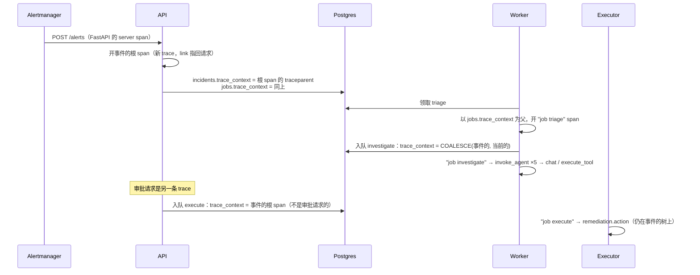
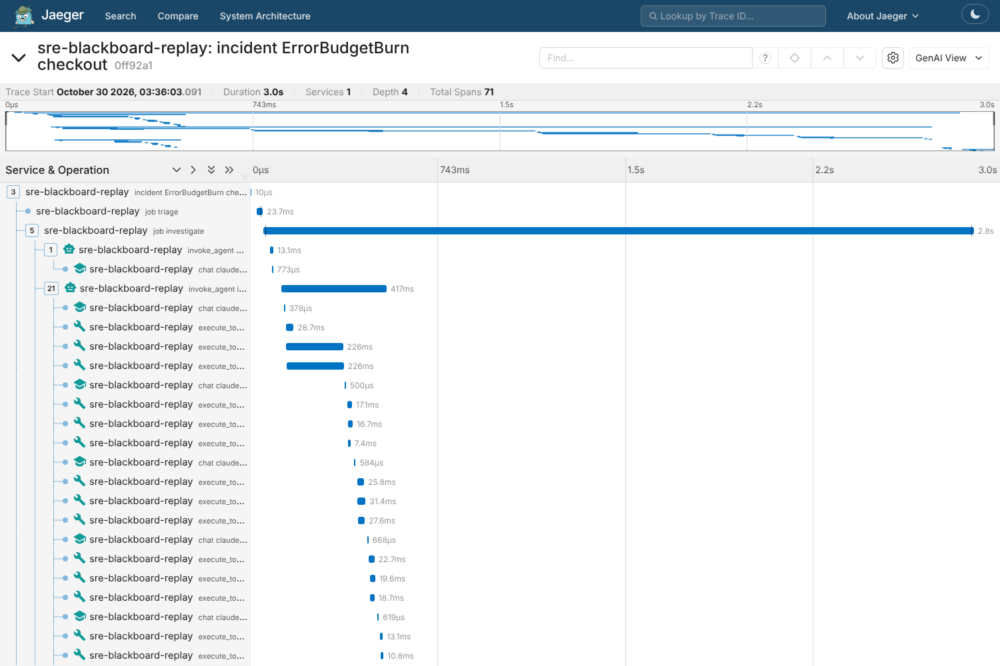

# 第 13 章 系统自身的可观测性

> 一个处理事故的系统，自己也会出事故：调查慢了、队列堵了、worker 全挂了、额度在被快速烧掉。本章讲怎样让系统说清自己的状况：一个事件一棵 trace，跨越 API、worker 和执行器；遵循 OpenTelemetry GenAI 语义约定；指标的标签都有界；自身的告警只发给人。

相关决策：[ADR-0011](../adr/0011-system-observability.md) · 学习笔记：[M8](../learn/m8-observability.md) · 代码：`app/obs/`、`deploy/observability/`

## 13.1 三种信号各答什么问题

| 信号 | 回答 | 特点 |
|---|---|---|
| 指标 | 有没有问题、多严重 | 便宜、能聚合、能告警，只能按有限的标签切 |
| trace | 这一次慢在哪里 | 保留因果结构，量大，不适合直接告警 |
| 日志 | 那一刻具体发生了什么 | 最细，要靠 trace id 才能和别的信号串起来 |

三者靠 ID 连起来：日志行带 `trace=<id>`；直方图的 exemplar 带 trace id；`chat` span 带请求哈希，可以对回 `llm_calls` 表里的完整提示和回答。

## 13.2 一个事件一棵 trace

进程之间没有 HTTP，只有 Postgres 里的队列。所以把 W3C `traceparent` **当作数据**存进行里：



这和消息队列的做法一样：Kafka 把它放在消息头里，这里放在任务行的一列里。

> [!IMPORTANT]
> **关键设计：事件的所有任务都挂在事件的根 span 下。** 包括由审批请求入队的执行任务：入队时用 `COALESCE(事件的上下文, 当前 span)`。否则同一个事件的执行和验证会出现在审批请求的 trace 里，"一个事件一棵树"就不成立了。
>
> 为什么每个事件开**新的** trace，而不是挂在 webhook 请求下面：一个请求可能带几十条告警、开出好几个事件；事件活几分钟到几小时，请求只有几毫秒。挂在请求下面，一批事件会挤在同一条 trace 里。所以用 **link** 指回请求：两边都能找到对方，但不是父子关系。

一次回放的 bad-release 调查在 Jaeger 里是一棵 71 个 span 的树：



```
incident（1） → job（3） → invoke_agent（6） → chat（21）
                                              → execute_tool（39）
                         → policy.evaluate（1）
```

（图里的时长是回放的时长，模型和工具都从录音里取，不是真实耗时。）

### GenAI 语义约定

OpenTelemetry 为大模型应用定义的属性（目前是 development 状态），遵循它，Jaeger 等工具就能看懂：

| span | 属性 |
|---|---|
| `invoke_agent` | `gen_ai.agent.name`、模型、提示词版本、步数、工具调用次数、改写次数、丢弃的发现、token |
| `chat` | `gen_ai.request.model`、`gen_ai.usage.*`、缓存读写、时延、重试次数、`sre.llm.request_hash`、`sre.llm.final` |
| `execute_tool` | `gen_ai.tool.name`、参数（PromQL、LogQL）、证据 id、错误码 |

细节：约定里的 `input_tokens` 包含缓存命中的部分；本系统的 `Usage.input_tokens` 是未缓存的部分，所以 span 上写三者之和，缓存读写另外记录。

> [!WARNING]
> **关键问题：trace 里为什么不记提示词和回答？** 量大（一步就是几万 token 的上下文），而且可能包含日志里的敏感数据。它们已经在 `llm_calls` 表里，用请求哈希关联。工具参数记了：排查时最先要看的就是 Agent 问了什么，而且参数里没有密钥。

## 13.3 指标

| 类别 | 例子 |
|---|---|
| 事件 | 收到的告警（opened / merged）、打开的事件（按优先级）、阶段耗时（告警到诊断、诊断到计划…） |
| 队列 | 任务数（按 kind、结局）、排队等待时间、**队列深度、最老的可运行任务**（数据库现查） |
| 模型 | 调用数、token、时延、错误（按错误码） |
| Agent / 工具 | 步数、工具调用（按工具名、错误码）、熔断状态 |
| 修复 | 策略结论、审批、执行结局、验证结局 |
| HTTP | 按路由模板计数 |

几条规则：

- **标签只用有界集合**：任务种类、状态、优先级、Agent 角色、工具名、模型、错误码。租户、事件 ID、服务名不作标签，它们会让序列数随数据增长；按单个事件看问题本来就该用 trace。**模型编出来的工具名统一记成 `unknown`**，否则模型编一个名字就多一条序列。
- **分桶要包含阈值**：P0 的目标是 120 秒，所以阶段耗时的分桶里一定有 120，"2 分钟内的比例"才能精确计算，而不是靠插值。测试里断言了这一点。
- **"此刻"的数据从数据库读**：队列深度、最老的未诊断事件，由 API 在被抓取时现查。如果让 worker 上报，多个 worker 报同一个数要去重，而且 **worker 全挂的时候这些数字也跟着消失**，而那恰恰是最需要它们的时候。每个优先级都输出（没有就是 0），告警规则不会因为序列不存在而静默。
- **事务回滚的观测要丢掉**：状态转换里如果直接计数，事务回滚（版本冲突、租约丢失）后计数已经加上了。做法是把观测挂在连接上，引擎的 commit 事件触发时才执行，rollback 时丢弃。
- **多进程**：uvicorn 多进程时用 prometheus_client 的 multiprocess 模式（mmap 文件，抓取时加总）。

## 13.4 告警：只发给人

11 条规则（`deploy/observability/rules/`，都有 promtool 单元测试）：

| 规则 | 级别 | 含义 |
|---|---|---|
| `P0DiagnosisLate` | page | 此刻有一个 P0 超过 2 分钟还没诊断 |
| `P0DiagnosisObjectiveMissed` | ticket | 最近一小时 2 分钟内诊断的比例低于 90%（升级算未达标） |
| `QueueBacklog` | — | 可运行的任务在积压 |
| `JobsDeadLettered` | — | 15 分钟内有任务进了死信 |
| `NoWorkers` | — | 没有 worker 在领取 |
| `StateUnreadable` | — | API 读不了数据库状态 |
| `ModelErrors` | — | 模型调用错误率高 |
| `ToolBackendFailing` | — | 某个观测后端持续失败 |
| `TokenSpendHigh` | — | token 消耗速度异常 |
| `ApprovalWaiting` | — | 有计划在等审批 |
| `sre:p0_diagnosed_within_2m:ratio_1h` | 记录规则 | 给 ticket 告警用 |

**同一个 SLO 分成两条**：page 盯"此刻"（单个事件，人手接管还来得及）；ticket 盯"整体"（系统需要改进，但不用半夜叫醒人）。实验环境的请求 SLI 用的是多窗口燃烧率（第 5 章），这里不用，因为事件是低频的，一小时可能只有几个 P0，燃烧率很不稳定。

> [!IMPORTANT]
> **关键设计：系统自己的告警不能发给系统自己。** 系统挂了，就处理不了关于自己的告警；系统没挂，就会花模型额度调查自己；调查过程中的报错还可能触发新的告警，形成循环。实验环境里还要防一个**间接的循环**：Demo 的 collector 会把每个 span 变成 span 指标，实验环境的 SLO 告警按服务名统计。如果本系统的 trace 经过那个 collector，本系统的报错会变成 `service_name="sre-blackboard-worker"` 的错误率 → 触发告警 → Alertmanager 发给本系统 → 本系统调查自己。所以本系统的 trace 直接发给 Jaeger，不经过 collector。

## 13.5 验收：CI 里不调用模型

`scripts/obs_check.py` 在 CI 的 `e2e` 任务里：

```
ok    targets up: sre-api, 2 sre-worker
ok    sum(sre_alerts_received_total) = 2000
ok    sum(sre_alerts_received_total{result="opened"}) = 200
ok    sum(sre_jobs_total{kind="triage", outcome="done"}) = 200
ok    max(sre_queue_ready_oldest_seconds) = 0
ok    11 alert and recording rules loaded, all healthy
ok    every dashboard query evaluates (39)
ok    trace c27dc223…: ['sre-blackboard-api', 'sre-blackboard-worker'], incident root -> job triage
ok    replayed trace 0ff92a1e…: 71 spans {'incident': 1, 'job': 3, 'chat': 21, 'invoke_agent': 6, 'execute_tool': 39, 'policy.evaluate': 1}
```

1. 复用负载测试（2000 条告警、200 个事件），在真实的 Prometheus 里对账；
2. 每条告警规则和面板查询都在 Prometheus 上求值一遍：PromQL 写错会在这里失败，不会等到值班时才发现；
3. 检查 Jaeger 里有跨 API 和 worker 的 trace；
4. 回放一段评测录音：worker 的处理函数、Agent 循环、策略都真实运行，检查树的形状和 GenAI 属性。

开销：一个 span 约 37 µs，一次计数器加直方图约 4 µs；一个事件约 71 个 span，合计不到 3 ms。相比之下诊断要两三分钟。

> [!WARNING]
> **关键问题：真实模型的 trace 还没在实验环境里跑过。** 所以"166 秒花在哪里"（等模型、跑工具、等并发槽位）还没有被拆开看。这是优化诊断时间的第一步，需要花订阅额度，等确认后再跑。

## 13.6 参数表

| 参数 | 默认值 | 环境变量 | 说明 |
|---|---|---|---|
| OTLP 地址 | 空（不导出 trace） | `SRE_OTEL_ENDPOINT` | 例如 `http://jaeger:4318` |
| 指标端口 | 9464 | `SRE_METRICS_PORT` | worker 和执行器；API 在 `/metrics`；端口被占只记警告 |
| 仪表盘 | 6 组 34 个面板 | `scripts/dashboard.py` 生成 | — |

## 本章小结

- traceparent 存进事件行和任务行，一个事件一棵 trace，跨 API、worker、执行器；webhook 请求用 link 关联。
- GenAI 语义约定；trace 不记提示词和回答，用请求哈希关联。
- 指标标签有界；分桶包含阈值；"此刻"的数据由 API 从数据库现查；事务回滚的观测丢弃。
- 自身告警只发给人；防止通过 span 指标形成间接的自我调查循环。

## 面试官追问

<details>
<summary>🟢 Q1：一次事件横跨三个进程，进程之间只有 Postgres 队列，怎么做成一条 trace？</summary>

把 W3C traceparent 当数据存起来：开事件时创建根 span，把 traceparent 写进事件行；入队时任务行复制事件的 traceparent；领取任务的进程用它作父上下文开 `job <kind>` span。和消息队列在消息头里带 trace 上下文是同一个思路。CI 里检查 Jaeger 里同一条 trace 的根 span 来自 API、`job triage` 来自 worker。

</details>

<details>
<summary>🟢 Q2：队列深度为什么由 API 从数据库现查，而不是由 worker 上报？</summary>

真相在数据库里。worker 上报有两个问题：多个 worker 报的是同一个数；worker 全挂的时候这些数字也跟着消失，而"没有 worker、队列在涨"恰恰是最需要告警的时刻。由 API 现查，只要 API 和数据库在，数字就在。多个 API 副本报同一个数，查询时用 `max()`。

</details>

<details>
<summary>🟡 Q3：指标的标签怎么选？为什么不按租户或事件打标签？</summary>

只用取值有限的集合。租户、事件 ID、服务名会让序列数随数据增长，Prometheus 的内存和查询代价都和序列数成正比；而"按单个事件看问题"本来就该用 trace。模型输出的工具名不能直接当标签，否则模型编一个名字就多一条序列，所以统一记成 `unknown`。

</details>

<details>
<summary>🟡 Q4：事务回滚了，指标怎么办？</summary>

状态转换和事务里的其他写入要么一起提交，要么一起回滚。指标如果在转换函数里立即加上，回滚后就多算了一次。做法是把观测挂在连接上，引擎的 commit 事件触发时执行，rollback 或连接归还时丢弃。有一个坑：`Connection.info` 跟着连接池里的物理连接走，引擎没装钩子时观测会在连接上越积越多，所以要确认钩子装了，没装就立即执行。

</details>

<details>
<summary>🟡 Q5：P0 首次诊断不超过 2 分钟的告警怎么设计？</summary>

两条。page：此刻有 P0 超过 2 分钟还没诊断，数据来自数据库的 gauge，针对单个事件。ticket：最近一小时 2 分钟内诊断的比例低于 90%，用直方图 `le="120"` 的桶除以总数，升级算未达标。为了精确，120 必须是分桶边界。实测默认变体达不到（p50 166 秒），但目标不该迁就现状：它说明要么换单 Agent 变体，要么缩短调查。

</details>

<details>
<summary>🔴 Q6：系统自己的告警发给谁？为什么？</summary>

发给人，不发给系统自己。系统挂了就处理不了；没挂就会花额度调查自己；调查中的报错可能触发新的告警，形成循环。实验环境里还有一个间接循环：如果本系统的 span 经过 Demo 的 collector，会被变成 span 指标，进入按服务名统计的 SLO 告警，最后发回给本系统。所以本系统的 trace 直接发给 Jaeger。

</details>

<details>
<summary>🔴 Q7：怎么用 trace 调试一次"诊断错了"的调查？</summary>

1. 在 Jaeger 里按 `sre.incident.id` 找到这条 trace；
2. 看汇总者之前各个调查者的 `execute_tool` 参数：有没有查对服务、对时间窗；
3. 看哪个工具返回了错误码，有没有因为 `too_large` 被迫缩小查询；
4. 看哪一步 `chat` 的 `sre.llm.final` 为真，以及丢弃了几条发现；
5. 需要看模型原话时，用 `sre.llm.request_hash` 去 `llm_calls` 表里取。

最后用同一份录音在本地回放，改提示词或代码后对比。

</details>

<details>
<summary>🔴 Q8：事件量大了以后，trace 存储会成为问题吗？</summary>

会。一个事件约 71 个 span，量本身不大；但如果每天几万个事件，加上 HTTP 的 span，存储会增长很快。做法是**尾部采样**：在 collector 里等一条 trace 结束再决定保不保留，保留慢的（超过 SLO）、失败的（ESCALATED、有错误码）、和一定比例的正常 trace。头部采样（一开始就随机丢）不适合这里，因为最需要的恰恰是那些"后来才知道有问题"的 trace。

</details>

---

上一章：[第 12 章 评测体系](12-evaluation.md) · 下一章：[第 14 章 控制台](14-console.md)
