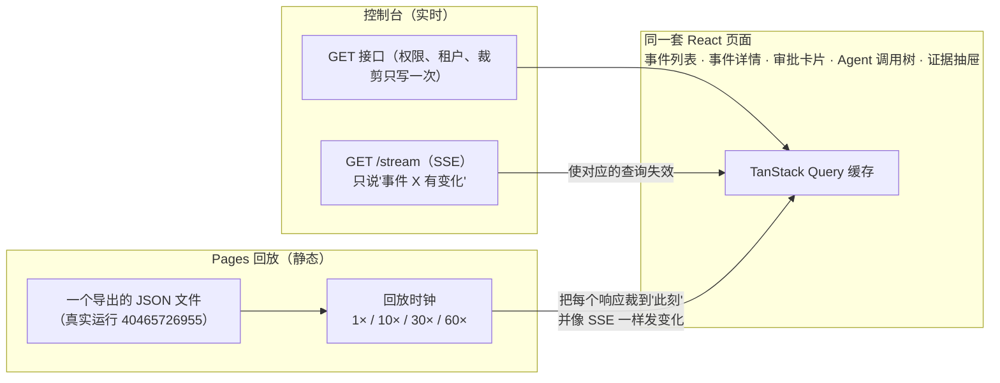

# 第 14 章 控制台：一套页面，两种数据源

> 值班的人通过控制台看事件、看证据、批准计划。同一套 React 页面还部署在 GitHub Pages 上，回放一次真实事件。本章讲：为什么用 SSE 推"变化"而不是推"状态"、审批这种敏感操作为什么也能乐观更新、以及"流畅"怎么用数字卡住。

相关决策：[ADR-0008](../adr/0008-console-sse-replay-design-tokens.md) · 学习笔记：[M9](../learn/m9-console.md) · 代码：`web/`、`app/api/stream.py`、`app/console/export.py`

## 14.1 一套页面，两种数据源

回放不是录屏：导出一个事件页面读到的全部 API 响应，回放时按时钟把每个响应裁到"此刻"（之前的审计行、Agent 步骤、计划、审批），并像 SSE 一样发变化事件。回放停在"等待审批"，访客扮演审批人点批准后继续。**页面代码和控制台完全一样**，所以回放本身就在测试增量更新这条路径。

## 14.2 SSE 推"变化"而不是推"状态"

| | SSE | WebSocket | 轮询 |
|---|---|---|---|
| 方向 | 服务器 → 浏览器 | 双向 | 浏览器拉 |
| 协议 | 普通 HTTP，`text/event-stream` | 升级为独立协议 | 普通 HTTP |
| 断线续传 | 标准自带：`id:` + `Last-Event-ID` + `retry:` | 自己实现 | — |
| 代理 | 友好（要关缓冲） | 需要支持 Upgrade | 友好 |

控制台只需要"服务器告诉我有变化"，SSE 正合适。

每条事件只说"事件 X 有一条新审计行"或"事件 X 的 investigator.metrics 走了一步"。页面收到后让对应的查询**失效**，由同一套 GET 接口重新取数据：

- 权限、租户隔离、字段裁剪只在 GET 接口里写一次；
- 页面只重新渲染变化的部分（Agent 走一步，只有调用树和诊断用量刷新）；
- 丢了一条事件也不怕，下一次失效会把最新状态取回来。

> [!WARNING]
> **关键问题：浏览器的 `EventSource` 不能设置请求头，而 API 只认 `Authorization: Bearer`。** 把 token 放进 URL 会进访问日志。所以用 `fetch` 读响应流，自己按规范解析（空行分隔事件、`data:` 多行拼接、`:` 开头是心跳注释、`id:` 记下来、`retry:` 改重连间隔），断线指数退避，带单元测试覆盖跨块拆分、多行 data、`\r\n`。

**不丢不重**：每条事件的 id 是一个游标（审计序号.模型调用 id.工具调用 id），表示"投递完这条之后从哪里继续"。重连时带上最后一个 id，服务器从那里往后查。服务器每 5 分钟主动断开一次，客户端按 `retry` 重连，避免空闲的代理在任意时刻掐断。

## 14.3 乐观更新：审批也可以

点"批准"时先改本地缓存（计划显示"已批准 · 发送中"，事件变成 EXECUTING），再发请求。成功就让缓存失效、取回真实状态；失败就把 `onMutate` 时保存的旧值放回去，显示服务器给的原因（计划被修订、过期、别人已经决定、自己不能批自己的计划）。

> [!IMPORTANT]
> **关键设计：安全性不依赖前端。** 审批请求带的是页面上那份计划的哈希；计划在你看的时候被修订了，服务器按哈希拒绝，页面回滚。服务器还检查角色和发起人，执行器执行前再查一遍。乐观更新只影响显示，而且"发送中"的状态是明确标出来的。

## 14.4 界面上的 Problem Host 与 Event Host

根因卡片上标 "problem host"（原因所在的服务）；如果它也是告警的服务，再标 "event host"；区块标题旁写明本事件的 event host。两者不同的典型情况是下游故障表现为上游的错误，修复必须指向 problem host，这和策略引擎的 `problem_host` 检查是同一个概念。审批卡片上列出 7 项策略检查的逐条理由、未选的方案和理由、计划哈希、过期倒计时。

## 14.5 "流畅"的数字

| 指标 | 要求 | 结果 |
|---|---|---|
| 首屏 JS（gzip） | < 200 KB | 111–157 KB（CI 的 `npm run budget` 卡住） |
| Lighthouse 性能 | ≥ 90 | 移动 91–94、桌面 100 |
| CLS | < 0.05 | 0–0.028 |
| INP | < 200 ms | CPU 4 倍降速下最慢 88 ms |
| 文字对比度 | ≥ 4.5:1 | 38 对组合 × 深浅两套主题，单元测试 |

手段：

- **动画只改 `transform` 和 `opacity`**（合成层，不触发布局）：进度条是 `scaleX`、抽屉是 `translateX`；尊重 `prefers-reduced-motion`；
- **整页一个骨架**：5 个查询各自返回时，后到的区块把先到的挤下去，CLS 0.226；改成核心查询全部到齐后一次替换，降到 0；
- **代码分割**：路由懒加载；图表库（约 93 KB gzip）在证据抽屉第一次打开时才加载；
- **虚拟列表**：只渲染可见的几十行；
- **设计 token**：颜色用 `light-dark()` 一个变量两套值，组件只用语义名；对比度用单元测试守住（深色主题的悬停色一开始只有 3.95:1，是测试抓出来的）。

## 本章小结

- 一套页面两种数据源：API + SSE，或一个导出的 JSON 加回放时钟。
- SSE 只推"变化"，页面失效查询，数据仍走 GET；用 `fetch` 读流以便带认证头；游标保证不丢不重。
- 审批乐观更新，安全性由服务器按哈希、角色、发起人保证。
- 流畅有数字：首屏预算进 CI、Lighthouse、CLS、INP、对比度测试。

## 面试官追问

🟢 Q1：为什么用 SSE 不用 WebSocket？

只需要服务器到浏览器一个方向；SSE 是普通 HTTP，断线续传是标准自带的，对代理友好。代价是浏览器的 `EventSource` 不能带认证头，所以用 `fetch` 读流、自己解析，一百来行，带单元测试。

🟡 Q2：推送完整状态和推送"变化通知"怎么选？

推变化。完整状态要在流里重做一遍权限、租户、裁剪；变化通知只让前端失效几个查询，数据仍然走已有的 GET 接口。丢一条通知也只是晚一点刷新。代价是多一次请求，对控制台的量级可以忽略。

🟡 Q3：审批这种敏感操作适合乐观更新吗？

适合，因为乐观更新只影响显示，不影响安全。服务器按计划哈希、角色、发起人检查，执行器执行前还会再查一遍。失败时恢复旧缓存并显示服务器的拒绝原因。"发送中"的状态明确标出来，人不会误以为已经执行了。

🔴 Q4：回放页面为什么不直接录屏？

录屏不能交互、不能点开证据、也证明不了页面真的能处理增量更新。导出 API 响应、按回放时钟裁剪，页面代码和控制台完全一样，回放本身就在测试增量更新这条路径。导出时原始结果超过 64 KB 的不放进去（保留摘要、大小和哈希），文件从 19 MB 降到约 330 KB。

🔴 Q5：CLS 0.226 是怎么查出来、怎么修的？

Lighthouse 的 layout-shifts 审计指出被挤动的是 Agent 区块。原因是 5 个查询分别返回，根因区块后到，插在 Agent 区块上面。新插入的元素本身不算偏移，被挤动的才算。改成整页一个骨架，全部到齐后一次替换，没有"被挤动"的元素，CLS 变为 0。

---

上一章：[第 13 章 系统自身的可观测性](13-observability.md) · 下一章：[第 15 章 走向真生产](15-production-gaps.md)
