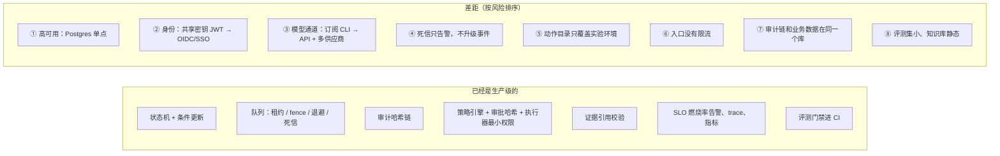
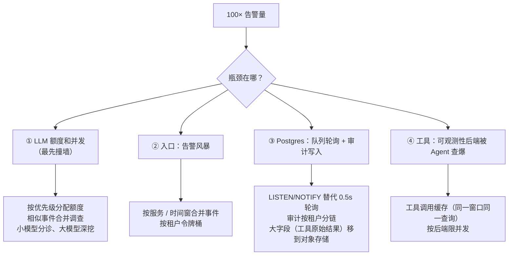
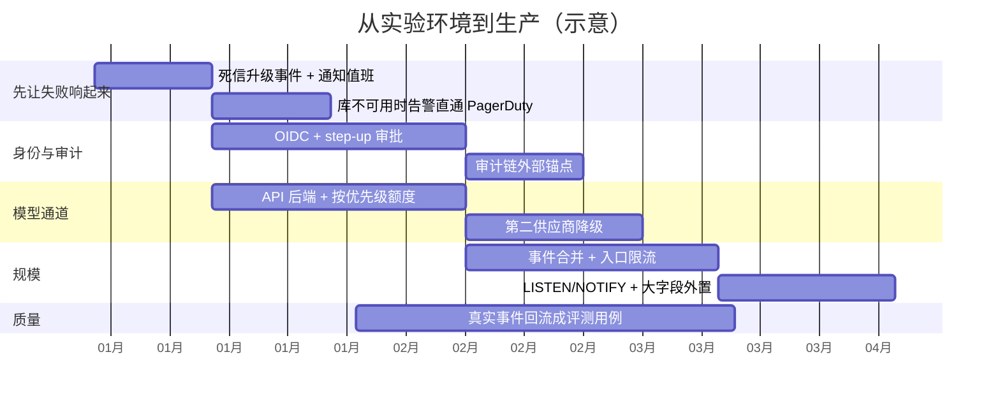

# 第 15 章 走向真生产

> 前 14 章讲的是"已经做了什么、为什么这样做"。本章反过来：**现在离一个真正上线、给几十个团队用的系统还差什么**。能清楚说出自己系统的边界，是面试里最能区分"做过"和"真想过"的地方。本章按三部分组织：差距清单、故障模式分析（FMEA）、扩展到 100 倍时先改哪里。

## 15.1 现在的系统是什么规模

| 维度 | 现状 | 依据 |
|---|---|---|
| 部署 | 单个 API、单个 Worker、单个 Executor、单个 Postgres | 第 1 章 |
| 集群 | kind 本地集群 + 实验环境（被调查的服务、Prometheus、Loki、Jaeger、Chaos Mesh） | 第 5 章 |
| 吞吐 | Worker 并发 4，其中 1 个槽位留给 P0；LLM 并发 2 | 第 3、7 章 |
| 模型 | 默认 haiku、`cli` 后端（订阅额度），每事件预算 1.5M token | 第 7 章 |
| 评测 | 固定的实验环境录音 + 少量真实模型用例 | 第 12 章 |
| 用户 | 共享密钥签发的 JWT，四个角色 | 第 4 章 |

> [!IMPORTANT]
> **关键设计：这些"单个"都是有意的。** 第 1 章的原则是先把**正确性**（状态机、租约、审计链、策略）做对，再谈规模。所有"单个"的组件都已经按"多实例也正确"的方式写了：队列用 `SKIP LOCKED` + 租约 + fence，审计链用 advisory lock 串行化，状态转换是带条件的 `UPDATE`。所以横向扩展是**加机器**，不是**重写**。

## 15.2 差距清单

| # | 差距 | 风险 | 生产上怎么补 |
|---|---|---|---|
| ① | Postgres 单点，没有副本和自动故障转移 | 库挂了整个系统停：告警收不进来，正在跑的调查全部停住 | 托管 Postgres（主从 + 自动切换）；**告警入口在库不可用时要有降级**：直接把告警转发给 PagerDuty，至少人能被叫醒 |
| ② | JWT 用 HS256 共享密钥签发，角色写在 token 里 | 密钥泄露等于全部角色泄露；没有离职回收 | 接公司的 OIDC，角色从组映射；审批这种动作要求近期重新认证（step-up） |
| ③ | `cli` 后端走订阅额度，限流是"额度用完"，恢复时间不可控 | 高峰期（恰恰是多个事件同时发生的时候）调查全部排队 | 走 API；按优先级分配额度（P0 永远有）；第二个供应商做降级；模型完全不可用时直接升级给人 |
| ④ | 任务进死信后只写审计、发 `JobsDeadLettered` 告警 | 一个事件的调查死了，事件本身仍停在 INVESTIGATING，值班的人可能以为 Agent 还在查 | 死信时把事件转为 ESCALATED，并通知值班人（第 3 章已标为改进点） |
| ⑤ | 动作目录只有回滚、扩容、重启这几种，作用域是实验命名空间 | 真生产的修复种类多得多 | 每加一种动作都要：结构化参数、风险等级、回滚方式、策略检查、执行器权限。**宁可目录小，也不要通用的"执行命令"** |
| ⑥ | 告警入口没有速率限制 | 告警风暴（或拿到 ingest token 的人）可以塞满队列，把真正的 P0 挤在后面 | 按指纹去重已经有（同一指纹只开一个事件）；再加按租户的令牌桶、按服务的事件合并 |
| ⑦ | 审计链的哈希存在同一个 Postgres 里 | 有库权限的人可以重算整条链 | 定期把链头哈希写到外部（对象存储的 WORM 桶、另一个系统），验证时对比外部锚点 |
| ⑧ | 评测用例是少量固定录音；知识库是仓库里的静态文档 | 换模型、改提示的回归覆盖面有限；运行手册过期没人知道 | 每个真实事件结束后，人工确认的根因自动变成新的评测用例；知识库文档带 owner 和过期时间 |

> [!WARNING]
> **关键问题：哪一个差距最先要补？** 不是性能，是 **④ 和 ①**。Agent 系统最危险的失败不是"答错"，而是**"安静地不工作"**：调查死了，界面还显示"调查中"，人以为有人在管。生产系统的第一原则是**失败要响**：任何一条路径失败，最终都要落到"一个人被通知"。

## 15.3 故障模式分析（FMEA）

按"哪里坏了 → 用户看到什么 → 系统怎么发现 → 怎么兜底"逐一过一遍。严重度 S、发生概率 O、可发现度 D 都是 1–5，RPN = S × O × D，越高越先处理（D 越高表示**越难**发现）。

| 组件 | 故障 | 影响 | 发现手段 | 现有兜底 | S | O | D | RPN |
|---|---|---|---|---|---|---|---|---|
| Worker | 进程崩溃 | 正在跑的任务中断 | 租约 30 秒过期 | 其他 Worker 回收重跑；fence 让旧 Worker 的写入失效 | 3 | 3 | 1 | 9 |
| Worker | 卡死但心跳还在 | 任务永远不结束 | 任务超时 1200 秒 | 超时后按失败处理，退避重试 | 3 | 2 | 2 | 12 |
| 队列 | 任务反复失败 | 5 次后进死信 | `JobsDeadLettered` 告警 | **事件不会自动升级**（差距 ④） | 4 | 2 | 3 | 24 |
| LLM | 额度用完 / 限流 | 调查停在中途 | `rate_limited` 错误码、LLM 错误率告警 | 整个任务按 `retry_after` 重试 | 4 | 4 | 2 | 32 |
| LLM | 模型返回格式错误 | 一步失败 | 解析错误计数 | 重试；超过步数上限就升级给人 | 2 | 3 | 1 | 6 |
| LLM | **模型自信地答错** | 错误诊断给到人 | 引用校验只能查"有没有引用"，查不了"推理对不对" | 置信度阈值 0.5；人审批；验证器发现没修好 | 4 | 3 | 4 | **48** |
| 工具 | Prometheus/Loki/Jaeger 不可用 | 某类证据缺失 | 熔断器（30 秒内 5 次失败） | 熔断后快速失败，调查者用其余证据；证据不够就升级 | 3 | 2 | 1 | 6 |
| 工具 | 返回的数据是错的（比如抓取延迟） | 基于过期数据推理 | 难 | 证据带时间戳，摘要写明查询窗口 | 3 | 2 | 4 | 24 |
| 策略 | 规则有 bug，放过了坏提议 | 坏提议摆到人面前（R2/R3）或自动执行（R0/R1） | 评测里的注入用例、策略单元测试 | R1 以上要人批；执行器再查一遍；动作可回滚 | 5 | 1 | 3 | 15 |
| 执行器 | 执行到一半断掉 | 修复状态不确定 | 执行记录停在 `started` | 每个动作一行记录（幂等键唯一），发补丁前先提交；重跑看到 `started` 就标 `unknown` 并升级给人，不再发第二次 | 4 | 1 | 2 | 8 |
| 验证器 | 指标在 settle 时间内还没恢复就判定失败 | 误判"没修好" | 验证记录 | 3 次检查、600 秒超时；失败后升级给人而不是再修 | 2 | 3 | 2 | 12 |
| Postgres | 不可用 | 全部停止 | 健康检查 | **无**（差距 ①） | 5 | 1 | 1 | 5 |
| 审计链 | 被篡改 | 事后追责失真 | `audit/verify` 接口 | 只能发现库外的篡改（差距 ⑦） | 4 | 1 | 4 | 16 |

> [!WARNING]
> **关键问题：RPN 最高的不是"挂了"，而是"自信地答错"。** 进程崩溃、工具超时都很容易发现，因为它们会报错。模型答错不会报错，它看起来和答对一模一样。这就是为什么整个系统围绕"不信任模型"来设计：引用校验保证每句话有出处、策略只读结构化字段、人按哈希审批、验证器用指标判断修好没有。**每一层都在把"难发现"的失败变成"容易发现"的失败。**

## 15.4 扩展到 100 倍：先改哪里

假设从"一个实验环境"变成"公司 50 个团队、每天几百个事件、告警风暴时一分钟上百条"。

**顺序和理由：**

1. **LLM 是第一个瓶颈**。一个事件 3 个调查者 × 最多 5 步，再加汇总者和 Planner，十几次模型调用。100 倍事件量下，额度和并发会先撞墙，而且恰好在最需要的时候（大面积故障时告警最多）。
   - 改法：**相似事件合并**（同一时间窗、同一服务的告警只调查一次，这比任何优化都有效）；分诊用小模型决定要不要深挖；额度按优先级预留，P0 永远有。
2. **入口要合并而不是只去重**。现在按指纹去重，同一条告警只开一个事件；但一次数据库故障会让 20 个服务各发一条不同指纹的告警。需要按依赖关系或时间窗合并成一个事件。
3. **Postgres 很晚才会成为瓶颈**。`SKIP LOCKED` 队列在每秒几百个任务以内都没问题。先做的是：0.5 秒轮询改 `LISTEN/NOTIFY` 唤醒（减少空查询）、工具原始结果这种大字段移到对象存储、审计链按租户分开（advisory lock 只锁本租户）。
4. **工具调用会把可观测性后端查爆**。几十个 Agent 同时查 Loki 是真实风险。同一时间窗、同一查询的结果缓存，按后端限制总并发。

> [!IMPORTANT]
> **关键设计：先测再改。** 第 13 章的指标已经能回答"瓶颈在哪"：队列等待时间（`sre_queue_wait_seconds`）、LLM 调用延迟和限流次数、工具调用延迟和熔断次数。扩展时先看这几个数字哪个先变坏，而不是凭感觉先拆微服务。

## 15.5 演进路线

先做的永远是"让失败响起来"，然后是身份和审计（安全），再是模型通道（可用性），最后才是规模。

## 本章小结

- 现在的"单个"都是有意的；代码已按多实例正确的方式写，扩展是加机器。
- 最该先补的差距：死信不升级事件、Postgres 单点——都是"安静地不工作"。
- FMEA 里 RPN 最高的是"模型自信地答错"，因为它最难发现；整个系统的设计都在把难发现的失败变成容易发现的。
- 100 倍时先撞墙的是 LLM 额度，最有效的改法是相似事件合并；Postgres 很晚才是瓶颈。

## 面试官追问

🟢 Q1：你这个系统现在能直接上生产吗？

不能直接上，但离得不远，而且差距是清楚的。核心的正确性部分（状态机、队列租约、审计链、策略和审批、引用校验）是按生产标准写的，也有测试和评测。差的是**运维层面**：Postgres 高可用、公司 SSO、模型走 API 而不是订阅、死信要升级事件、告警入口限流。我会先补死信升级和库不可用时的降级，因为这两个是"安静地不工作"。

🟡 Q2：为什么说"自信地答错"是最高风险？你怎么降低它？

因为它不报错。崩溃、超时、限流都有错误码和告警；模型答错时，输出的格式、语气和答对时一模一样。降低它靠的是把"推理"变成"可检查的东西"：

1. 每句事实必须引用证据 id，引用校验检查证据存在、引用的数字和原文一致；
2. 根因带置信度，低于 0.5 不出修复；
3. 修复由人按哈希批准，人看到的是证据而不是模型的说服；
4. 修复后验证器用指标判断有没有好转，没好转就升级给人。

还剩下的风险是"证据都对、推理错了"，这只能靠评测（第 12 章）持续衡量，并且让真实事件的人工结论回流成评测用例。

🟡 Q3：Worker 卡死但心跳还在跳，会怎样？

心跳是单独的协程，所以主逻辑卡死时心跳可能还在跳，租约不会过期。兜底是任务级超时 1200 秒：超时后任务按失败处理、按退避重试。fence 保证即使卡住的那个 Worker 之后"醒过来"，它的写入也会因为 fence 不匹配而失效。

更好的做法是让心跳也检查"主逻辑有没有进展"（比如最近一次 Agent 步骤的时间），没有进展就停止续约，让别的 Worker 更早接手。这是一个改进点。

🔴 Q4：告警风暴来了，一分钟 200 条告警，你的系统会怎样？

现在：按指纹去重，同一指纹只开一个事件；不同指纹的告警各开一个事件、各排一个调查任务。Worker 并发 4，LLM 并发 2，所以队列会迅速积压。P0 有预留槽位和排序优先（sort_key = 入队时间 + 优先级 × 60 秒），所以 P0 不会被 P3 饿死，但同为 P0 的事件之间会排队。

这时候 Agent 帮不上大忙，反而会消耗额度。正确的做法是：

1. **入口合并**：同一时间窗内、同一依赖链上的告警合并成一个事件（一次数据库故障不应该开 20 个事件）；
2. **风暴模式**：积压超过阈值时，新事件只做分诊（便宜），不做完整调查；
3. **直接升级**：大面积故障本来就需要人，Agent 的价值是给人整理证据，而不是排队等着自己去查。

🔴 Q5：如果要扩展到 50 个团队，Postgres 撑得住吗？你会拆服务吗？

撑得住很久。`SKIP LOCKED` 队列在每秒几百个任务的量级都没问题，而 50 个团队每天几百个事件，每个事件几十个任务，换算下来每秒不到 1 个。真正先撞墙的是 LLM 额度，然后是可观测性后端被 Agent 查爆。

我不会先拆服务。拆服务带来的是分布式事务：现在"状态转换 + 写审计 + 入队下一个任务"在一个事务里，拆了就要 outbox 或 saga。在数据库确实成为瓶颈之前，我会先做：轮询改 `LISTEN/NOTIFY`、工具原始结果移到对象存储、审计链按租户分开。判断依据是第 13 章的指标，而不是"微服务更先进"。

🔴 Q6：执行器执行到一半进程被杀了，重启后会重复执行吗？

不会。每个动作有一行执行记录，幂等键是 `plan:<计划 id>:action:<序号>`，唯一约束。执行器**先提交**一行 `started`，然后才向集群发补丁，成功后改成 `succeeded`。

重跑时：

- 看到 `succeeded`：这一步已经做完，跳过；
- 看到 `started`：上一次在"记录已写、补丁发没发出去不知道"的位置断了。这时**不再发第二次**，而是把记录标成 `unknown`，把事件升级给人："结果未知，请检查集群"。

为什么不自动重试？对基础设施的写操作，"再做一次"可能比"没做"更危险：回滚执行两次，会把坏版本之前的那个版本也回滚掉，等于把坏版本带回来。不确定的时候，让人看一眼比猜更安全。

可以进一步改进的是：对能读到结果的动作（比如回滚，看 Deployment 当前的 revision），自动判断补丁是否已经生效，减少需要人介入的次数。

---

上一章：[第 14 章 控制台](14-console.md) · 下一章：[第 16 章 面试作战手册](16-interview-playbook.md)
