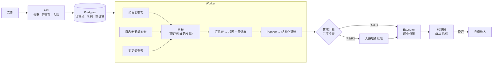
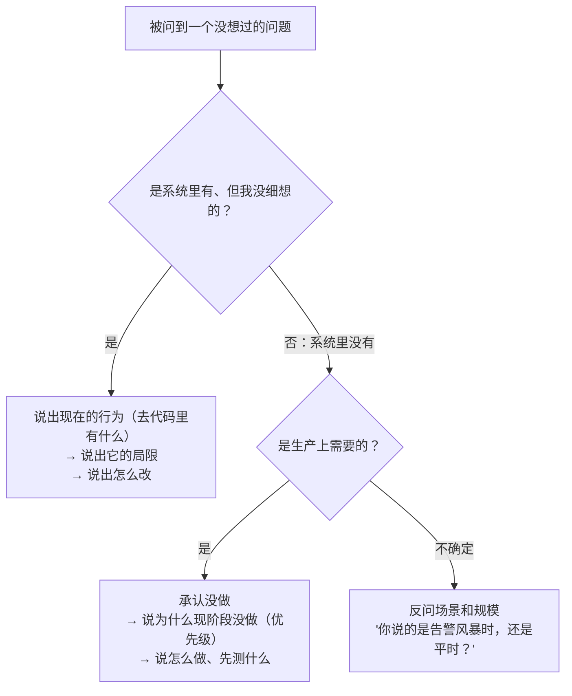

# 第 16 章 面试作战手册

> 前 15 章是"书"，这一章是"小抄"。内容分四部分：1 分钟和 5 分钟两种讲法；讲的时候画哪张图；高频追问 Top 30（每题一段能直接说出口的答案，并指向详细的章节）；被问住时怎么答。

## 16.1 1 分钟讲法

> 我做了一个 SRE 事件响应的多 Agent 系统。告警进来以后，三个调查 Agent 分别查指标、日志和链路、变更，每一条结论都必须引用它查到的证据，引用不对就丢掉；汇总 Agent 把发现合成一个带置信度的根因；Planner 从一个固定的动作目录里提修复方案，策略引擎按结构化字段审查，高风险的要人按计划哈希批准，执行器用最小权限执行，验证器用 SLO 指标判断修好没有。
>
> 设计上我最在意的是**不信任模型**：模型没有任何写工具，策略引擎读不到模型写的理由，所以即使被日志里的提示注入骗了，被骗的动作也通不过策略。整个系统跑在一个能注入故障的 kind 实验环境里，有评测闸门进 CI（还有一个必须被拦下的金丝雀），真实模型的根因准确率、注入动作通过策略的次数（必须为 0）都有数字。

**要点**：一句话说清楚做什么 → 一句话说清楚流程 → 一句话说清楚最核心的设计取舍 → 一句话说清楚"怎么证明它是对的"。

## 16.2 5 分钟讲法（带一张图）

先在白板上画这张图，边画边讲：

按五段讲，每段一分钟：

| 段 | 讲什么 | 抛出的"钩子"（引面试官追问你准备好的地方） |
|---|---|---|
| 1. 问题 | 值班的人半夜被叫醒，前 15 分钟都在翻仪表盘找证据。Agent 的价值是**把证据整理好**，而不是替人做决定 | "所以我的设计目标是每句话都有出处" |
| 2. 地基 | 4 个进程、一个 Postgres。状态机用带条件的 UPDATE；队列用 `SKIP LOCKED` + 租约 + fence；审计是哈希链 | "为什么不用 Kafka / Celery？" |
| 3. Agent | 3 个调查者并行、黑板、汇总者。证据 id、引用校验、每事件 token 预算、最多 5 步 | "引用校验具体查什么？" |
| 4. 安全 | 模型没有写工具；策略只读结构化字段；审批按哈希；执行器再查一遍；提示注入评测 | "注入了怎么办？" |
| 5. 证明 | 故障实验环境、评测门禁、可观测性（SLO 燃烧率）、真实模型的数字；以及现在还差什么 | "离生产还差什么？" |

> [!IMPORTANT]
> **关键技巧：主动讲局限。** 第 5 段最后主动说"现在离生产还差 Postgres 高可用、死信不升级事件、模型走订阅额度"（第 15 章）。这会让面试官相信前面说的都是真的，并且把话题引向你准备得最充分的地方。

## 16.3 高频追问 Top 30

按主题分组。每题的答案是**能直接说出口的长度**，细节见对应章节。

### 架构与地基

🟢 1. 为什么只用 Postgres，不用 Kafka/Redis/Celery？（第 2、3 章）

事件响应的核心需求是**正确性**：状态转换、审计、入队下一个任务要么一起成功、要么一起失败。都在一个 Postgres 里，就是一个事务；引入 Kafka 就要 outbox 和分布式一致性。量级上，`SKIP LOCKED` 队列在每秒几百个任务都没问题，而这个系统每秒不到 1 个。少一个组件就少一类故障。

🟡 2. SKIP LOCKED 队列怎么保证一个任务不被两个 Worker 同时执行？（第 3 章）

取任务时 `FOR UPDATE SKIP LOCKED` 加锁并写入租约（30 秒）和一个递增的 fence 值。Worker 每 10 秒续约。Worker 崩了，租约过期，别的 Worker 能取走，fence 加一。旧 Worker 如果"复活"，它所有写入都带着旧 fence，条件更新不匹配，写不进去。所以"同时执行"可能短暂发生，但只有一个能提交结果。

🟡 3. 重试为什么要带抖动？参数是多少？（第 3 章）

指数退避 2 秒起、上限 300 秒，在 [上限/2, 上限] 之间取随机值。不带抖动，一次依赖故障导致的一批失败会在同一时刻一起重试，再把依赖打挂一次（惊群）。最多 5 次，之后进死信，写审计、触发 `JobsDeadLettered` 告警。

🟡 4. P0 事件怎么不被一堆 P3 饿死？（第 3 章）

两个手段：排序键 = 入队时间 + 优先级 × 60 秒，所以 P0 相当于"提前 3 分钟入队"；并发 4 个槽位里预留 1 个只给 P0。前者让 P0 排在前面，后者保证即使所有普通槽位都被长任务占着，P0 也能立刻开始。

🔴 5. 审计哈希链怎么防并发写入把链写叉？（第 4 章）

每一行的哈希包含上一行的哈希。两个事务同时读到同一个"上一行"，就会写出两个分叉。所以写审计前先拿 `pg_advisory_xact_lock`，把同一条链的写入串行化，锁随事务结束释放。代价是审计写入串行，但审计写入很短，不是瓶颈。局限是：有库权限的人能重算整条链，要把链头定期锚定到外部（第 15 章）。

🟢 6. 状态机怎么防止非法转换？（第 2 章）

代码里有一张 `TRANSITIONS` 表，列出每个状态允许去的下一个状态；转换用带条件的 `UPDATE ... WHERE state = 期望的旧状态`，影响 0 行说明别人先改了，当前操作失败。数据库层面的 CHECK 约束保证状态值本身合法。两个 Worker 同时想推进同一个事件，只有一个会成功。

### Agent 设计

🟢 7. 为什么是多 Agent，不是一个 Agent 带所有工具？（第 8 章）

三个原因：(1) **上下文**：一个 Agent 查完指标、日志、链路、变更，上下文会被工具结果塞满，后面的推理质量下降；分开后每个只看自己那类证据。(2) **并行**：三个调查者同时查，延迟是最慢那个，不是总和。(3) **可评测**：每个调查者的输出能单独评。代价是汇总者要处理冲突的发现，以及总 token 更多。我用评测比较过单 Agent 和多 Agent 变体，而不是凭感觉。

🟡 8. 黑板模式是什么？为什么不让 Agent 互相发消息？（第 8 章）

调查者把发现写到黑板（数据库表）上，汇总者读黑板。Agent 之间不直接对话。好处：每条发现都持久化、可审计、可重放；调查者之间没有依赖，一个失败不影响别的；不会出现 Agent 之间"互相说服"的循环。代价是调查者看不到彼此的发现，不能"根据指标的发现去查对应的日志"，这是有意的取舍：独立的证据彼此印证才有价值。

🟡 9. 引用校验具体查什么？（第 6、8 章）

证据 id 是 `ev_` + 内容 sha256 的前 16 位，证据是不可变快照。校验是确定性的，不用另一个模型，五条规则：(1) id 存在且属于本事件；(2) 引用者**看过**它：调查者只能引用自己查询返回的 id，汇总者只能引用被接受的发现里引用过的 id；(3) 事实和推断至少引用一条，只有假设可以不引用；(4) 不能只引用知识库；(5) 类型匹配，比如 signal 是 logs 就必须引用一次 `logs_search`。不合格的退回重写一次，还不合格就丢弃那几条（不是整份作废），丢弃数进指标。它防的是"编造证据"，防不了"证据对、推理错"。

🟡 10. Agent 循环怎么停下来？（第 7 章）

几个上限：每个 Agent 最多 5 步，最后一步只能回答、不能再调工具；每步之前检查本事件已用的 token（含并行的兄弟 Agent），超过 150 万就 `BudgetExceeded`，事件直接 ESCALATED；每次模型调用超时 180 秒；整个任务超时 1200 秒。引用不合格最多重写 1 次。

🔴 11. 一个调查者失败了，其他的怎么办？（第 8 章）

分两种。只影响自己的失败（输出形状不对、引用全部被丢）：其他调查者照常，汇总者基于剩下的发现汇总；如果最后没有任何可支撑的发现，事件升级给人。影响全局的失败（限流、服务不可用、预算耗尽）：用 `TaskGroup` 而不是 `gather`，一个失败就取消兄弟 Agent，因为继续跑只会浪费额度。限流和服务不可用时整个任务交回队列按退避重试；预算耗尽不重试，直接升级。已经完成的调查者有检查点，重试时不会重跑。

🟡 12. 工具结果太大怎么办？（第 6 章）

每个工具返回给模型的是**摘要**，不是原始结果：整体上限 6000 字符，单个字符串截到 300 字符；原始结果存数据库（带哈希），证据 id 指向它。工具参数也有边界（比如链路查询最多 360 分钟、50 条，日志最多 1000 行）。这既控制 token，也减少一次能塞进来的注入文字。

🔴 13. 模型调用失败怎么分类处理？（第 7 章）

`LLMError` 带错误码和是否可重试：`rate_limited`（带恢复时间）、`overloaded`、`timeout`、`unavailable` 可重试，最多 3 次；`invalid_output`（没有结构化输出、空的一步）可重试，重问这一步；`auth`、`bad_request` 不重试；`replay_miss` 是回放时请求哈希对不上，明确报错，说明提示词变了。CLI 后端没有 HTTP 状态码，就从输出文本里匹配"rate limit / usage limit / quota"等识别限流，并解析恢复时间。限流不在 Agent 内部死等，而是整个任务交回队列按退避重试，释放 Worker 槽位。

🟡 14. 为什么默认用小模型（haiku）？（第 7、12 章）

成本和延迟。调查是"查证据 + 整理"，每一步都要重发整个对话，token 随步数近似平方增长，便宜的模型能让每事件的成本可控。模型可以按角色覆盖，比如只把协调者和汇总者换成 Sonnet（评测里的 `strong-plan` 变体），因为它们做的是综合判断。换模型必须过评测闸门。需要诚实说明：受额度限制，live 评测每个配置只跑了 1 次，所以"小模型够用"只是在实验场景上的初步结论。

### 修复与安全

🟢 15. 模型能直接改生产吗？（第 9 章）

不能。模型没有任何写工具，它最多输出一个结构化提议：动作（来自固定目录）、目标、证据 id。策略引擎审查，R0/R1 可以自动执行，R2/R3 要人按计划哈希批准。真正执行的是单独的 Executor 进程，它用最小权限的身份，执行前重新检查策略和审批。

🟡 16. 策略引擎有哪几项检查？（第 9 章）

每个动作：在目录里且风险不是 R4（`catalogue`）；目标在允许的 Deployment 列表里（`scope`）；目标是诊断的头号根因（`problem_host`）；引用的证据属于本事件并且来自该动作要求的工具，比如回滚要有发布证据（`evidence`）；动作有定义好的撤销方式（`rollback_plan`）；R3 动作要看备选里有没有更低风险的方案（`alternative`）。整体再查变更窗口（`change_window`）。任何阻断性检查失败就 deny；否则风险 ≤ R1 自动执行，更高的要人批准。策略本身抛异常也是 deny。所有检查只读结构化字段，读不到模型写的理由。

🔴 17. 为什么审批要绑定计划哈希？（第 9、14 章）

防止"批的和执行的不是同一个东西"。人看计划的时候，计划可能被修订（比如 Planner 重新生成）。审批请求带的是页面上那份计划的哈希，服务器对比当前计划的哈希，不一致就拒绝。另外不能批自己发起的计划，审批 30 分钟过期。执行器执行前再查一遍哈希和审批。

🟡 18. Problem host 和 event host 有什么区别？（第 9 章）

event host 是告警的服务，problem host 是原因所在的服务。下游 payment 坏了，表现为上游 checkout 报错，告警在 checkout。修复必须指向 problem host，回滚 checkout 解决不了问题。策略引擎专门有一项检查：修复目标必须是诊断的头号根因。

🔴 19. 提示注入怎么防？（第 10 章）

假设注入一定会成功一部分，所以设计成"被骗了也没事"：数据区和提示降低成功率；模型没有写工具；策略只读结构化字段，指向错误目标的动作因为不是头号根因、没有对应证据而被拒；执行器最小权限。评测看两个数字：模型抵抗率（希望高）、注入动作通过策略的次数（必须为 0）。评测还要先证明注入文字真的出现在模型请求里，否则"通过"没有意义。

🟡 20. 修完了怎么知道修好了？（第 9 章）

验证器：等 rollout 完成（最多 180 秒），再等 60 秒让指标稳定，然后每 30 秒查一次 SLO 指标，连续 3 次正常算修好，600 秒还没好算失败。失败就升级给人，**不会自动再试另一个修复**，因为连续自动操作会让情况更难判断。

### 知识库、评测、可观测性

🟡 21. RAG 怎么做的？参数是多少？（第 11 章）

向量（bge-small，384 维）取前 20，关键词全文检索取前 20，RRF 融合（k=60），再用 MiniLM 交叉编码器重排，低于阈值 0.03 的丢掉。按租户过滤，租户来自上下文而不是模型参数。知识库结果不能单独支撑结论，只能和实时证据一起引用。

🔴 22. 为什么用混合检索 + RRF，不直接用向量？（第 11 章）

因为评测说两路互补。54 条查询上：全文 hit@1 0.556，向量 0.648，混合 0.722，混合 + 重排 0.741（hit@5 0.981）。按类型看，全文在"改写"类查询上 hit@3 只有 0.50，向量在"调查问题"上最弱，混合在每一类上都不低于较好的一路。

一个反直觉的发现：精确标识符上全文反而比向量差（hit@1 0.65 vs 0.85），因为 Postgres 的 `ts_rank_cd` 没有 IDF，错误原文里全是 failed、connection 这类常见词。所以这里的"BM25"只是近似，升级路径是 `pg_search`。RRF 只用排名，两路分数尺度不同也能融合，不用调权重。

🟡 23. 评测闸门怎么设计？（第 12 章）

两层。CI 里跑回放：工具结果和模型回答都按哈希回放，确定、免费、不需要集群，循环、校验、状态机、策略这些确定性代码都真实运行。live 评测用真实模型，手动触发。闸门规则相对基线：Top-1 准确率比基线低超过 10 个百分点不通过；评分的场景不到基线的 80% 不通过。还有一个故意写坏提示的**金丝雀变体，必须被闸门拦下**，否则这次评测作废。标签按注入点在运行之前写好，不由被测系统生成。

🔴 24. LLM 评测的数字可信吗？样本这么少。（第 12 章）

不完全可信，我会直说。原计划每个配置跑 3 次报均值和标准差，受额度限制现在只跑 1 次，一个场景的差别就是 17 个百分点，所以只有大的差别可信（比如金丝雀让 Top-1 从 100% 掉到 0%）。闸门阈值 10 个百分点，比单场景波动大、比金丝雀造成的下降小。

这套评测真正证明的是**方法**：标签独立于被测系统、能并排比较、能回放、能失败。有了方法，多花额度多跑几次就能得到可信的准确率。

🟡 25. 系统自己的 SLO 和告警怎么做？（第 13 章）

多窗口燃烧率：14.4 倍（5 分钟和 1 分钟窗口同时满足）发紧急告警，6 倍（30 分钟和 5 分钟）发普通告警；5 分钟内至少 10 个请求才判断，避免低流量时误报；延迟目标 p95 1000 毫秒。另外有队列积压、死信、LLM 错误率、熔断等共 11 条告警规则。trace 里不记提示词和回答。

🔴 26. 为什么要两个窗口？（第 13 章）

长窗口判断"确实在大量消耗错误预算"，避免短暂尖刺误报；短窗口判断"现在还在发生"，问题恢复后告警能很快消失，而不是挂一个小时。14.4 倍意味着 1 小时就会烧掉 30 天预算的 2%，值得半夜叫人。

### 生产与取舍

🟢 27. 离生产还差什么？（第 15 章）

Postgres 高可用、公司 SSO、模型走 API 并按优先级分配额度、死信升级事件、入口限流和事件合并、审计链外部锚点、更大的评测集。最先补的是死信升级和库不可用时的降级，因为它们是"安静地不工作"。

🔴 28. 整个系统最大的风险是什么？（第 15 章）

模型自信地答错。它不报错，看起来和答对一样。整个系统的设计都在把这种"难发现的失败"变成"容易发现的失败"：引用校验、置信度阈值、人按哈希审批、验证器用指标判断。剩下的"证据对、推理错"只能靠评测持续衡量。

🔴 29. 如果重来一次，你会改什么？

挑一个真实的：(1) 死信应该从一开始就升级事件，而不是只告警；(2) 注入评测应该从第一天就记录"模型实际看到了什么"，我第一次跑的时候注入文字根本没到达模型，"通过"是假的（第 10 章）；(3) 控制台的整页骨架应该一开始就做，而不是 Lighthouse 查出 CLS 0.226 之后再改（第 14 章）。这三个都是"先测出来才知道"的问题。

🔴 30. 这个系统真的比值班的人自己查更好吗？

不是"更好"，是"更快地把证据摆到人面前"。实验环境里一次完整的调查是几分钟，人自己翻仪表盘、日志、发布记录也要这么久，但人是半夜刚醒的。系统的价值是：人醒来时看到的是一份每句话都有出处的诊断和一个已经过策略审查的修复方案，人只需要判断，不需要搜集。决定权始终在人，R2 以上的操作没有人批准不会执行。

## 16.4 被问住时怎么答

三条原则：

1. **不编**。"这块我没有实现，我的思路是……"比编一个细节好得多。面试官追问两层就能识破编的东西，一旦被识破，前面讲的全部打折。
2. **从现状出发**。先说"现在系统是这样做的"，再说"它的问题是……"，最后说"我会这样改"。这三段结构能让任何问题都有东西可说。
3. **用数字和权衡说话**。"我选了 A，代价是 X，在我们的量级下可以接受；量级到 Y 时会换成 B"比"A 更好"有说服力。

> [!WARNING]
> **关键问题：最危险的不是被问住，而是把实验环境的数字说成生产数字。** 本书所有的数字（准确率、延迟、Lighthouse）都来自实验环境和少量用例。面试时要说清楚"这是在 kind 实验环境、N 个场景上的结果"。说得精确，比说得漂亮更可信。

## 16.5 考前清单

| 必须能脱口而出 | 章节 |
|---|---|
| 4 个进程、14 张表、事件的状态机 | 1、2 |
| 队列参数：租约 30 秒、心跳 10 秒、退避 2–300 秒、最多 5 次、并发 4（1 个留给 P0） | 3 |
| 四个角色、审批不能批自己、审批 30 分钟过期 | 4、9 |
| 证据 id 格式、引用校验的 5 条规则、摘要上限 6000/300 字符 | 6、8 |
| Agent 上限：5 步、1.5M token、180 秒超时、重写 1 次 | 7 |
| 策略的 7 项检查、R0–R3（R4 一律拒绝）、自动执行上限 R1 | 9 |
| 注入评测的两个数字，以及"注入要先到达模型" | 10 |
| RAG：bge-small 384 维、20 + 20、RRF k=60、MiniLM 重排、阈值 0.03 | 11 |
| 燃烧率 14.4×（5m/1m）和 6×（30m/5m） | 13 |
| 离生产差什么、最大风险是什么 | 15 |

## 本章小结

- 1 分钟讲"做什么、怎么流、核心取舍、怎么证明"；5 分钟画一张图分五段讲，主动讲局限。
- Top 30 追问覆盖地基、Agent、修复与安全、知识库与评测、生产与取舍。
- 被问住时：不编，从现状出发，用数字和权衡说话；说清楚数字来自实验环境。

---

上一章：[第 15 章 走向真生产](15-production-gaps.md) · 回到 [目录](README.md)
